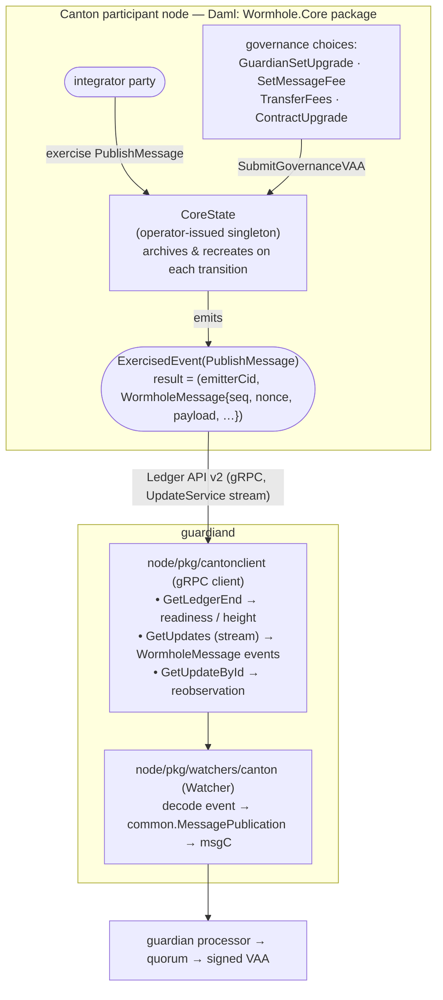
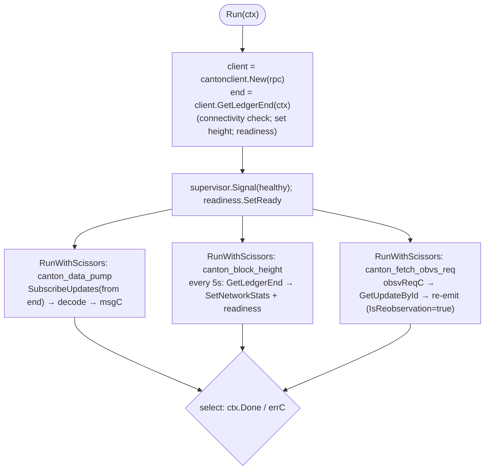

# Wormhole Core Bridge & Watcher for Canton

This directory contains the Wormhole **core bridge** for the
[Canton Network](https://www.canton.network/) (implemented in
[Daml](https://docs.daml.com/)) and documents the guardian-node **watcher** that
observes it (implemented in Go under
[`node/pkg/watchers/canton`](../node/pkg/watchers/canton) with a Ledger-API
client under [`node/pkg/cantonclient`](../node/pkg/cantonclient)).

**Target deployment:** the **public Canton Network mainnet** — Canton **3.5.x**
protocol, **Daml SDK 3.5.1** (Daml-LF **2.3**, Protocol Version **35**). Two
consequences shape the design: Ledger API **v2**, and **contract keys too weak
to build on** (non-unique, resolved against the submitter's read view, negative
lookups fail open) — the package uses **no contract keys**: contracts are
addressed by contract-id, resolved off-ledger (§4.7); identity uniqueness is
registry-enforced and address integrity is cryptographic (see §1, §4).

The goal is parity with the canonical EVM core bridge
([`ethereum/contracts/Implementation.sol`](../ethereum/contracts/Implementation.sol),
[`Messages.sol`](../ethereum/contracts/Messages.sol),
[`Governance.sol`](../ethereum/contracts/Governance.sol)) and conformance with
the Wormhole whitepapers:

- [0001 — Generic Message Passing](../whitepapers/0001_generic_message_passing.md)
- [0002 — Governance Messaging](../whitepapers/0002_governance_messaging.md)
- [0004 — Message Publishing](../whitepapers/0004_message_publishing.md)
- [node watcher README](../node/pkg/watchers/README.md)

> **Status:** initial implementation. The Daml packages **compile and tests pass
> on Daml SDK 3.5.1**, including on-chain VAA verification validated against a
> real guardian-signed VAA and the cross-language address derivation pinned by a
> shared test vector. The remaining mainnet-gating item — the exact Ledger-API
> protobuf surface — plus the guardian hosting topology are tracked in
> [Open Questions & Validation Items](#11-open-questions--validation-items).

---

## 1. Background: how Canton differs from EVM

Wormhole's core bridge has two responsibilities on every chain:

1. **Publish** messages — an on-chain caller emits a message; the guardians
   observe it, reach quorum, and produce a signed VAA.
2. **Verify** messages (VAAs) on-chain — needed so the chain can act on
   governance VAAs (guardian-set upgrades, fees, upgrades) and so higher-level
   protocols (token bridge, etc.) can verify inbound VAAs.

Canton is structurally unlike EVM/Solana/Sui, and those differences drive the
design:

| Concept                   | EVM                                         | Canton                                                                                                                                                 |
| ------------------------- | ------------------------------------------- | ------------------------------------------------------------------------------------------------------------------------------------------------------ |
| Smart-contract model      | Solidity contract with mutable storage      | Daml **templates**; state is the set of **active contracts** (UTXO-like). State is changed by **archiving** a contract and **creating** its successor. |
| Calling a method          | `CALL` to an address                        | **Exercising a choice** on a contract                                                                                                                  |
| Identity / "address"      | 20-byte account/contract address            | **Party ID** (a string `hint::fingerprint`) and **contract IDs**                                                                                       |
| Event log                 | `LOG`/`event` topics                        | Ledger-API **events** (`CreatedEvent`, `ExercisedEvent`) in the transaction stream                                                                     |
| Block / height            | block number                                | **participant offset** (monotone `int64`) into the update stream. Each participant assigns its own offsets.                                            |
| Transaction hash          | 32-byte transaction hash                    | **update id**: a SHA2-256 multihash as lowercase hex. It is the same on every participant (§7.2).                                                      |
| Finality                  | probabilistic (reorgs) → consistency levels | deterministic: once a transaction is committed by the sequencer/mediator it is final. No reorgs.                                                       |
| Node API the watcher uses | JSON-RPC / `eth_getLogs`                    | **Ledger API v2** (gRPC), `UpdateService` streaming                                                                                                    |
| Crypto available on-chain | `ecrecover`, `keccak256` precompiles        | Daml `keccak256` and `secp256k1` built-ins (see §5)                                                                                                    |

The most consequential differences:

- **No `msg.sender`.** A Daml choice knows its acting parties, but Wormhole
  needs a stable 32-byte emitter address with a per-emitter monotonically
  increasing sequence. We solve this with an **`Emitter` registration**
  contract (§4.2), analogous to Sui's `EmitterCap`. The emitting party (`owner`)
  co-signs the `Emitter` and is part of the address derivation, so it is the
  faithful Canton analog of `msg.sender`: only that party's key can emit under
  its address (§4.2, §10).
- **No `ecrecover`.** Daml's `secp256k1` builtin _verifies_ a signature against
  a _public key_; it does not _recover_ the signer from the signature like
  Ethereum does. Guardian-set state on Canton therefore stores guardian
  **public keys** (not just their 20-byte addresses), bound to the canonical
  addresses from the governance VAA (§5).
- **No global mutable singletons; no contract keys.** The "core bridge
  contract" is modeled as a single long-lived **`CoreState`** contract, archived
  and recreated on every governance transition. Contract keys exist on Canton
  3.5 (Daml-LF 2.3) but are **not unique** — multiple active contracts may share
  a key ([docs](https://docs.canton.network/appdev/modules/m3-contract-keys#contract-keys))
  — and lookups resolve against the submission's readers, with negative results
  failing open (§4.6). They can carry neither uniqueness nor authenticity, so
  this package uses none: contracts are addressed **by contract-id**, resolved
  from a stakeholder's own ACS or via the disclosure service (§4.7), and
  authenticated by their **payloads** (signatories cannot be forged). The
  `CoreState` is **co-signed by the `operator` and a `guardianGovernance`
  party** (a k-of-n threshold party), so the operator cannot forge the guardian
  set (§4.1); per-emitter uniqueness is a **registry** that allocates ids plus
  an owner-bound, cryptographic address (§4.2).

---

## 2. Architecture overview



The watcher is **read-only**: it never submits to Canton. It observes the
`PublishMessage` choice's result event, reads the `WormholeMessage` out of the
result tuple's second element, maps it to a
[`common.MessagePublication`](../node/pkg/common/chainlock.go), and hands it to
the processor exactly like every other watcher.

---

## 3. The VAA and the digest (unchanged across chains)

Canton uses the standard VAA v1 body and digest. Quoting
[0001](../whitepapers/0001_generic_message_passing.md) and matching
`Messages.sol`:

```
body = timestamp(4) ‖ nonce(4) ‖ emitterChain(2) ‖ emitterAddress(32)
       ‖ sequence(8) ‖ consistencyLevel(1) ‖ payload(var)

digest = keccak256( keccak256( body ) )          // double keccak, Ethereum-style
```

Guardians sign `digest` with secp256k1 (Ethereum ECDSA, 65-byte `r‖s‖v`).
Replay protection records `digest` (the double keccak — EVM's `vm.hash`), both
for governance (`consumedGovernance`, §4.4) and for integrator VAAs (the
`ReplayNode` trie, §4.6). The on-chain Daml verifier reconstructs and re-hashes
the body and checks signatures against the stored guardian set (§5).

`ChainID` for Canton is **75** (`ChainIDCanton`). Upstream assigned 72 (Robinhood)
and 73 (Hydration) after this branch first claimed 72; Canton moved to 75, leaving
74 as headroom. It is registered in [`sdk/vaa/structs.go`](../sdk/vaa/structs.go).

---

## 4. On-chain design (Daml)

Daml package name: `wormhole-core` (the `core` package). Module layout under
[`core/daml/`](core/daml):

| Module                      | Responsibility                                              |
| --------------------------- | ----------------------------------------------------------- |
| `Wormhole.Core.Bytes`       | byte/hex helpers, big-endian integer (de)serialization      |
| `Wormhole.Core.VAA`         | VAA struct, parser, digest, signature/quorum verification   |
| `Wormhole.Core.GuardianSet` | guardian-set representation and expiry                      |
| `Wormhole.Core.State`       | the `CoreState` singleton + `EmitterRegistry` and `Emitter` |
| `Wormhole.Core.Governance`  | governance packet parsing and the governance choices        |
| `Wormhole.Core.Setup`       | initialization (`setup`)                                    |

### 4.1 `CoreState` — the singleton

```haskell
template CoreState
  with
    operator           : Party          -- advances the singleton; the "deployer"
    guardianGovernance : Party          -- guardians' governance anchor (threshold party)
    chainId            : Int            -- 75
    governanceChainId  : Int            -- 1 (Solana)
    governanceContract : Bytes32        -- 0x..0004 (the governance emitter)
    guardianSetIndex   : Int            -- current set index
    guardianSets       : Map Int GuardianSet   -- index -> set (with expiry)
    messageFee         : Int            -- fee required to publish (native units)
    consumedGovernance : Set Bytes32    -- governance-only replay protection (§4.6)
  where
    signatory operator, guardianGovernance
```

**Guardian visibility.** Every guardian participant hosts `guardianGovernance`
(§10), so guardians see what that party sees: `CoreState` and every `Emitter`
as a signatory (§4.2). The ledger-model rule that makes
this sufficient: **informees of a _consuming_ exercise include the contract's
stakeholders**. `SubmitGovernanceVAA` and `PublishMessage` are both consuming, so
guardians see every governance transition and the full message surface;
nonconsuming `ParseAndVerifyVAA` (§4.3) is a pure read. Its `Emitter` signature
gives `guardianGovernance` no publish or archive authority alone: each also
needs the owner (`TestGuardianVisibility`).

Every state-mutating choice is `controller`-checked (controller `operator`),
archives the current `CoreState`, and `create`s the next one with updated fields.
This is the Daml idiom for mutable state and gives us deterministic,
replay-protected transitions.

**Singleton co-signed by a governance party; authenticity is in the payload.**
The `CoreState` is co-signed by the `operator` and a **`guardianGovernance`**
party — in production a **decentralized-namespace external party** under a k-of-n
threshold of guardian keys (the Canton Network DSO construction), rotated at the
topology layer without touching this template (the party id, and thus every
consumer's trust anchor, is stable across rotation). Two things follow:

- **The operator cannot forge the guardian set.** Because `guardianGovernance`
  is a signatory, a compromised operator cannot `create` a `CoreState` bearing
  the real governance party, so any `CoreState` whose `guardianGovernance` field
  is the known anchor is **authentic by construction**, however its cid was
  obtained — consumers authenticate the payload, never the resolution path
  (§4.7). **Pinning `operator` is weaker than pinning `guardianGovernance`:** a
  compromised operator (a single hot key) can co-sign a `CoreState` whose
  `operator` is genuine but whose `guardianGovernance`/`feeRecipient` it
  controls, so an `operator`-only pin accepts a shadow `CoreState`. For the fee
  path — where `guardianGovernance` _is_ the fee-custody anchor — only the
  `guardianGovernance` pin suffices (see below).
- **Governance stays low-friction.** `guardianGovernance` actively signs only at
  **genesis**; each `SubmitGovernanceVAA` inherits its authority from the
  archived contract (as the `Emitter` owner does through `PublishMessage`), so
  the operator submits governance alone. "Exactly one live `CoreState`" is still
  behavioral, but the set's _contents_ are now anchored.

Per-emitter **sequence numbers live in each `Emitter`** (§4.2), not `CoreState`:
a choice can only be exercised by a stakeholder, and the emitter owner is not a
stakeholder of the operator-owned `CoreState`. Keeping the sequence in the
`Emitter` lets the owner publish — and advance its own sequence — **without the
operator's authority**, preserving EVM's permissionless `publishMessage`.
`CoreState` holds only shared config and governance state.

> **Why an `operator` party?** Canton requires every contract to have a
> signatory. The `operator` is a designated, well-known party (configured at
> deploy time) that owns the singleton. It has **no special authority** over
> message contents or governance outcomes — governance is gated entirely by VAA
> verification (§4.4). Its role is mechanical: it is the party that the daml
> transaction is submitted as in order to advance the singleton. This mirrors
> how non-EVM chains (e.g. Near) have an account that "owns" the bridge object
> without being able to forge messages.

### 4.2 Message publishing

Mirrors `publishMessage(nonce, payload, consistencyLevel)` from
`Implementation.sol:15` and whitepaper 0004.

An integrator first registers an emitter — **directly, with no operator
involvement**. The operator and `guardianGovernance` co-sign an
`EmitterRegistry`, created with the `CoreState` in the genesis ceremony; the
requester exercises `RegisterEmitter` on it, holding only the registry's
disclosure (§4.7). The flexible controller brings the requester's signature;
the operator's co-signature on the created `Emitter` is _inherited_ from the
registry's signatories — the same authority-inheritance that powers
`VerifyAndConsumeVAA`. Registration is permissionless (EVM/Sui parity: anyone
may emit); the choice is consuming, so racing registrations contend on the
registry and the loser retries with the fresh cid:

```haskell
-- One per (operator, guardianGovernance); allocates monotonically increasing
-- emitter ids.
template EmitterRegistry with
    operator           : Party
    guardianGovernance : Party    -- carried into each new Emitter
    registrationFee    : Int      -- 10^-10 feeInstrument units; 0 for free
    nextId             : Int
  where
    signatory operator, guardianGovernance
                                  -- gg co-signs: the operator alone cannot reset
                                  -- nextId (A14-3)
    ensure nextId >= 0 && nextId <= maxEmitterId + 1      -- maxEmitterId = 2^53 - 1
      && registrationFee >= 0 && registrationFee <= maxRegistrationFee
    -- choice RegisterEmitter : (ContractId EmitterRegistry, ContractId Emitter)
    --   with requester, payer : Party; coreStateCid, feeAllocation : Optional ...
    --        expectedGuardianGovernance : Optional Party -- Some gg pins the registry
    --   controller requester, payer -- operator + gg authority inherited; no crank
    --   returns (successorRegistryCid, emitterCid)
    -- choice SetRegistrationFee : ContractId EmitterRegistry
    --   with newRegistrationFee : Int
    --   controller operator, guardianGovernance -- keeps nextId

template Emitter
  with
    operator           : Party
    guardianGovernance : Party    -- fee-custody anchor; co-signer
    owner              : Party
    emitterId          : Int      -- registry-allocated
    emitterAddress     : Bytes32  -- keccak256(tag ‖ operator ‖ owner ‖ emitterId), set at creation
    sequence           : Int      -- next sequence to assign (per-emitter)
  where
    signatory operator, owner, guardianGovernance
                                -- owner co-signs: the msg.sender analog
                                -- gg co-signs: no second Emitter of an issued
                                -- identity outside RegisterEmitter (A14-2)
    ensure emitterId >= 0 && emitterId <= maxEmitterId
      && sequence >= 0 && sequence <= maxEmitterSequence
```

`RegisterEmitter` copies the registry's `guardianGovernance` onto the created
`Emitter`. `guardianGovernance` is a signatory of every `Emitter`, thus a
stakeholder of every publish exercise (and its `WormholeMessage` result) and of
the sequence-bumped successor `Emitter` create, for every owner (§4.1, §10).
`guardianGovernance` alone cannot publish or archive: each needs the owner too.

The watcher accepts a consuming `PublishMessage` event only if its read-as
party is a stakeholder of the exercised `Emitter`. `acs_delta` set shows this
for an `Emitter` that existed before the transaction. For an `Emitter` that the
same transaction creates, `acs_delta` is false: then the `CreatedEvent` of that
contract id in the transaction must be of the package id that executed the
publish, and must list the read-as party as a signatory. In an upgrade window,
a create under the current id does not unlock a publish under the retiring id,
and the reverse is also true. An exercise that `guardianGovernance` only
witnesses, for example a publish on an `Emitter` of a registry under another
`guardianGovernance` nested in a contract that the real party observes, is
dropped. Each drop
increments `wormhole_canton_publish_without_read_party_stakeholder_total` and
writes a WARN log with the update id. The watcher also rejects an `emitterId`
above `maxEmitterId` (2^53 - 1), so every off-ledger tool reads ids exactly.

`guardianGovernance` is a signatory of the registry. Thus its hosting
participants confirm each `RegisterEmitter`, and a registration needs the
confirmation threshold of `guardianGovernance`. A change of `registrationFee`
needs a guardian ceremony that runs `SetRegistrationFee`. The choice keeps
`nextId`. See [A14_EMITTER_ID_UNIQUENESS.md](A14_EMITTER_ID_UNIQUENESS.md).

**Emitter address derivation.** The 32-byte Wormhole emitter address is

```
keccak256( utf8("wormhole:emitter:v1")
         ‖ uint32be(len(registrar)) ‖ utf8(registrar)
         ‖ uint32be(len(owner))     ‖ utf8(owner)
         ‖ uint64be(emitterId) )
```

where `registrar` is the operator. The 4-byte length prefixes make the preimage
injective across the two variable-length party ids. It is computed **on-ledger**
at allocation (Daml `DA.Crypto.Text` is stable in 3.5) and stored in
`emitterAddress` for integrators to read, but the guardian watcher **re-derives**
it from the `WormholeMessage` fields and is the sole source of truth — a corrupt
on-ledger value cannot spoof it.

**Impersonation is cryptographically prevented (the `msg.sender` guarantee).**
Because the `owner` is both a **signatory** of the `Emitter` and part of the
address preimage, only a transaction carrying the owner's authority can create a
contract whose address is the owner's. A compromised `operator` therefore cannot
emit under an existing emitter's address: an operator-alone forge is rejected in
guardian replay (missing the owner's signature), and a colluding duplicate under
a different owner derives a **different**, untrusted address. This is the
invariant guardians verify — "the transaction is Daml-valid under the vetted
package" — with no bespoke watcher logic (see [§10](#10-trust-model--deployment-topology)).
Registry-allocated ids give per-owner uniqueness and let one party hold **many**
emitters, matching Sui's multiple `EmitterCap`s. `guardianGovernance` co-signs
the registry, so the operator alone cannot reset the id sequence (A14-3). It
also co-signs each `Emitter`, so the operator and an owner together cannot
rewind an emitter of that owner (A14-2).

Publishing — a choice on the **`Emitter`** (controller = `owner`), so it needs
no operator authority:

```haskell
-- on Emitter
-- Returns the sequence-bumped successor Emitter cid alongside the message,
-- so callers never re-resolve it off-ledger.
choice PublishMessage : (ContractId Emitter, WormholeMessage)
  with
    nonce            : Int            -- 0 .. 2^32-1
    payload          : Bytes          -- even-length lowercase hex, <= 750 bytes (whitepaper 0004)
    consistencyLevel : Int            -- 0 .. 255; see §6
    coreStateCid     : ContractId CoreState                       -- fee read (§ Fees)
    payer            : Party          -- funds messageFee; = owner for a direct publish
    feeAllocation    : Optional (ContractId Allocation, ExtraArgs)
  controller owner, payer
  do
    -- 1. assert the field ranges and the payload encoding and length
    -- 2. charge the current messageFee to payer through CoreState (§ Fees)
    -- 3. archive self; create the successor Emitter with sequence = sequence + 1
    -- 4. return WormholeMessage{registrar, owner, emitterId, sequence, nonce,
    --      payload, consistencyLevel} -- watcher derives the address
    pure result
```

The choice's **exercise result** is `(ContractId Emitter, WormholeMessage)` —
the sequence-bumped successor cid paired with the message. The successor
`Emitter` is recreated with both signatures inherited from the consumed
contract; the owner is a signatory, so the successor's **cid also arrives on
its own ACS** as the transaction's `CreatedEvent`, and the next publish
addresses that cid directly — stakeholders never need an off-ledger resolver
(§4.7). The watcher reads the tuple's `WormholeMessage` element directly from
the `ExercisedEvent.exercise_result` on the Ledger-API stream (see §7). The
`WormholeMessage` record is the wire contract between Daml and the watcher:

```haskell
data WormholeMessage = WormholeMessage with
    registrar        : Party     -- the operator; address input
    owner            : Party     -- the emitting party; address input (anti-impersonation)
    emitterId        : Int       -- registry-allocated; address input
    sequence         : Int       -- uint64
    nonce            : Int       -- uint32
    consistencyLevel : Int       -- uint8
    payload          : Bytes
  deriving (Eq, Show)
```

Equivalent to the EVM `LogMessagePublished(sender, sequence, nonce, payload,
consistencyLevel)` event (`Implementation.sol:12`), except the `sender` (emitter
address) is **derived by the watcher** from `(registrar, owner, emitterId)`
rather than carried in the record. The VAA **timestamp** is not carried in the
record either: per whitepaper 0001/0004 the guardian derives it from the block,
so the watcher reads it from the transaction's **ledger effective time**
(`Transaction.effective_at`) — see §7.1.

**Sequence numbers** are per-emitter, start at 0, increment by
1 — identical to EVM's `_state.sequences[emitter]`.

**Fees.** Whitepaper 0004 requires a fee in the chain's native token. Fees are
paid via the **Canton Network Token Standard** (CIP-0056, V1 — the
`splice-api-token-*-v1` interface DARs under `canton/dars/`), so the bridge works
with Canton Coin or any standard token, chosen at genesis
(`CoreState.feeInstrument`, no governance action covers it):

- **The payer is the submitter**, so the bridge only _consumes_ allocations,
  never issues wallet-facing `AllocationRequest`s (future UX work). The payer
  locks funds via the token registry's `AllocationFactory` (its wallet/CLI plus
  the registry's CIP-0056 OpenAPI, which supplies the `ExtraArgs` choice context
  and registry disclosures — untrusted-for-safety, liveness-only, like our own
  disclosure service, §4.7), with the convention `executor = sender = payer`,
  `receiver = feeRecipient`.
- The charging choice validates the allocation — receiver, instrument, amount
  (`≥` fee: the **entire leg amount transfers**, allocations are all-or-nothing,
  so overpayment is deliberate padding against fee-raise races), sender, and the
  **instrument admin's signature** (views are forgeable, a signature is not) —
  then exercises `Allocation_ExecuteTransfer` **in the same transaction** as the
  publish/registration/claim. Executing consumes the allocation: one-shot by
  activeness, no replay bookkeeping. Fees are `Int`s in **10^-10 token units**
  (exactly Decimal's last digit — every fee exactly representable).
- `Allocation_ExecuteTransfer` needs sender ∧ receiver ∧ executor authority
  jointly, and the receiver is the fee recipient — so all charging routes
  through `CoreState` choices (`ChargeMessageFee` / `ChargeFee`), where the
  recipient's authority is inherited. `PublishMessage` therefore references the
  `CoreState` on every publish (EVM parity: the current `messageFee` is read each
  call; a stale cid fails closed and is re-resolved). The fee is charged to
  `payer`, which equals `owner` for a direct publish but is named explicitly when
  an app publishes on a user's behalf (NTT §10); `payer` co-controls the publish,
  so it cannot be a third party who did not authorize spending its funds.
  Registries charge their `registrationFee`/`claimFee` the same way, skipping the
  `CoreState` entirely at fee 0. Before charging, every call site pins the
  `CoreState` by exercising `GetGuardianGovernance` against the
  `guardianGovernance` committed on the emitter/registry — **the fee-custody
  anchor, not merely the `operator`** — so a forged `CoreState` cannot redirect
  the fee (see the custody bullet).
- **Custody is governance-controlled**: `feeRecipient` is the
  `guardianGovernance` threshold party, so accrued fees move only via the k-of-n
  guardian ceremony — the operator never touches them (the Canton analog of "fees
  sit in the bridge contract"). This holds **even against a compromised operator
  hot key**: each charge pins `guardianGovernance` (unforgeable by a single
  operator key) rather than `operator`, so an operator co-signing a shadow
  `CoreState` under a throwaway `feeRecipient` is rejected before any funds move.
  A `TransferFees` VAA mints an on-ledger `FeeWithdrawalAuthorization` (signed by
  guardianGovernance) recording the amount, the VAA's 32-byte recipient, and the
  VAA hash — the artifact the guardians' custody policy matches when
  threshold-signing the outbound transfer. "Only per authorization" is enforced
  in gg key custody, the same trust plane as the guardian keys.
- Token Standard **V2** (CIP-0112) is approved but not yet on mainnet; it
  arrives as a parallel `-v2` interface family, and
  `Wormhole.Core.Fees.chargeFee` is the single seam where support would be
  added.

### 4.3 VAA verification choice

```haskell
-- on CoreState; pure verification, does not mutate state
nonconsuming choice ParseAndVerifyVAA : VerifiedVAA
  with
    verifier   : Party            -- any party; the sole controller
    encodedVAA : Bytes
    pubKeys    : [(Int, Bytes)]   -- guardianIndex -> 65-byte uncompressed pubkey
  controller verifier
  do
    vaa <- parseVAA encodedVAA
    verifyVAA self vaa pubKeys     -- §5
    pure (toVerified vaa)
```

`pubKeys` are supplied by the caller because Daml verifies against a public key,
not by recovery (§5). They are _untrusted hints_; verification fails unless each
provided key hashes to the guardian address stored in the set.

**This is genuinely permissionless, not merely operator-delegated.** `verifier`
is the sole controller — `operator` never needs to be an active party. The
choice is `nonconsuming` and does no create/archive at all, so nothing in its
body needs `operator`'s authority for any structural reason (contrast
`SubmitGovernanceVAA` below, which _is_ consuming and creates a successor
`CoreState` genuinely needing `guardianGovernance`'s co-signature). Any external
protocol — the token bridge, NTT, anything else — can verify a VAA as itself.
The one real requirement is visibility, not authorization: a non-stakeholder
needs `CoreState` explicitly disclosed to reference it at all, via Daml's
[Explicit Contract
Disclosure](https://docs.digitalasset.com/build/3.4/sdlc-howtos/applications/develop/explicit-contract-disclosure.html)
feature — a data attachment, not a signature — servable by any party with read
access. In Daml Script, `submitWithDisclosures` is the idiom. Proven both
in-memory
(`test/daml/Test/TestCore.daml:testParseAndVerifyVAAByExternalVerifier`) and
against a live sandbox/participant
([`node/pkg/watchers/canton/core_verify_vaa_integration_test.go`](../node/pkg/watchers/canton/core_verify_vaa_integration_test.go)):
a party with no relationship to `CoreState` at all — not `operator`, not
`guardianGovernance` — verifies a real guardian-signed VAA as itself.

Integrators that must consume a VAA (redeem exactly once) use
`VerifyAndConsumeVAA` instead, which verifies **and** records consumption
atomically (§4.6).

### 4.4 Governance

Governance follows [0002](../whitepapers/0002_governance_messaging.md). A single
`SubmitGovernanceVAA` choice on `CoreState` (controller `operator`) verifies the
VAA and dispatches on the parsed action. Module identifier is **`"Core"`**
(`0x00..00436f7265`, 32 bytes). A governance VAA is accepted only if (matching
`Governance.sol:190`):

1. `verifyVAA` passes against the **current** guardian set;
2. `emitterChain == governanceChainId` and `emitterAddress == governanceContract`;
3. `module == "Core"` and `action` matches the choice;
4. `chain == chainId` (or `0` for chain-independent actions);
5. `digest ∉ consumedGovernance` — then it is inserted (replay protection).

Supported actions (parity with `GovernanceStructs.sol`). Each packet must have
the exact length that `sdk/vaa/payloads.go` serializes: 67 bytes for
ContractUpgrade and SetMessageFee, `40 + 20·len` for GuardianSetUpgrade, and 99
for TransferFees.

| Action                 | ID  | Payload (after 32-byte module + 1-byte action)   | Behavior                                                                                                                                                                                   |
| ---------------------- | --- | ------------------------------------------------ | ------------------------------------------------------------------------------------------------------------------------------------------------------------------------------------------ |
| **ContractUpgrade**    | 1   | `chain(2) ‖ newContract(32)`                     | Records intent + emits an event. On Canton, "upgrade" = a [Daml package upgrade](https://docs.daml.com/upgrade/); `newContract` is interpreted as the new package-id (32 bytes). See note. |
| **GuardianSetUpgrade** | 2   | `chain(2) ‖ newIndex(4) ‖ len(1) ‖ keys(20·len)` | Validates `newIndex == current+1`; sets old set's `expirationTime = effectiveTime + 86400`; stores new set. Requires `pubKeys` hints to bind addresses (§5).                               |
| **SetMessageFee**      | 3   | `chain(2) ‖ fee(32)`                             | Updates `messageFee`.                                                                                                                                                                      |
| **TransferFees**       | 4   | `chain(2) ‖ amount(32) ‖ recipient(32)`          | Moves collected fees to `recipient`. (No-op accounting until CC payments are wired.)                                                                                                       |

`RecoverChainId` (EVM action 5) is **EVM-specific** (it repairs `block.chainid`
after a fork) and has no analog on Canton; it is intentionally omitted.

**ContractUpgrade note:** EVM upgrades swap a proxy implementation. Daml has no
in-place code mutation; upgrading the bridge logic means deploying a new package
version and having the `operator` migrate the `CoreState` to the new package via
Daml's smart-contract upgrade (data-preserving). The governance VAA records the
authorized target package-id on-ledger; the operator's migration is then
gated by that recorded value. This is the faithful Canton analog and is the one
governance action whose mechanism differs most from EVM — see Open Questions.

### 4.5 Guardian-set expiry

This logic matches EVM `Setters.sol`. A `GuardianSetUpgrade` sets the
`expirationTime` of the previous set to `effectiveTime + 86400` (1 day).
`verifyVAA` accepts a non-current set while `effectiveTime <= expirationTime`.
EVM `Messages.sol:80` rejects only when `expirationTime < block.timestamp`.
`isActiveAt` truncates both times to whole seconds, as `block.timestamp` does.
Thus `verifyVAA` accepts the set until the end of its expiry second. The
current set never expires.

### 4.6 Replay protection for integrators: a trie of consumed digests

Governance replay protection is the `consumedGovernance` set inside `CoreState`
(§4.4) — fine there, because governance actions are rare and already churn the
singleton. App VAAs (token bridge / NTT) must **not** be recorded that way: Daml
values have no structural sharing across contract updates, so an ever-growing
set would be reserialized into every create node (payload size, participant DB
write, and network cost all linear in history), and every integrator's consume
would contend on the one singleton contract.

They also must not be recorded as per-digest keyed contracts (the design this
replaces): Canton LF 2.3 key lookups resolve once, on the submitting
participant, against the submission's readers, and the result is a pinned
input to validation. Confirming participants re-check authorization,
conformance, and the activeness of every contract a transaction _uses_ — but
they do **not** re-run key lookups against their own stores (with non-unique
keys and per-party visibility there is no canonical answer, and local
re-checks would make validation nondeterministic and leak private state). A
_positive_ resolution names a cid that is consistency-checked like any input;
a _negative_ one names nothing and **fails open**. Replay protection is
precisely a negative claim ("this digest was never consumed"), so it cannot be
built on key lookups — this module uses no contract keys at all.

Instead, each replay scope's consumed-digest set is a **prefix trie of leaf
contracts** (`Replay.daml`). A scope is **(consumer, namespace)**: the
`consumer` party carries the authority, and the opaque `namespace` string lets
one consumer party maintain many independent tries — an integrator whose admin
role is transferable keeps the party stable and derives the namespace from its
own permanent identity instead (NTT: a hash of the instrument id and the
initial admin party). A node covers a hex `prefix` and stores the set of
digest _suffixes_ consumed under it:

```haskell
template ReplayNode
  with
    consumer       : Party    -- integrator scope party; bears the replay risk
    operator       : Party    -- co-signs: no unilateral archive or re-create
    namespace      : Text     -- opaque sub-scope: one consumer, many tries
    prefix         : Bytes    -- lowercase hex, 0..63 nibbles; "" at the root
    splitThreshold : Int      -- node capacity; children inherit it
    consumed       : Set Bytes  -- suffixes, each (64 − |prefix|) nibbles
  where
    signatory consumer, operator
```

A trie starts as one root (empty prefix, empty set). `ConsumeDigest`
(consuming, controller `consumer`) checks the node covers the digest, rejects
if the suffix is already present, and recreates the node with it inserted.
When the node is at `splitThreshold`, the consume instead **splits** it: all
16 children are created (one per nibble, empty ones included), suffixes
bucketed by their first nibble, which is dropped. Internal nodes are never
stored. **The invariant: a scope's active nodes partition the digest space —
every digest has exactly one covering node**, so membership in that node is
global consumption truth.

**Why this is sound where keys were not.** "Not consumed" became a positive
statement about one _named_ contract: fetch the covering node, check absence,
consume it. Every confirming participant validates the node's activeness — a stale cid
conflicts and aborts; the current covering node provably contains or excludes
the digest. Soundness is **submitter-independent**: any submitter with a
disclosure of the current covering node gets a correct check, and a wrong or
stale node can only fail the transaction, never replay. Where the key design
failed _open_ (a lookup that misses waves a replay through), the trie fails
_closed_ (an archived subspace has no covering node — nothing verifies).

`VerifyAndConsumeVAA` (nonconsuming, on `CoreState`, flexible controller
`consumer`) takes the covering node's cid, verifies the VAA (§5), binds the
node to the (consumer, namespace, operator) scope, and exercises
`ConsumeDigest` with the digest — verify + consume + act in one transaction.

Properties:

- **Nobody can touch someone else's scope; your own scope is your own
  problem.** Archival alone only bricks (fail-closed); the replay vector is
  node _re-creation_. Nodes are co-signed, so no third party can archive or
  re-create them (splits inherit both signatures from the archived parent —
  the operator is not involved per consume), and roots come only from the
  operator's `ReplayRootRegistry` — a stateless, never-churning anchor whose
  nonconsuming `ClaimReplayRoot` lends the operator's _inherited_ signature
  to a consumer-submitted claim (the `RegisterEmitter` pattern: no crank; the
  operator multisig signs nothing after genesis). Claiming a root for a
  consumer requires **that consumer's authority**, so nobody can fork another
  app's replay scope (the namespace is a free-form sub-scope _under_ that
  authority, not a claim anyone else can contest). There is deliberately _no_
  one-root-per-scope enforcement: maintaining a single trie per scope is the
  consumer's own responsibility (its disclosure service defines which trie its
  consumes resolve into, and detects forks — more than one covering node — for
  free). This is EVM
  parity: nobody grants replay storage there either; every integrator owns
  its mapping. A consumer minting parallel roots, like a consumer whose key
  is stolen, only harms itself — and a stolen consumer key defeats the app
  more directly anyway. (If key-compromise resilience is ever wanted, the
  hardening is trie-identity pinning: thread the original root's cid through
  successors via `self` and pin it in the app contract — documented, not
  built.) Spam claims cost the spammer synchronizer traffic per transaction
  and the operator ~300 B of storage per worthless root; no shared contract
  grows, nothing bricks.
- **Scoping and contention.** Tries are per (consumer, namespace): different
  apps — or one consumer party under different namespaces — consume the same
  VAA independently. Consumes racing on the _same node_
  conflict — exactly one commits (validator-checked, regardless of submitter);
  the loser re-resolves the covering node and retries. A blind retry of a
  consume that actually committed fails on membership ("digest already
  consumed") — a clean idempotency signal. Until the first split, all of one
  app's
  consumes serialize through its root; 16-way fan-out begins at
  `splitThreshold` consumes.
- **Cost.** `defaultSplitThreshold = 128`: suffixes are ≤64-char hex (~66 B
  serialized), so nodes top out ~8.5 KB, the average consume rewrites ~4 KB,
  and the split transaction redistributes the same bytes across 16 creates
  (~15 KB) — all far below Canton's request caps. Total ACS bytes stay ~66 B
  per digest; 10 M digests ≈ 150 k nodes at depth 3–4. Larger thresholds thin
  the ACS but amplify every write.
- **Privacy.** Nodes are integrator-private safety state, outside the guardian
  view (§4.1): target-chain consumption is the integrator's concern, and the
  attestation surface is `CoreState` and `Emitter`.

**The disclosure service.** Submitters locate the covering node off-ledger: a
service indexes the active nodes by (consumer, namespace, prefix) (following
the `CreatedEvent`s that consumes and splits produce) and serves, for a digest,
the covering node's cid plus its explicit disclosure — alongside the
`CoreState` disclosure it already serves (§4.3). It is **untrusted for
safety**: the worst it can do is serve a wrong or stale node, which fails the
transaction. It is trusted for _liveness_ only, like any RPC endpoint. §4.7
aggregates every resolution the service must provide. (Go implementation is
future work; the Daml tests simulate it with a script helper,
`Test.TestReplay.coveringNode`, which also asserts the partition invariant on
every use.)

**Integrating — direct and user-submitted.** The executable reference is
[`test/daml/Test/ExampleIntegrator.daml`](test/daml/Test/ExampleIntegrator.daml)
(test package only): the end user herself exercises `Redeem` on the app
contract with two disclosures attached (CoreState + covering node) and nothing
else — no read grants, no `readAs`, no relayer queue. The manager's
_authority_ for the consume is inherited from the app contract's signatory;
its _visibility_ is simply not needed. `testIntegratorRedeem` pins the
inversion of the key-based design's failure mode: replay attempts by arbitrary
submitters fail on activeness (stale node) or membership (fresh node) — never
succeed.

### 4.7 Addressing without keys: the disclosure service

With contract keys gone (§1), every contract reference is a **contract-id**.
Two distinct needs hide behind "how do I find the contract", and they have
different answers:

- **Cid resolution** — _what is the current cid of X?_ Stakeholders get this
  for free: a consuming exercise delivers the successor's `CreatedEvent` to
  every stakeholder's ACS, so the operator tracks its registries and the
  `CoreState`, an emitter owner tracks its `Emitter`, a consumer tracks its
  trie — all without any off-ledger help.
- **Disclosure attachment** — a **non-stakeholder** submitter must additionally
  attach the explicit-disclosure blob of every contract its transaction
  references, or its participant cannot construct the transaction at all.

The **disclosure service** is the single off-ledger component that provides both
to the parties that need them: an index over the relevant contracts — fed by the
update stream / ACS of a party that sees them — answering "current cid (+
disclosure blob) for X". The complete inventory it must serve:

| Contract                                 | Index                              | Needed by                                                              | Disclosure attachment?                                                            | Churn                                                      |
| ---------------------------------------- | ---------------------------------- | ---------------------------------------------------------------------- | --------------------------------------------------------------------------------- | ---------------------------------------------------------- |
| `CoreState`                              | the one true instance              | §4.3 verify, §4.6 consume, and EVERY publish / fee'd onboarding (§4.2) | yes — every non-stakeholder submitter (incl. all publishers)                      | per governance action (rare)                               |
| `ReplayNode`                             | (consumer, namespace, prefix covering digest) | every `VerifyAndConsumeVAA` / integrator redeem             | yes for non-stakeholders (e.g. end users); the consumer itself only needs the cid | every consume under that node                              |
| `EmitterRegistry`                        | (operator, guardianGovernance)     | `RegisterEmitter`                                                      | yes — the requester submits                                                       | per emitter registration; recreated by a guardian ceremony on fee change |
| `ReplayRootRegistry`                     | operator                           | `ClaimReplayRoot`                                                      | yes — the consumer submits (cacheable blob)                                       | only on operator fee change                                |
| `Emitter`                                | (operator, owner, emitterId)       | `PublishMessage`                                                       | no — owner submits, own ACS (but see `CoreState` row)                             | per publish                                                |
| token-registry context                   | the fee instrument's registry      | any fee'd choice (§4.2): `ExtraArgs` + registry disclosures            | yes — from the REGISTRY'S own CIP-0056 OpenAPI, not this service                  | registry-defined                                           |
| app contracts (e.g. `ExampleIntegrator`) | app-defined                        | the app's own choices                                                  | app's concern (its users are observers)                                           | app-defined                                                |

Two properties make this safe to outsource:

- **Untrusted for safety.** A wrong or stale answer can only make the
  transaction fail — the trie fails closed on staleness (§4.6), and consumers
  authenticate every resolved contract by its **payload**, never by how the
  cid was found: `CoreState` by its signatory anchor fields (§4.1),
  `ReplayNode` by the (consumer, namespace, operator) binding inside
  `VerifyAndConsumeVAA` plus the app-side operator pin (see
  `ExampleIntegrator.Redeem`). The service is trusted for _liveness_ only, like
  any RPC endpoint.
- **Registry pin.** A client passes `expectedGuardianGovernance = Some gg` to
  `RegisterEmitter`, with `gg` from its own configuration. A registry from the
  service under another `guardianGovernance` then fails with "registry
  guardianGovernance mismatch" before any fee charge. NTT `RegisterManager`
  must pass `Some` too.
- **One reader suffices.** A service reading as the operator (a stakeholder of
  `CoreState`, both registries, and — as co-signatory — every consumer's trie)
  can serve the whole table; integrators can equally run their own for their
  trie and app contracts. Reading as a party requires only that party's
  `CanReadAs` on the serving participant.

Concrete implementation (interface: `(template, index) → (cid,
created_event_blob)` over the state-service ACS plus the update stream) is
future work; the Daml tests simulate it with `Test.TestReplay.coveringNode` /
`queryDisclosure`.

---

## 5. On-chain signature verification (the crux)

EVM uses `ecrecover(digest, v, r, s)` and compares the recovered 20-byte address
to `guardianSet.keys[i]`. Daml's
[`DA.Crypto.Text`](https://docs.canton.network/appdev/reference/daml-standard-library/da-crypto-text)
has **no recovery** builtin; the relevant functions (confirmed against the
3.x docs) are:

```haskell
keccak256             : BytesHex -> BytesHex
secp256k1             : SignatureHex -> BytesHex -> PublicKeyHex -> Bool  -- SHA-256s the message first
secp256k1WithEcdsaOnly : SignatureHex -> BytesHex -> PublicKeyHex -> Bool  -- verifies the message directly
```

We use **`secp256k1WithEcdsaOnly`** because Ethereum signs the 32-byte
`keccak256(keccak256(body))` digest _directly_ (no further hashing); plain
`secp256k1` would SHA-256 the digest first and never match. The design:

1. **Bind a caller-supplied pubkey → guardian address.** There is no recovery,
   so the verifier is given `pubKeys : [(Int, Bytes)]` (the signing guardians'
   uncompressed keys) and asserts `keccak256(pubKey)[12..32] == keys[index]`.
   Because the address is the keccak of the key, a wrong key can't pass — this
   re-introduces the EVM guarantee without recovery.

2. **DER-encode for the builtin.** `secp256k1WithEcdsaOnly` wants a **DER**
   signature and a **DER (SubjectPublicKeyInfo)** public key, both hex.
   `Wormhole.Core.VAA` DER-encodes the VAA's raw `(r, s)` (`derSignature`) and
   wraps the uncompressed point in the fixed secp256k1 SPKI prefix
   (`derPublicKey`). The 32-byte digest is passed as the message **as-is**.

3. **Verify.** `secp256k1WithEcdsaOnly (derSignature r s) digest (derPublicKey pubKey)`.

4. **Quorum** — identical to EVM `Messages.sol:90`:
   `required = floor(numGuardians * 2 / 3) + 1`. Signatures must be in
   **strictly ascending** guardian-index order (prevents double-counting).

### Making verification hint-free for integrators (recommended)

Supplying `pubKeys` on every call is acceptable for governance (rare,
operator-submitted) but is real friction for integrators (e.g. a token bridge),
whose relayers would otherwise have to look up the signing guardians' keys on
every inbound message. The recommended evolution: **persist the guardian public
keys in the guardian set** — i.e. `GuardianSet` stores `pubKeys` alongside `keys`,
bound to the canonical addresses _once_ at install time (the
GuardianSetUpgrade / setup choices already receive pubkey hints and verify
`keccak256(pubKey)[12..32] == addr`, so the binding is free). After that,
`verifyVAA` reads the keys from the set and callers pass **only the VAA bytes**,
making the integrator API equivalent to EVM's `parseAndVerifyVM(bytes)`. This is
a planned change to the current code, which still takes per-call hints.

### Validation status

The whole verification path is **empirically validated** against a real
Ethereum-style guardian signature on Daml SDK 3.5.1. `testParseAndVerifyVAA` and
`testGovernanceSetMessageFee` (in [`TestCore.daml`](test/daml/Test/TestCore.daml))
feed a genuine VAA — signed by the well-known devnet guardian and produced by
[`node/pkg/cantonclient/vectorgen_test.go`](../node/pkg/cantonclient/vectorgen_test.go)
— through `ParseAndVerifyVAA` / `SubmitGovernanceVAA` and both pass. That confirms:

- ✅ `keccak256` hashes the **decoded** hex bytes (the double-keccak digest
  matched the signature), so the `BytesHex` semantics are as assumed;
- ✅ `derSignature` (DER `r,s`) and `derPublicKey` (SPKI) are encoded correctly;
- ✅ `secp256k1WithEcdsaOnly` verifies the 32-byte digest **directly** (no
  pre-hash), and the pubkey→address keccak binding holds.

As of Daml SDK 3.5 the `DA.Crypto.Text` builtins are **stable** (the earlier
Alpha `-Wno-crypto-text-is-alpha` suppression is no longer needed), so the
previous mainnet-readiness concern about depending on an Alpha builtin is
resolved. All Daml crypto remains encapsulated in `Wormhole.Core.VAA`, and the
same builtins now also back the on-ledger address derivation in
`Wormhole.Core.Bytes` (`toHex` + `keccak256`).

---

## 6. Consistency / finality

Canton transactions are final once committed by the synchronizer
(sequencer + mediator); there are no reorgs. Like Sui, Canton therefore has a
single meaningful consistency level. The watcher treats every observed message
as final and publishes immediately. The `consistencyLevel` byte is passed
through from the `WormholeMessage` (integrators may set it; per
[0001](../whitepapers/0001_generic_message_passing.md) "all other chains … this
field will be `0`"), and the watcher does **not** gate on it.

---

## 7. Off-chain design (the watcher)

Lives in [`node/pkg/watchers/canton`](../node/pkg/watchers/canton); the gRPC
client is [`node/pkg/cantonclient`](../node/pkg/cantonclient). It mirrors the
structure of the Sui watcher
([`node/pkg/watchers/sui`](../node/pkg/watchers/sui)) and the `suiclient`
package.

### 7.1 `cantonclient` (Ledger API v2, gRPC)

There is no official Go binding for the Daml Ledger API, so the
`com.daml.ledger.api.v2` protobuf (the State + Update service closure, from
**Canton 3.5.5**) are vendored under
[`node/pkg/cantonclient/proto`](../node/pkg/cantonclient/proto) and compiled with
the repo's `buf` toolchain; the generated stubs are committed and CI-verified
(see [`node/pkg/cantonclient/README.md`](../node/pkg/cantonclient/README.md)).
The client exposes a small interface (mirroring `suiclient.SuiClient`):

```go
type CantonClient interface {
    // GetLedgerEnd returns the current participant offset (the "height").
    GetLedgerEnd(ctx context.Context) (int64, error)

    // SubscribeUpdates streams transactions from beginExclusive onward,
    // delivering each Wormhole message-publish event found in them.
    SubscribeUpdates(ctx context.Context, beginExclusive int64, templateID TemplateID, choiceName string, out chan<- CantonMessageEvent) (Subscription, error)

    // GetTransactionByUpdateID fetches a single transaction by update id
    // (reobservation), with the same party filter and template filter as SubscribeUpdates.
    GetTransactionByUpdateID(ctx context.Context, updateID UpdateID, templateID TemplateID, choiceName string) (CantonTransaction, error)

    Close() error
}
```

Mapping to Ledger API v2 RPCs:

| Need                | Ledger API v2                                                                                                                       |
| ------------------- | ----------------------------------------------------------------------------------------------------------------------------------- |
| height / readiness  | `StateService.GetLedgerEnd` → `offset (int64)`                                                                                      |
| live message stream | `UpdateService.GetUpdates` (server stream); filter `Transaction.events[].exercised` by `template_id` + `choice == "PublishMessage"` |
| reobservation       | `UpdateService.GetUpdateById` for the update id encoded in the reobservation request; same `UpdateFormat` as the stream             |

The Wormhole message comes from the **`ExercisedEvent`** of the `PublishMessage`
choice: `exercise_result` is the `WormholeMessage` record (§4.2), decoded from
the Ledger-API `Value`/`Record` representation. The watcher derives the 32-byte
emitter address from the record's `registrar`, `owner`, and `emitterId` fields
using the canonical encoding in §4.2 (see `deriveEmitterAddress` in
[`watcher.go`](../node/pkg/watchers/canton/watcher.go)); the encoding is pinned
against the Daml side by a shared cross-language test vector.

**Party filter.** The `GetUpdates` and `GetUpdateById` requests use one
`UpdateFormat` with a wildcard template filter. Outside unsafe dev mode,
`--cantonReadAsParty` is required. Set it to the **`guardianGovernance`** party
(§4.1). This party is a stakeholder of every `Emitter` and of `CoreState`, so the
narrowed `filters_by_party` stream carries every `PublishMessage`. In unsafe dev
mode an empty `--cantonReadAsParty` selects **`filters_for_any_party`**. The
**devnet** sandbox uses this wildcard.
`TRANSACTION_SHAPE_LEDGER_EFFECTS` is required so `ExercisedEvent`s — which carry
the choice result — are included.

### 7.2 `TxID` and offsets

The `MessagePublication.TxID` is the transaction's **update id**. The
participant offset is not the `TxID`.

Each participant assigns its own offsets. On LocalNet, one update has offset
590, 762, and 1381 on three participants. Each guardian reads its own
participant. Thus an offset from one guardian identifies a different update, or
no update, on the participant of a different guardian. The update id is the same
on every participant that hosts the transaction.

Encoding:

- The Ledger API `update_id` is 68 lowercase hex characters. It is a SHA2-256
  multihash: the header `1220`, then the 32-byte digest.
- `TxID` is the hex-decoded update id: exactly 34 bytes, with the first two bytes
  `0x12 0x20`. This length is in the `MessagePublication` bounds (32 to 255
  bytes). A compile-time assertion in the watcher checks this.
- `TxIDString()` is `0x` followed by the update id. An operator can give the
  update id directly to `guardiand admin send-observation-request 75 <update id>`.
- `cantonclient.ParseUpdateID` and `cantonclient.UpdateIDFromTxID` reject all
  other forms: a different length, uppercase hex, or a different multihash
  header. A stream transaction with Wormhole messages and a malformed update id
  stops the subscription.

Reobservation:

1. The watcher decodes `ObservationRequest.tx_hash` with `UpdateIDFromTxID`.
2. The watcher calls `UpdateService.GetUpdateById` with that update id.
3. The request uses the same `UpdateFormat` as the stream: the
   `--cantonReadAsParty` party filter. The watcher then applies the same template,
   choice, and `--cantonPackageID` filter.
4. The watcher rejects a response with a different update id.

The participant offset stays in use for one purpose: the stream resume point
after a restart (`lastOffset`). It is local to the participant, so it does not
leave the guardian.

**Mixed guardian versions.** Earlier versions used a 32-byte left-padded offset
as the `TxID`. The two encodings are not compatible:

- A guardian on this version rejects a 32-byte offset `tx_hash` (length is not 34).
- An earlier guardian rejects a 34-byte `tx_hash` (length is more than 32).

Upgrade all guardians that observe Canton together, because the old and new
TxID formats reject each other's reobservation requests.

### 7.3 `Run` loop (three goroutines, mirrors Sui)



Each observed event becomes a `common.MessagePublication`
([`chainlock.go`](../node/pkg/common/chainlock.go)) with
`EmitterChain = vaa.ChainIDCanton`, `EmitterAddress = deriveEmitterAddress(registrar, owner, emitterId)`,
`Unreliable = false`, then is sent on `msgC`.

### 7.4 Configuration

`WatcherConfig` (implements `watchers.WatcherConfig`):

```go
type WatcherConfig struct {
    NetworkID                    watchers.NetworkID
    ChainID                      vaa.ChainID // ChainIDCanton
    Rpc                          string // host:port of the Ledger API
    PackageID                    string // current wormhole-core package-id; required outside unsafe dev mode
    PackageVersion               string // its version (MAJOR.MINOR.PATCH); required outside unsafe dev mode
    RetiringPackageID            string // retiring core package-id during an upgrade window (§7.5)
    RetiringPackageAcceptedUntil string // exclusive record-time deadline of RetiringPackageID (RFC 3339 UTC)
    RetiringPackageVersion       string // its version; required with it outside unsafe dev mode
    ReadAsParty                  string // guardianGovernance party; required outside unsafe dev mode
}
```

Wired into the guardian via
[`node/pkg/node/options.go`](../node/pkg/node/options.go) and a `--cantonRPC` /
`--cantonPackageID` flag pair in `node/cmd/guardiand`, following the Sui pattern.
`--cantonReadAsParty` populates `ReadAsParty`. `WatcherConfig.Create` requires
`--cantonPackageID` and `--cantonReadAsParty` outside `--unsafeDevMode`. Set
`--cantonReadAsParty` to the `guardianGovernance` party (§4.1, §7.1). Devnet runs
in unsafe dev mode and leaves both empty (wildcard). `--cantonPackageVersion`,
`--cantonRetiringPackageID`, `--cantonRetiringPackageAcceptedUntil`, and
`--cantonRetiringPackageVersion` populate the other fields (§7.5).

---

## 8. File map

```
canton/
  README.md                      ← this document
  multi-package.yaml             ← multi-package project (core + test)
  Dockerfile                     ← devnet image (build DARs + run sandbox)
  core/                          ← `wormhole-core` package (templates; NO daml-script)
    daml.yaml
    daml/Wormhole/Core/Bytes.daml
    daml/Wormhole/Core/VAA.daml
    daml/Wormhole/Core/GuardianSet.daml
    daml/Wormhole/Core/State.daml
    daml/Wormhole/Core/Replay.daml
    daml/Wormhole/Core/Fees.daml ← CIP-0056 fee collection (chargeFee, §4.2)
    daml/Wormhole/Core/Governance.daml
    daml/Wormhole/Core/Setup.daml
  dars/                          ← vendored token-standard interface DARs (provenance in dars/README.md)
  test/                          ← `wormhole-core-test` package (Daml Scripts)
    daml.yaml                    ← data-dependency on core's DAR + the interface DARs
    daml/Test/TestCore.daml      ← unit tests + devnet `setup` / `integrationPublish`
    daml/Test/TestGuardianVisibility.daml ← guardianGovernance visibility/authority tests
    daml/Test/TestReplay.daml    ← replay-trie tests + disclosure-service simulation (§4.6)
    daml/Test/MockToken.daml     ← minimal CIP-0056 mock instrument for fee tests
    daml/Test/TestFees.daml      ← fee-payment tests (§4.2)
    daml/Test/ExampleIntegrator.daml ← reference integrator + disclosure/replay e2e (§4.6)
  devnet/
    start_sandbox.sh             ← starts the Ledger API v2 sandbox
    bootstrap.sh                 ← allocates Operator + creates CoreState
    wait_for_ledger.sh

node/pkg/cantonclient/           ← Ledger API v2 gRPC client
  proto/com/daml/ledger/api/v2/  ← real vendored protos (Canton 3.5.5)
  proto/gen/                     ← generated Go stubs (buf generate)
  vectorgen_test.go              ← Daml fixture drift guard (CANTON_VECTORGEN=write rewrites)
node/pkg/watchers/canton/        ← the watcher (config.go, watcher.go)
  watcher_integration_test.go    ← dpm-driven end-to-end test (integration tag)
  core_verify_vaa_integration_test.go ← ParseAndVerifyVAA by a non-stakeholder external party (integration tag)
sdk/vaa/structs.go               ← ChainIDCanton = 75
devnet/canton-devnet.yaml        ← Tilt k8s manifest (sandbox + bootstrap)
Tiltfile                         ← `canton` component (opt-in)
```

## 9. Local development

This project uses the Canton Network
[`dpm`](https://docs.canton.network/sdks-tools/cli-tools/dpm) toolchain (not the
legacy `daml` assistant). It is a **multi-package** project
([`multi-package.yaml`](multi-package.yaml)): `core` (the production
`wormhole-core` templates — no `daml-script`) and `test` (`wormhole-core-test`,
the Daml Scripts, with a data-dependency on core's DAR). Splitting keeps
`daml-script` and the test code out of the production DAR.

### Building & testing with `dpm`

```bash
# one-time: install the dpm CLI
curl https://get.digitalasset.com/install/install.sh | sh

cd canton
dpm install 3.5.1                # fetch the pinned SDK (Daml-LF 2.3)
dpm build --all                  # builds core, then test → *.daml/dist/*.dar
cd test && dpm test --all --show-coverage   # run the Scripts + coverage
```

`dpm test` runs every `Script` in
[`TestCore.daml`](test/daml/Test/TestCore.daml) on an in-memory ledger — no
running sandbox required. The suite passes, including governance and VAA
verification with a **real guardian-signed VAA** test vector (§5) and the
owner-bound emitter address derivation pinned against the shared cross-language
vector (`testAddressVector`). Note Daml coverage is **template/choice coverage
only**; the pure parser / DER / governance
helpers and the address encoding are additionally validated by Script
_assertions_ and the signed-VAA / address vectors, not by the coverage metric.

### Watcher integration test (dpm + Go)

The watcher's real transport is covered end-to-end by a Go integration test,
[`node/pkg/watchers/canton/watcher_integration_test.go`](../node/pkg/watchers/canton/watcher_integration_test.go)
(`//go:build integration`):

```
go test -tags integration -run TestCantonWatcherIntegration ./pkg/watchers/canton -v
```

It builds the DAR, boots a `dpm sandbox`, publishes a message via
`dpm script --upload-dar`, then connects the **real** `cantonclient` gRPC client
(real Ledger API v2 protos) and asserts the published `WormholeMessage` is
observed and mapped to a `common.MessagePublication`. It is skipped unless `dpm`
(+ a JDK) is present and is excluded from the default build. Notes learned the
hard way and baked into the test/devnet scripts: Canton's `sandbox` binds the
Ledger API on **6865** and does not take `--dar`/`--port`; and `dpm script` needs
**`--upload-dar`** so package vetting is synchronous (a bare upload races vetting
→ `PACKAGE_SELECTION_FAILED`).

### End-to-end with Tilt

Canton is wired into [`Tiltfile`](../Tiltfile) as an **opt-in** component
(`--canton`), mirroring the Sui setup:

```
tilt up -- --canton
```

This brings up:

- a **`canton`** pod running a Canton **sandbox** (Ledger API v2 on `:6865`)
  ([`devnet/start_sandbox.sh`](devnet/start_sandbox.sh));
- a **`canton-contracts`** bootstrap step that uploads+vets the `wormhole-core`
  DAR (`dpm script --upload-dar`), allocates the **Operator** party, and creates
  the `CoreState` with the standard devnet guardian via `Test.TestCore:setup`
  ([`devnet/bootstrap.sh`](devnet/bootstrap.sh)); and
- the **guardian** configured with `--cantonRPC canton:6865` (no
  `--cantonReadAsParty`: the watcher uses a wildcard "any party" filter, §7.1).

### `guardianGovernance` external-party bootstrap

[`devnet/setup_guardian_governance.sh`](devnet/setup_guardian_governance.sh) +
[`devnet/guardian_governance.canton`](devnet/guardian_governance.canton) stand up
`guardianGovernance` as an **external, decentralized-namespace party** — a
namespace owned by three guardian keys with a 2-of-3 threshold, the same pattern
the Canton Network DSO party uses (§10, §11 item 2). Concretely, the console
script:

1. self-signs a root `NamespaceDelegation` for each of the three owner keys;
2. creates a `DecentralizedNamespaceDefinition` (2-of-3 threshold) over those
   three owner namespaces, authorized by all three;
3. allocates `guardianGovernance::<namespace>` under it and hosts it at
   **Confirmation** permission, with the same three keys registered as its
   threshold transaction-signing keys (`PartyToParticipant.partySigningKeys` —
   the standalone `PartyToKeyMapping` was deprecated in Canton 3.4 in favor of
   this); and
4. writes an artifacts JSON (party id, decentralized-namespace id, owner
   fingerprints/public-key paths, threshold) that is the handoff to submitting
   the same topology to the CN global synchronizer later.

Every topology transaction is built **unsigned**
(`topology.transactions.generate`), signed by each owner's external signer, and
only then submitted (`topology.transactions.load`) — the participant never holds
an owner's private key, matching real guardian custody (HSM/KMS/offline signer).
`devnet/guardian_key_tool.js` is a small Ed25519 keypair/signing helper (Node's
built-in `crypto` module only, no dependencies) that stands in for that custody
system locally; production wires `GG_OWNER_SIGN_ARGV_1/2/3` to the real one
instead. Each is a JSON array of strings (program, then arguments), so no shell
splits a key path (see the script's header for the full environment-variable contract).

[`devnet/genesis_guardian_governance.sh`](devnet/genesis_guardian_governance.sh)
exercises the resulting party: it prepares a `create CoreState` and a
`create EmitterRegistry` command, one prepared transaction each (the prepare
endpoint takes one command), co-signed by an external `operator` party and `guardianGovernance` (the
interactive-submission equivalent of `Test.TestCore:setup`'s
`submit (actAs operator <> actAs guardianGovernance)`), has owners sign the
prepared
transaction hash, and executes. It supports three modes — `happy` (2-of-3,
succeeds), `threshold` (1-of-3, rejected), and `forge` (no guardianGovernance
signature at all, rejected — the anti-forgery property from §10: a compromised
operator cannot fabricate a `CoreState` bearing the real governance party).

[`devnet/test_guardian_governance.sh`](devnet/test_guardian_governance.sh) runs
all of the above against a fresh `dpm sandbox` and asserts the full table:
namespace/threshold/hosting shape, and all three genesis modes' expected
outcome.

```bash
canton/devnet/test_guardian_governance.sh
```

**Sandbox vs. CN fidelity.** The sandbox has no SVs or decentralized
synchronizer, so "registering with the super-validators" cannot be exercised
locally. That step is theoretical here by construction, not by omission: the
decentralized namespace is guardian-owned, so SVs never approve it — CN
"registration" is just (a) onboarding a participant to the CN global
synchronizer (one-time, SV-sponsored validator onboarding) and (b) submitting
the _same_ topology transactions this script builds to that synchronizer instead
of the sandbox's, where they are sequenced and seen by all participants. The
script is synchronizer-target-parameterized (`GG_SYNCHRONIZER_ALIAS`,
`GG_CANTON_CONSOLE_CONFIG`) for exactly that reason, and the local run proves
the namespace/party/threshold mechanics port unchanged.

**Multi-participant hosting.** The dpm sandbox has one participant, so this
script hosts the party on one participant only. The LocalNet runbook
([`localnet/README.md`](localnet/README.md), section "guardianGovernance
rehearsal on three participants") hosts `guardianGovernance` on three
participants at `Confirmation` with a confirmation threshold of 2. The runbook
also checks the confirmation quorum, the package vetting gate, a guardian set
rotation and an owner key rotation.

When `GG_HOSTING_PARTICIPANTS` names more than one participant,
`GG_CONFIRMATION_THRESHOLD` is mandatory and must be a majority of the hosts.
A threshold of 1 then lets one compromised host confirm for the party.
With one host, the threshold is 1.

Limits of the LocalNet rehearsal:

- One container runs the three participants and the synchronizer.
- The owner keys are files on the host, not keys in guardian custody.
- The checks disconnect participants. They do not stop participant processes.

### Status: opt-in while the k8s devnet path is validated

Unlike Sui, the `canton` component is **not** enabled by `--ci`. The guardian
builds the real client by default (no build tag) and the watcher needs no
operator party id (wildcard filter), so there are no functional gates left — the
main item to finish is:

1. **Full k8s path validation.** Validated locally: the Go integration test (§9)
   covers the watcher↔ledger path; the sandbox `0.0.0.0` bind
   (`-C canton.participants.sandbox.ledger-api.address=0.0.0.0` → binds `*:6865`),
   the bootstrap `dpm script --upload-dar` flow, and the same-pod localhost wiring
   are all confirmed against a live `dpm sandbox`. What still needs a real cluster
   run: the `canton-node` **image build** (`canton/Dockerfile`, which fetches dpm
   and builds the DARs) and the **guardian connecting** to `canton:6865` across the
   k8s Service.

Today `--canton` stands up the **chain + contracts** for Daml-side development
(iterating on the templates, `dpm test`); the watcher↔ledger path itself is
covered by the integration test in §9.

### 7.5 Core package upgrades

`core/daml.yaml` sets `upgrades:` to the vendored DAR of the previous release.
`damlc` then rejects a build that is not a valid smart contract upgrade (SCU) of it.
For 0.8.0, the baseline is `dars/wormhole-core-0.7.0.dar`.

0.8.0 adds `guardianGovernance` as a signatory of `EmitterRegistry` (A14-3) and of `Emitter` (A14-2).
`damlc` reports these changes only as warnings.
A 0.7.0 `EmitterRegistry` or `Emitter` cannot run under 0.8.0.
No participant outside LocalNet vetted 0.7.0 or 0.8.0. Thus 0.8.0 starts from a fresh genesis with a new operator party, with no migration of 0.7.0 contracts.
[A14_EMITTER_ID_UNIQUENESS.md](A14_EMITTER_ID_UNIQUENESS.md) gives the deployment, the scan, and the integrator cutover.
The procedure below applies only to an upgrade that keeps the signatories and observers of every template.

**Event package ids.** The watcher compares the package id of each
`PublishMessage` `ExercisedEvent` with `--cantonPackageID` (`templateMatches`
in `cantongrpc.go`). The Ledger API `event.proto` defines
`ExercisedEvent.template_id` as "the template that defines the executed
choice". The proto adds that this package id can differ from the package id
of the target contract. Thus the event shows the package that executed the choice. The package that
created the `Emitter` has no effect on the match. A `CreatedEvent` shows the
package that created the contract.

Consequences for a watcher pinned to one package id:

- A watcher pinned to 0.6.0 drops each 0.7.0 `PublishMessage`, also on
  emitters that 0.6.0 created.
- A watcher pinned to 0.7.0 drops each 0.6.0 `PublishMessage`, also on
  emitters that 0.7.0 created.
- A dropped exercise uses the emitter sequence number. The ledger keeps it.

The sandbox test `TestCantonWatcherUpgradeWindow` covers these rules. A
publish under the current core on an emitter that the retiring core created
shows the current package id. A publish under the retiring core on an emitter
that the current core wrote last shows the retiring package id.

**Dropped-message metric.** The watcher counts each dropped `PublishMessage`
in `wormhole_canton_unpinned_publish_messages_total`. The
`executing_package_id` label holds the package id of the event. Each drop also
writes a WARN log with the update id, the executing package id, and the accepted
package ids. The watcher still drops the message. Thus the pin stays a security
boundary. A reobservation request for a dropped message increments the counter
again.

The counter labels a maximum of 8 package ids. Other package ids use the label
`other`. A participant can upload a package with the same module and template
names, so the package ids are not under guardian control. Use the WARN log to
find the package id and update id of an `other` count.

Each informee participant must vet the package that runs the choice.
`guardianGovernance` is an informee of each `PublishMessage` (§10). Thus a
package that no guardian participant vets cannot run `PublishMessage`.

**Procedure: upgrade from 0.6.0 to 0.7.0.** This order makes sure that a
submitter cannot use 0.6.0 to bypass the 0.7.0 checks.

1. Upload and vet the 0.7.0 DAR on all guardian participants.
2. Upload and vet the 0.7.0 DAR on the operator participant.
3. Tell integrators to submit with the 0.7.0 package id.
4. Monitor `wormhole_canton_unpinned_publish_messages_total` on a watcher
   pinned to the 0.7.0 package id. Continue only when the counter shows zero
   new 0.6.0 publishes.
5. Set `--cantonPackageID` to the 0.7.0 package id on each guardian.
6. Restart each guardian in one coordinated window.
7. Send reobservation requests for the 0.7.0 messages of steps 3 to 6. The
   WARN logs of the 0.6.0 watchers give their update ids.
8. Unvet 0.6.0 on all guardian participants.

> **WARNING:** Do not unvet 0.6.0 before step 6 is complete on all guardians.
> A guardian pinned to 0.6.0 then sees no message that it can sign.

> **CAUTION:** Between step 1 and step 6, the watchers drop each 0.7.0
> message. Reobservation by update id recovers these messages after step 6.

> **CAUTION:** Between step 6 and step 8, the watchers drop each 0.6.0
> message. These messages are not recoverable. Their sequence numbers stay
> unused. Step 4 makes sure that integrators stopped the use of 0.6.0. Keep
> this window short.

> **NOTE:** A restarted watcher starts at the ledger end. Messages from the
> restart window need reobservation requests.

**LocalNet rehearsal.** `localnet/core_upgrade_rehearsal.sh` runs this
procedure on three `guardianGovernance` hosts (`localnet/README.md`). Results:

- After the unvet of 0.6.0, contracts that 0.6.0 created work under 0.7.0.
  `PublishMessage` on such an `Emitter` and `ParseAndVerifyVAA` on such a
  `CoreState` commit. Thus the unvet of 0.6.0 does not need new contracts.
- After the unvet, the prepare step rejects a submission that selects 0.6.0.
  The error is `INVALID_PRESCRIBED_SYNCHRONIZER_ID` with `has not vetted`.
- A package that calls `wormhole-core` by package id keeps that version. The
  NTT package `ntt` 0.2.0 calls 0.6.0. Its `PublishMessage` runs under 0.6.0,
  also when each host vets 0.7.0. A watcher pinned to 0.7.0 drops these
  messages. Without 0.6.0, each `ntt` 0.2.0 transaction that uses
  `wormhole-core` fails with `required dependencies not vetted`.
- `ntt` 0.3.0 calls 0.7.0. Each `ntt` 0.3.0 `PublishMessage` runs under
  0.7.0 on the three hosts. A watcher pinned to 0.7.0 observes these
  messages, live and from reobservation requests by update id.
- After the unvet of 0.6.0 and `ntt` 0.2.0, a submission that selects
  `ntt` 0.2.0 fails with `has not vetted`. `ntt` 0.3.0 continues to work.

**Dependent packages first.** Each dependent package (NTT included) must
move to 0.7.0 before the guardians move.

1. Build the dependent package on the 0.7.0 DAR.
2. Before step 4, upload and vet the new package on each guardian
   participant.
3. In step 7, unvet 0.6.0 and the old dependent package together.

> **WARNING:** Do not do step 7 while a vetted dependent package calls 0.6.0.
> Each transaction of that package then fails.

> **NOTE:** `localnet/ntt_upload_dars.sh` vets only the packages of the NTT
> DAR that are not vetted. It stops if the NTT DAR calls a `wormhole-core`
> version that is not the newest vetted version.

**Open item.**

- The two-package window below replaces this procedure if the owner approves
  proposal U3.

#### Upgrade with a two-package window (proposal U3)

> **NOTE:** This is a proposal for an owner decision. Compare it with the
> single-pin procedure above.

**Scope.** Use the window only for a core upgrade that keeps the signatories
and observers of each template. `damlc` reports a signatory change only as a
warning, so read the SCU warnings of each build. An example is 0.8.0 to 0.8.1.
The window cannot apply to 0.7.0 to 0.8.0, because 0.7.0 contracts do not run
under 0.8.0.

**Roles.** The watcher accepts a maximum of two core package ids:

- `--cantonPackageID` is the current id. The watcher accepts it with no time
  limit.
- `--cantonRetiringPackageID` is the retiring id. The watcher accepts it only
  for a transaction with a record time before
  `--cantonRetiringPackageAcceptedUntil`.

The forward upgrade sets the new version as the current id and the old version
as the retiring id. A rollback swaps the two versions. Thus each role always
matches its effect.

**Rules for the ids and the deadline.**

- Each id has exactly 64 lowercase hex characters.
- The retiring id is different from the current id.
- The retiring id needs a current id, also in unsafe dev mode.
- The retiring id needs a deadline. A deadline needs a retiring id.
- The deadline has the format RFC 3339, UTC, whole seconds. An example is
  `2026-12-01T00:00:00Z`.
- The deadline is a maximum of 7 days after the startup of the guardian
  (`MaxRetiringPackageWindow`). A longer window stops the guardian at startup.
- The 7-day bound applies at each startup. The guardian keeps no record of the
  deadline of an earlier startup. Thus a restart with a later deadline makes
  the window longer. Keep the same deadline at each restart. Monitor
  `wormhole_canton_retiring_package_accepted_until_seconds` for changes.
- A deadline in the past is valid. It keeps the messages from before the
  deadline recoverable. The guardian writes a WARN log at startup.
- Each canton flag without `--cantonRPC` stops the guardian at startup.

**Rules for each publish.**

- The watcher compares the deadline with the `record_time` of the
  transaction. The sequencer of the synchronizer sets the record time. The
  submitter cannot change it. The VAA timestamp stays `effective_at`.
- The deadline is exclusive. The watcher drops a retiring-id publish at or
  after the deadline. It increments
  `wormhole_canton_retiring_package_publish_after_deadline_total`.
- The watcher drops a retiring-id publish without a record time. It
  increments `wormhole_canton_publish_without_record_time_total`.
- The watcher drops each other `PublishMessage` on the core template. The
  dropped-message metric counts it.
- Reobservation uses the same rules and the record time of the original
  transaction. Thus a message from before the deadline stays recoverable after
  the deadline. Each guardian uses only ledger data, so all guardians make the
  same decision.

**Approved versions.**

- Outside unsafe dev mode, each pinned id needs a version:
  `--cantonPackageVersion` and `--cantonRetiringPackageVersion`
  (`MAJOR.MINOR.PATCH`).
- Outside unsafe dev mode, each pair of id and version must be in
  `node/pkg/cantonclient/approved_core_packages.json`. guardiand compiles this
  file in. Thus a new core version needs a guardiand release.
- At startup and every 60 seconds, the watcher reads the vetting metadata of
  each pinned id from its participant (`PackageService.ListVettedPackages`).
  The package name must be `wormhole-core`. The package version must be equal
  to the version flag.
- A different name or version stops the watcher with an error. The supervisor
  restarts it, and the check runs again. If the stream delivers a publish of
  that id, the next start reads again from before the offset of that publish.
- A failure of the metadata RPC at startup also stops the watcher. In unsafe
  dev mode, before the first match of a role, a failure of the metadata RPC
  for a publish of that role also stops it. A failure at the 60-second check
  does not stop the watcher. The watcher keeps the last result.
- If the participant has no metadata for an id, the gauge
  `wormhole_canton_package_metadata_verified` for that role is 0. The watcher
  writes a WARN log. This occurs before the vetting and after the unvet of
  step 17.
- Outside unsafe dev mode, the watcher continues to emit the publishes of an
  id without metadata. The approved list binds each id to its version. Thus
  the unvet does not stop the recovery of steps 18 to 21.
- In unsafe dev mode, guardiand has no approved list. Thus each role needs one
  match while the watcher runs. Before that match, the watcher drops each
  publish of that role and increments the error count. The stream continues.
  After a match, reobservation recovers the dropped messages. The watcher
  keeps a match in memory, so a match stays valid after the unvet. A
  guardiand start after the unvet has no match. It drops the publishes of
  that role, and reobservation cannot recover them.
- The reply of `ListVettedPackages` has one entry for each participant and
  synchronizer that vets the id. The watcher reads a maximum of 16 pages. More
  pages is an error. At startup, this error stops the watcher.

> **CAUTION:** The metadata check finds an operator copy error. It is not a
> security boundary, because the author of a package sets its name and
> version. The approved list in guardiand is the security boundary.

**Metrics and heartbeat.**

- `wormhole_canton_accepted_package_ids` has one series for each accepted id,
  with the value 1. The `role` label is `current` or `retiring`.
- `wormhole_canton_retiring_package_accepted_until_seconds` is the deadline
  in Unix seconds. It is 0 outside a window.
- `wormhole_canton_accepted_publish_messages_total` counts the stream
  publishes that the watcher emits. The `role` label is `current` or
  `retiring`. Reobservations are not in this counter.
- The heartbeat contract address is `current` or `current,retiring`. A
  dashboard that reads this field must split it at the comma.

**Rule for a security fix.** If the new core corrects a security defect, set
the deadline to a maximum of 24 hours after step 13. Alternatively, use the
single-pin procedure. Until the deadline or the unvet, the guardians sign
old-core messages under the old checks.

**Procedure: upgrade from 0.8.0 to 0.8.1 with a two-package window.**

Prepare the guardians:

1. Add the 0.8.1 package id and version to `approved_core_packages.json`.
2. Release guardiand with this change. Install it on each guardian.
3. Record the ledger end offset and the participant id of one guardian
   participant. Write both values in the upgrade record.
4. Select the deadline. Use a maximum of 7 days after step 6. For a security
   fix, use the rule above.
5. On each guardian, set these flags:
   - `--cantonPackageID` to the 0.8.1 package id.
   - `--cantonPackageVersion=0.8.1`.
   - `--cantonRetiringPackageID` to the 0.8.0 package id.
   - `--cantonRetiringPackageVersion=0.8.0`.
   - `--cantonRetiringPackageAcceptedUntil` to the deadline.
6. Restart the guardians one at a time. Coordination is not necessary.
7. Make sure that each guardian exports
   `wormhole_canton_accepted_package_ids` with the 0.8.1 id as `current` and
   the 0.8.0 id as `retiring`.
8. Make sure that each guardian exports the deadline in
   `wormhole_canton_retiring_package_accepted_until_seconds`.
9. Continue only when all guardians confirm steps 7 and 8.

Upgrade the ledger:

10. Upload the 0.8.1 core DAR and its dependent DARs to all guardian
    participants.
11. Vet these DARs on all guardian participants.
12. Upload and vet the same DARs on the operator participant.
13. Tell integrators to submit with the 0.8.1 package id. Tell them to use
    one core version in each transaction.
14. On each guardian participant, set the vetting of the 0.8.0 core DAR to
    end at the deadline. Use `PackageManagementService.UpdateVettedPackages`
    with `new_valid_until_exclusive`.
15. Monitor `wormhole_canton_accepted_publish_messages_total{role="retiring"}`.
16. Continue when the counter shows no new publishes.
17. Before the deadline, unvet the 0.8.0 core DAR and its dependent DARs on
    all participants.

Recover the old-core messages:

18. On the participant of step 3, run `guardiand admin canton-list-publishes`.
    Set `--fromOffset` to the offset of step 3. Set `--executingPackageID` to
    the 0.8.0 package id.
19. For each output line, find the VAA by emitter chain, emitter address, and
    sequence.
20. For each line without a VAA, run
    `guardiand admin send-observation-request 75 <txId>`.
21. Continue only when each line of step 18 has a VAA.

Close the window:

22. At a later restart, remove the three retiring flags from each guardian.

> **WARNING:** Do not do step 10 before all guardians confirm step 9. A
> guardian without the 0.8.1 id drops each 0.8.1 message.

> **WARNING:** Do not remove the retiring flags before step 21 is complete.
> After the removal, reobservation cannot recover a 0.8.0 message.

> **CAUTION:** Until the deadline or the unvet, the guardians sign 0.8.0
> messages. The 0.8.0 checks apply to these messages.

> **NOTE:** Step 5 comes before step 10. An id that no participant vets cannot
> execute a choice. Thus no guardian drops a 0.8.1 message.

> **NOTE:** Step 14 makes the ledger enforce the deadline too. The watcher
> enforces it also without step 14.

> **NOTE:** `canton-list-publishes` reads as `guardianGovernance` with the
> watcher filter, from `--fromOffset` (exclusive) to the ledger end at its
> start. It stops with an error after 100000 publishes. Each guardian operator
> runs steps 18 to 21 on its own participant.

> **NOTE:** `canton-list-publishes` accepts `--executingPackageID` with no
> deadline. Thus it also lists 0.8.0 publishes with a record time at or after
> the deadline. The watcher drops the reobservation of these publishes. In
> step 20, skip each line with a `recordTime` at or after the deadline.

> **NOTE:** A restarted guardian does not see the messages of its restart
> period. The other guardians keep the quorum. Reobservation by update id
> recovers these messages for the restarted guardian. This recovery works
> only while that guardian accepts the executing package id.

> **NOTE:** A reobservation request for a message that the watcher drops also
> increments the dropped-message counter. These increments do not show new
> publishes.

This procedure removes these blockers of the single-pin procedure:

- **Late-message period.** The single-pin procedure loses each old-core
  message between its steps 6 and 8. Here the deadline ends the retiring id,
  and messages from before the deadline stay recoverable.
- **Signing outage.** The single-pin procedure drops each new-core message
  until the coordinated switch. Here each guardian signs both versions during
  the window.
- **Coordinated restart.** Each flag change here is a rolling restart.
- **Open-ended window.** The deadline ends the window also if an operator
  does not remove the flags.

These items stay:

- The 0.8.0 checks apply to 0.8.0 messages until the deadline or the unvet.
- The open item about contracts that an earlier version created stays open.

Known limits:

- Two publishes on one emitter in one transaction make the second publish
  transient. The watcher accepts the transient publish only if its emitter
  create and its exercise have the same package id. Thus a transaction that
  publishes under 0.8.0 and 0.8.1 on one emitter loses the second message.
  The ledger keeps its sequence number. Reobservation applies the same rule.
  The watcher increments
  `wormhole_canton_publish_without_read_party_stakeholder_total`. Step 13
  prevents this case.
- The 7-day bound applies to each startup, not to the full window. Rules
  for the ids and the deadline give the control.
- The metadata check reads the vetting state of all participants, not only of
  the guardian participant. A filter by participant needs `GetParticipantId`,
  which needs the `ParticipantAdmin` right. The watcher user does not have
  this right.

**Rollback.**

1. On each guardian, set `--cantonPackageID` to the 0.8.0 id and
   `--cantonPackageVersion=0.8.0`.
2. On each guardian, set `--cantonRetiringPackageID` to the 0.8.1 id and
   `--cantonRetiringPackageVersion=0.8.1`.
3. Set `--cantonRetiringPackageAcceptedUntil` to a new deadline.
4. Restart the guardians one at a time.
5. Make sure that each guardian exports the 0.8.0 id as `current` and the
   0.8.1 id as `retiring`.
6. Continue only when all guardians confirm step 5.
7. If step 17 is complete, vet 0.8.0 again on all participants.
8. Tell integrators to submit with the 0.8.0 package id.
9. Before the new deadline, unvet 0.8.1 on all participants.
10. Recover the 0.8.1 messages with steps 18 to 21. Use the 0.8.1 package id.

> **WARNING:** Do not vet 0.8.0 again before 0.8.0 is the current id on each
> guardian. A guardian without the id drops each 0.8.0 message.

> **CAUTION:** The sandbox test `TestCantonWatcherUpgradeWindow` shows that
> the retiring core can publish on an emitter that the current core wrote
> last. The two versions in that test have the same code. Do a rollback test
> on a test network before you use this rollback.

---

## 10. Trust model & deployment topology

How does a set of `n` guardians (`k`-of-`n` threshold) run Wormhole on Canton
faithfully — see and attest only what actually happened under rules they accept —
given Canton has no global VM that every node re-executes? Two requirements, met
by two mechanisms:

- **"The code is what we published."** Daml code identity is content-addressed: a
  DAR's **package-id is the hash of the compiled package**, and every Ledger-API
  event carries it (the watcher already filters on `WatcherConfig.PackageID`).
  Publish source + a reproducible build, and each guardian's participant **vets**
  that exact package-id before its parties transact under it. A lookalike package
  simply does not match the filter.
- **"The events are real."** Canton's synchronizer (sequencer + mediator)
  **orders and tallies but never runs Daml**. Execution integrity comes from the
  **participant nodes hosting a transaction's stakeholders re-executing** the
  choice from the vetted DAR and confirming the result; a transaction commits only
  if the confirmation policy over those participants is met.

**Topology.** Each guardian runs a **participant node**, and
**`guardianGovernance`** is **hosted on every guardian participant** in its
`PartyToParticipant` topology mapping. As signatory of `CoreState` and of every
`Emitter`, it is an informee of every `PublishMessage` and
`SubmitGovernanceVAA` exercise, so each guardian's participant independently
receives and validates every attestation-bearing transaction, and an invalid one
never appears on that participant's Ledger API — so a watcher cannot sign it.
Hosting changes need the `guardianGovernance` decentralized-namespace threshold,
except that a participant can always drop its own hosting; so no single key can
remove another guardian from observation.

Consequences of hosting a signatory party on guardian participants:

- **Hosting permission (mainnet gate).** Host `guardianGovernance` at
  `Confirmation` on every guardian participant, never at `Submission`: a
  submission-permission host could submit on its behalf alone. Set its
  confirmation threshold k > 1, so one compromised guardian participant cannot
  confirm for it.
- **Confirmation latency.** `guardianGovernance` is a confirming party wherever
  it signs (`CoreState` reads on every publish, NTT managers), so every publish
  waits for k guardian participants. Sizing k against guardian availability is
  an open deployment parameter (§11).
- **Package vetting.** A transaction runs only on packages vetted by every
  participant hosting an informee, so each guardian operator's vetting decision
  gates which code runs with `guardianGovernance` authority.

Note the operator party's ACTIVE signing surface after genesis is empty: every
day-to-day flow (`RegisterEmitter`, `ClaimReplayRoot`, fee charging, splits,
governance transitions) reaches its signature by inheritance from contracts it
signed at setup. If the operator is stood up as a k-of-n external threshold
party (the §9 machinery, `GG_THRESHOLD=k`), the interactive-submission signing
ceremony is needed for genesis only. The `guardianGovernance` party's
post-genesis surface grew with fees (§4.2): it holds **fee custody** (accrued
fees sit in its token holdings; withdrawing them is a threshold ceremony
matched against on-ledger `FeeWithdrawalAuthorization`s), and — because every
publish reads the fee off the `CoreState` — its participant is an informee of
every publish, a deliberate throughput/liveness trade recorded in Open
Questions.

**What a compromised operator can and cannot do.** It can degrade **liveness**
(stop serving disclosures — fail-safe: transactions stop constructing,
guardians simply stop seeing and stop signing). Guardian hosting is governed by
the `guardianGovernance` threshold, not the operator. It **cannot** produce
anything guardians would wrongly attest: emitting under an existing address
requires that owner's signature (§4.2), so an outbound forge is either an invalid
transaction (rejected in replay, never observed) or a valid contract with a
different, untrusted address.

Crucially, it also **cannot forge the guardian set** used for inbound
verification: `CoreState` is co-signed by the `guardianGovernance` threshold party
(§4.1), so the operator can neither mutate the real `CoreState` nor fabricate
one whose payload names the governance anchor consumers trust. This closes
the one gap that observation-only hosting does _not_ cover — inbound state
integrity — by moving it from "trust the single operator" to "trust the k-of-n
governance party." Compromising _that_ is a threshold compromise, i.e. genuinely
takeover-class, rather than a single-key bar. Residual inbound corruption (bugs in
a verification path, not forged state) can still only damage Canton-local state —
the same position Wormhole holds on every chain, where a compromised chain wrecks
its own state but cannot forge messages other chains accept. The guardians'
faithfulness invariant thus reduces to **"the transaction is Daml-valid under the
vetted package."**

Guardian visibility rides on `guardianGovernance` (§4.1, §4.2): the hosting
mapping that lets a guardian observe is the same threshold-governed mapping that
makes it a `guardianGovernance` host.

---

## 11. Open Questions & Validation Items

1. **Ledger API v2 RPC surface.** The exact message/field names of
   `UpdateService.GetUpdates` / `GetUpdateById` / `StateService.GetLedgerEnd`
   shift slightly across Canton releases (e.g. `begin_exclusive`/`end_inclusive`,
   `Update` one-of members). The vendored proto subset targets a specific release
   — confirm and pin against Daml SDK 3.5.1 / Canton 3.5.x.
2. **`guardianGovernance` threshold party.** `CoreState` is co-signed by a
   `guardianGovernance` party (§4.1), so guardian-set integrity is anchored to
   it rather than the operator. §9's `guardianGovernance` external-party bootstrap
   stands it up as a decentralized-namespace external party governed by a 2-of-3
   threshold of guardian keys (DSO-style), and its genesis co-sign ceremony is
   confirmed locally (2-of-3 succeeds, 1-of-3 and no-signature are rejected).
   Remaining before production: the CN-synchronizer submission itself (only
   designed/parameterized here, not exercised — no CN localnet available), the
   topology-level rotation flow (add/remove guardian keys without touching
   `CoreState` — the decentralized namespace's own threshold governs this once
   created; LocalNet rehearses owner-key rotation, see below), and confirming that consumers use the correct anchor party
   id. Note the `CoreState` singleton count ("exactly one") is still behavioral —
   confirm the genesis automation creates exactly one. (Emitter/manager
   **address** integrity is separately owner-bound and owner-co-signed, §4.2.)
   _LocalNet rehearsal:_ three-participant `Confirmation` hosting (threshold 2),
   the confirmation quorum with two hosts offline, the package vetting gate,
   guardian set rotation, and owner-key rotation run on Splice LocalNet
   ([`localnet/README.md`](localnet/README.md)). Caveats: one container runs all
   participants, and the owner keys are host files.
3. **Guardian hosting topology.** _Mechanism resolved:_ guardians observe
   through `guardianGovernance`, hosted on every guardian participant (§4.1,
   §10); `--cantonReadAsParty` maps to it (§7.1). **Residual (needs a human
   decision):** the production `PartyToParticipant` runbook (host the party
   _before_ genesis, or run Canton party replication / ACS import so a
   late-joining participant receives prior contracts), and the confirmation
   threshold across guardian participants.
4. **Integrator VAA verification.** Implement the hint-free guardian set (persist
   pubkeys, §5) and confirm the guardian-set distribution mechanism for
   integrators (explicit disclosure vs public-observer snapshot).
5. **Native fees.** _Mechanism resolved:_ CIP-0056 (Token Standard V1)
   allocations, consumed atomically inside `PublishMessage` / `RegisterEmitter`
   / `ClaimReplayRoot`, with fee custody under the `guardianGovernance`
   threshold party and `TransferFees` minting on-ledger withdrawal
   authorizations (§4.2). **Residual:** validate against real amulet on
   DevNet (the test suite uses a mock token implementing the interfaces; the
   real registry adds choice contexts, deadlines, locking, and featured-app
   rewards — the executor earns them as the amulet "provider"); the fee
   instrument and recipient are genesis-fixed (no governance action — decide
   whether that needs one before mainnet); the `CoreState` reference on every
   publish adds operator + guardianGovernance participants to the publish
   informee set (throughput/liveness trade to size); a `TransferFees` VAA
   test vector (vectorgen) for the withdrawal-authorization path; Token
   Standard V2 (CIP-0112) migration when it reaches mainnet
   (`Wormhole.Core.Fees.chargeFee` is the seam).
6. **ContractUpgrade mechanism.** Confirm the operator-driven Daml package
   upgrade flow and how strictly the recorded target package-id should gate it.
   (The package uses no contract keys, so the upgrade constraint that keys
   cannot be added to a deployed template does not apply.)
7. **Governance emitter.** Uses the standard governance emitter (Solana, chain 1,
   address `0x00..04`). Confirm for the target deployment/network.
