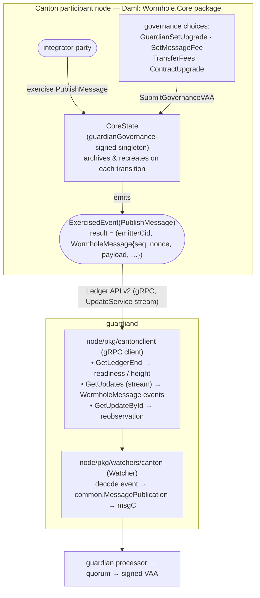

# Wormhole Core Bridge & Watcher for Canton

This directory contains the Wormhole **core bridge** for the
[Canton Network](https://www.canton.network/) (implemented in
[Daml](https://docs.daml.com/)) and documents the guardian-node **watcher** that
observes it (implemented in Go under
[`node/pkg/watchers/canton`](../node/pkg/watchers/canton) with a Ledger-API
client under [`node/pkg/cantonclient`](../node/pkg/cantonclient)).

**Target deployment:** the **public Canton Network mainnet**. **SDK and protocol
target:** Daml SDK **3.7.3**, Canton **3.7.3**, Daml-LF **2.3**, Protocol Version **37**. Two
consequences shape the design: Ledger API **v2**, and **contract keys too weak
to build on** (non-unique, resolved against the submitter's read view, negative
lookups fail open) — the package uses **no contract keys**: contracts are
addressed by contract-id, resolved off-ledger (§4.7); identity uniqueness is
registry-enforced and address integrity is cryptographic (see §1, §4).

The goal is parity with the canonical EVM core bridge
([`ethereum/contracts/Implementation.sol`](../ethereum/contracts/Implementation.sol),
[`Messages.sol`](../ethereum/contracts/Messages.sol),
[`Governance.sol`](../ethereum/contracts/Governance.sol)) and conformance with
the Wormhole whitepapers:

- [0001 — Generic Message Passing](../whitepapers/0001_generic_message_passing.md)
- [0002 — Governance Messaging](../whitepapers/0002_governance_messaging.md)
- [0004 — Message Publishing](../whitepapers/0004_message_publishing.md)
- [node watcher README](../node/pkg/watchers/README.md)

> **Status:** initial implementation. The Daml packages **compile and tests pass
> on Daml SDK 3.7.3**, including on-chain VAA verification validated against a
> real guardian-signed VAA and the cross-language address derivation pinned by a
> shared test vector. The remaining mainnet-gating item — the exact Ledger-API
> protobuf surface — plus the guardian hosting topology are tracked in
> [Open Questions & Validation Items](#11-open-questions--validation-items).

---

## 1. Background: how Canton differs from EVM

Wormhole's core bridge has two responsibilities on every chain:

1. **Publish** messages — an on-chain caller emits a message; the guardians
   observe it, reach quorum, and produce a signed VAA.
2. **Verify** messages (VAAs) on-chain — needed so the chain can act on
   governance VAAs (guardian-set upgrades, fees, upgrades) and so higher-level
   protocols (token bridge, etc.) can verify inbound VAAs.

Canton is structurally unlike EVM/Solana/Sui, and those differences drive the
design:

| Concept                   | EVM                                         | Canton                                                                                                                                                 |
| ------------------------- | ------------------------------------------- | ------------------------------------------------------------------------------------------------------------------------------------------------------ |
| Smart-contract model      | Solidity contract with mutable storage      | Daml **templates**; state is the set of **active contracts** (UTXO-like). State is changed by **archiving** a contract and **creating** its successor. |
| Calling a method          | `CALL` to an address                        | **Exercising a choice** on a contract                                                                                                                  |
| Identity / "address"      | 20-byte account/contract address            | **Party ID** (a string `hint::fingerprint`) and **contract IDs**                                                                                       |
| Event log                 | `LOG`/`event` topics                        | Ledger-API **events** (`CreatedEvent`, `ExercisedEvent`) in the transaction stream                                                                     |
| Block / height            | block number                                | **participant offset** (monotone `int64`) into the update stream. Each participant assigns its own offsets.                                            |
| Transaction hash          | 32-byte transaction hash                    | **update id**: a SHA2-256 multihash as lowercase hex. It is the same on every participant (§7.2).                                                      |
| Finality                  | probabilistic (reorgs) → consistency levels | deterministic: once a transaction is committed by the sequencer/mediator it is final. No reorgs.                                                       |
| Node API the watcher uses | JSON-RPC / `eth_getLogs`                    | **Ledger API v2** (gRPC), `UpdateService` streaming                                                                                                    |
| Crypto available on-chain | `ecrecover`, `keccak256` precompiles        | Daml `keccak256` and `secp256k1` built-ins (see §5)                                                                                                    |

The most consequential differences:

- **No `msg.sender`.** A Daml choice knows its acting parties, but Wormhole
  needs a stable 32-byte emitter address with a per-emitter monotonically
  increasing sequence. We solve this with an **`Emitter` registration**
  contract (§4.2), analogous to Sui's `EmitterCap`. The emitting party (`owner`)
  co-signs the `Emitter` and is part of the address derivation, so it is the
  faithful Canton analog of `msg.sender`: only that party's key can emit under
  its address (§4.2, §10).
- **No `ecrecover`.** Daml's `secp256k1` builtin _verifies_ a signature against
  a _public key_; it does not _recover_ the signer from the signature like
  Ethereum does. Guardian-set state on Canton therefore stores guardian
  **public keys** (not just their 20-byte addresses), bound to the canonical
  addresses from the governance VAA (§5).
- **No global mutable singletons; no contract keys.** The "core bridge
  contract" is modeled as a single long-lived **`CoreState`** contract, archived
  and recreated on every governance transition. Contract keys exist on Canton
  3.7 (Daml-LF 2.3) but are **not unique** — multiple active contracts may share
  a key ([docs](https://docs.canton.network/appdev/modules/m3-contract-keys#contract-keys))
  — and lookups resolve against the submission's readers, with negative results
  failing open (§4.6). They can carry neither uniqueness nor authenticity, so
  this package uses none: contracts are addressed **by contract-id**, resolved
  from a stakeholder's own ACS or via the disclosure service (§4.7), and
  authenticated by their **payloads** (signatories cannot be forged). The
  **`guardianGovernance`** (a k-of-n threshold party) and `feeCustody` sign the
  `CoreState`. Only the guardian threshold can create a guardian set
  (§4.1). Per-emitter uniqueness is a **registry** that allocates ids plus
  an owner-bound, cryptographic address (§4.2).

---

## 2. Architecture overview



The watcher is **read-only**: it never submits to Canton. It observes the
`PublishMessage` choice's result event, reads the `WormholeMessage` out of the
result tuple's second element, maps it to a
[`common.MessagePublication`](../node/pkg/common/chainlock.go), and hands it to
the processor exactly like every other watcher.

---

## 3. The VAA and the digest (unchanged across chains)

Canton uses the standard VAA v1 body and digest. Quoting
[0001](../whitepapers/0001_generic_message_passing.md) and matching
`Messages.sol`:

```
body = timestamp(4) ‖ nonce(4) ‖ emitterChain(2) ‖ emitterAddress(32)
       ‖ sequence(8) ‖ consistencyLevel(1) ‖ payload(var)

digest = keccak256( keccak256( body ) )          // double keccak, Ethereum-style
```

Guardians sign `digest` with secp256k1 (Ethereum ECDSA, 65-byte `r‖s‖v`).
Replay protection records `digest` (the double keccak — EVM's `vm.hash`), both
for governance (`consumedGovernance`, §4.4) and for integrator VAAs (the
`ReplayNode` trie, §4.6). The on-chain Daml verifier reconstructs and re-hashes
the body and checks signatures against the stored guardian set (§5).

`ChainID` for Canton is **75** (`ChainIDCanton`). Upstream assigned 72 (Robinhood)
and 73 (Hydration) after this branch first claimed 72; Canton moved to 75, leaving
74 as headroom. It is registered in [`sdk/vaa/structs.go`](../sdk/vaa/structs.go).

---

## 4. On-chain design (Daml)

Daml package name: `wormhole-core` (the `core` package). Module layout under
[`core/daml/`](core/daml):

| Module                      | Responsibility                                              |
| --------------------------- | ----------------------------------------------------------- |
| `Wormhole.Core.Bytes`       | byte/hex helpers, big-endian integer (de)serialization      |
| `Wormhole.Core.VAA`         | VAA struct, parser, digest, signature/quorum verification   |
| `Wormhole.Core.GuardianSet` | guardian-set representation and expiry                      |
| `Wormhole.Core.State`       | the `CoreState` singleton + `EmitterRegistry` and `Emitter` |
| `Wormhole.Core.Governance`  | governance packet parsing and the governance choices        |
| `Wormhole.Core.Setup`       | initialization (`setup`)                                    |

### 4.1 `CoreState` — the singleton

```haskell
template CoreState
  with
    guardianGovernance : Party          -- guardians' governance anchor (threshold party)
    chainId            : Int            -- 75
    governanceChainId  : Int            -- 1 (Solana)
    governanceContract : EmitterAddress -- 0x..0004 (the governance emitter)
    guardianSetIndex   : Int            -- current set index
    guardianSets       : Map Int GuardianSet   -- index -> set (with expiry)
    messageFee         : Int            -- fee required to publish, 10^-10 feeInstrument units
    feeInstrument      : InstrumentId   -- CIP-0056 instrument; genesis-fixed
    feeRecipient       : Party          -- feeCustody; genesis-fixed
    consumedGovernance : Set VaaDigest  -- governance-only replay protection (§4.6)
  where
    signatory guardianGovernance, feeRecipient
    ensure feeRecipient /= guardianGovernance
      && checkGuardianSetsAreConsistent guardianSetIndex guardianSets
```

**Genesis guardian set index.** Genesis installs the guardian set at the live
global index (mainnet: the Ethereum core `getCurrentGuardianSetIndex()`), not at 0.
Guardians sign each VAA with the global index in the VAA header.
`mkInitialCoreState` takes a `GenesisGuardianSet` (index and addresses), as Sui
`setup.move` does. EVM `Setup.sol` fixes index 0 and relays each upgrade VAA.
The template precondition applies to each create, including raw creates from the
genesis scripts: each index is 0 to 4294967295, the current set exists and does
not expire, each other set has a lower index and an expiry, and each set has 1 to
255 distinct, non-zero, 20-byte lowercase addresses.
`GuardianSetUpgrade` applies the same address check (`checkGuardianAddressesAreWellFormed`).

**Guardian visibility.** Every guardian participant hosts `guardianGovernance`
(§10), so guardians see what that party sees: `CoreState` and every `Emitter`
as a signatory (§4.2). The ledger-model rule that makes
this sufficient: **informees of a _consuming_ exercise include the contract's
stakeholders**. `SubmitGovernanceVAA` and `PublishMessage` are both consuming, so
guardians see every governance transition and the full message surface;
nonconsuming `ParseAndVerifyVAA` (§4.3) is a pure read. Its `Emitter` signature
gives `guardianGovernance` no publish or archive authority alone: each also
needs the owner (`TestGuardianVisibility`).

The only state-changing choice is `SubmitGovernanceVAA`. Any party is its
controller (`submitter`), and the guardian signatures on the VAA are the
authority (§4.4). The choice archives the current `CoreState` and creates the
successor with the updated fields. This is the Daml idiom for mutable state.

**Singleton signed by the governance party; authenticity is in the payload.**
`guardianGovernance` and `feeCustody` (the `feeRecipient` field) sign the
`CoreState`. In production, `guardianGovernance` is a **decentralized-namespace
external party** under a k-of-n threshold of guardian keys (the Canton Network
DSO construction). Guardians rotate its keys at the topology layer. The party
id, and thus the trust anchor of each consumer, stays the same. Two things
follow:

- **Only the guardian threshold creates a guardian set.** A `CoreState` whose
  `guardianGovernance` field is the known anchor is **authentic by
  construction**, independent of how the caller got its cid. Consumers
  authenticate the payload, not the resolution path (§4.7). `GetGuardianGovernance`
  is the read pin. The fee path pins `guardianGovernance`, and the `CoreState`
  pins `feeRecipient` (§4.2).
- **Governance stays low-friction.** `guardianGovernance` signs only at
  **genesis**. Each `SubmitGovernanceVAA` inherits its authority from the
  archived contract, as the `Emitter` owner does through `PublishMessage`.
  Thus any submitter applies a governance VAA. "Exactly one live `CoreState`"
  is behavioral, but the guardian signature anchors the set _contents_.

Per-emitter **sequence numbers live in each `Emitter`** (§4.2), not in
`CoreState`. The owner signs its `Emitter`, so the owner publishes and advances
its own sequence. This keeps EVM's permissionless `publishMessage`.
`CoreState` holds only shared configuration and governance state.

> **Why a `guardianGovernance` signatory?** Canton requires a signatory on each
> contract. `guardianGovernance` is the k-of-n guardian party. It signs every
> core contract at genesis or through inherited authority. Its signature gives
> it no power over message contents: VAA verification gates governance (§4.4),
> and each `Emitter` also needs its owner. Genesis needs only
> `guardianGovernance`, plus `feeCustody` for the `CoreState`.

### 4.2 Message publishing

Mirrors `publishMessage(nonce, payload, consistencyLevel)` from
`Implementation.sol:15` and whitepaper 0004.

An integrator first registers an emitter **directly**. `guardianGovernance`
signs the `EmitterRegistry`, which the genesis ceremony creates with the
`CoreState`. The requester exercises `RegisterEmitter` on it with the registry
disclosure (§4.7). The flexible controller brings the requester signature. The
created `Emitter` _inherits_ the `guardianGovernance` signature from the
registry, as in `VerifyAndConsumeVAA`. Registration is permissionless (EVM/Sui
parity). The choice is consuming, so racing registrations contend on the
registry, and the loser retries with the fresh cid:

```haskell
-- One per guardianGovernance; allocates monotonically increasing emitter ids.
template EmitterRegistry with
    guardianGovernance : Party    -- sole signatory; carried into each new Emitter
    onboardingFeeAdmin : Party    -- sets registrationFee only; not a signatory
    registrationFee    : Int      -- 10^-10 feeInstrument units; 0 for free
    nextId             : Int
  where
    signatory guardianGovernance  -- only the guardian threshold resets nextId (A14-3)
    ensure nextId >= 0 && nextId <= maxEmitterId + 1      -- maxEmitterId = 2^53 - 1
      && registrationFee >= 0 && registrationFee <= maxOnboardingFee
    -- choice RegisterEmitter : (ContractId EmitterRegistry, ContractId Emitter)
    --   with requester, payer : Party; coreStateCid, feeAllocation : Optional ...
    --        expectedGuardianGovernance : Party -- pins the registry
    --   controller requester, payer -- gg authority inherited; no crank
    --   returns (successorRegistryCid, emitterCid)
    -- choice SetRegistrationFee : ContractId EmitterRegistry
    --   with newRegistrationFee : Int
    --   controller onboardingFeeAdmin -- keeps nextId and the admin
    -- choice ReplaceEmitterRegistryFeeAdmin : ContractId EmitterRegistry
    --   with newOnboardingFeeAdmin : Party
    --   controller guardianGovernance -- emergency ceremony

template Emitter
  with
    guardianGovernance : Party    -- registrar and authenticity anchor; co-signer
    owner              : Party
    emitterId          : Int      -- registry-allocated
    emitterAddress     : EmitterAddress  -- keccak256(tag ‖ guardianGovernance ‖ owner ‖ emitterId), set at creation
    sequence           : Int      -- next sequence to assign (per-emitter)
  where
    signatory owner, guardianGovernance
                                -- owner co-signs: the msg.sender analog
                                -- gg co-signs: no second Emitter of an issued
                                -- identity outside RegisterEmitter (A14-2)
    ensure emitterId >= 0 && emitterId <= maxEmitterId
      && sequence >= 0 && sequence <= maxEmitterSequence
```

`RegisterEmitter` copies the registry's `guardianGovernance` onto the created
`Emitter`. `guardianGovernance` is a signatory of every `Emitter`, thus a
stakeholder of every publish exercise (and its `WormholeMessage` result) and of
the sequence-bumped successor `Emitter` create, for every owner (§4.1, §10).
`guardianGovernance` alone cannot publish or archive: each needs the owner too.

The watcher accepts a consuming `PublishMessage` event only if its read-as
party is a stakeholder of the exercised `Emitter`. `acs_delta` set shows this
for an `Emitter` that existed before the transaction. For an `Emitter` that the
same transaction creates, `acs_delta` is false: then the `CreatedEvent` of that
contract id in the transaction must be of the package id that executed the
publish, and must list the read-as party as a signatory. In an upgrade window,
a create under the current id does not unlock a publish under the retiring id,
and the reverse is also true. An exercise that `guardianGovernance` only
witnesses, for example a publish on an `Emitter` of a registry under another
`guardianGovernance` nested in a contract that the real party observes, is
dropped. Each drop
increments `wormhole_canton_publish_without_read_party_stakeholder_total` and
writes a WARN log with the update id. The watcher also rejects an `emitterId`
above `maxEmitterId` (2^53 - 1), so every off-ledger tool reads ids exactly.

`guardianGovernance` is the sole signatory of the registry. Thus its hosting
participants confirm each `RegisterEmitter`, and a registration needs the
confirmation threshold of `guardianGovernance`. The onboarding fee admin
(`onboardingFeeAdmin`) changes `registrationFee` with `SetRegistrationFee`. The
choice keeps `nextId` and the admin. The template precondition bounds the fee by
`maxOnboardingFee`. The core governance VAA set has no fee-admin action. Thus a
`guardianGovernance` ceremony replaces the admin with
`ReplaceEmitterRegistryFeeAdmin`. See
[A14_EMITTER_ID_UNIQUENESS.md](A14_EMITTER_ID_UNIQUENESS.md).

**Emitter address derivation.** The 32-byte Wormhole emitter address is

```
keccak256( utf8("wormhole:emitter:v1")
         ‖ uint32be(len(registrar)) ‖ utf8(registrar)
         ‖ uint32be(len(owner))     ‖ utf8(owner)
         ‖ uint64be(emitterId) )
```

where `registrar` is `guardianGovernance`. One `guardianGovernance` is one
deployment. The 4-byte length prefixes make the preimage
injective across the two variable-length party ids. It is computed **on-ledger**
at allocation (Daml `DA.Crypto.Text` is stable since 3.5) and stored in
`emitterAddress` for integrators to read, but the guardian watcher **re-derives**
it from the `WormholeMessage` fields and is the sole source of truth — a corrupt
on-ledger value cannot spoof it.

**Impersonation is cryptographically prevented (the `msg.sender` guarantee).**
Because the `owner` is both a **signatory** of the `Emitter` and part of the
address preimage, only a transaction carrying the owner's authority can create a
contract whose address is the owner's. A party without the owner signature
cannot emit under an existing emitter address: guardian replay rejects the
forge. A duplicate under a different owner derives a **different**, untrusted
address. This is the
invariant guardians verify — "the transaction is Daml-valid under the vetted
package" — with no bespoke watcher logic (see [§10](#10-trust-model--deployment-topology)).
Registry-allocated ids give per-owner uniqueness and let one party hold **many**
emitters, matching Sui's multiple `EmitterCap`s. `guardianGovernance` signs
the registry, so only the guardian threshold resets the id sequence (A14-3). It
also co-signs each `Emitter`, so an owner alone cannot rewind its emitter
(A14-2).

Publishing is a choice on the **`Emitter`** (controller `owner`, `payer`). The
owner authority is enough:

```haskell
-- on Emitter
-- Returns the sequence-bumped successor Emitter cid alongside the message,
-- so callers never re-resolve it off-ledger.
choice PublishMessage : (ContractId Emitter, WormholeMessage)
  with
    nonce            : Int            -- 0 .. 2^32-1
    payload          : MessagePayload -- even-length lowercase hex; no size cap (EVM parity)
    consistencyLevel : Int            -- 0 .. 255; see §6
    coreStateCid     : ContractId CoreState                       -- fee read (§ Fees)
    payer            : Party          -- funds messageFee; = owner for a direct publish
    feeAllocation    : Optional (ContractId Allocation, ExtraArgs)
  controller owner, payer
  do
    -- 1. assert the field ranges and the payload encoding
    -- 2. charge the current messageFee to payer through CoreState (§ Fees)
    -- 3. archive self; create the successor Emitter with sequence = sequence + 1
    -- 4. return WormholeMessage{registrar, owner, emitterId, sequence, nonce,
    --      payload, consistencyLevel} -- watcher derives the address
    pure result
```

The choice's **exercise result** is `(ContractId Emitter, WormholeMessage)` —
the sequence-bumped successor cid paired with the message. The successor
`Emitter` is recreated with both signatures inherited from the consumed
contract; the owner is a signatory, so the successor's **cid also arrives on
its own ACS** as the transaction's `CreatedEvent`, and the next publish
addresses that cid directly — stakeholders never need an off-ledger resolver
(§4.7). The watcher reads the tuple's `WormholeMessage` element directly from
the `ExercisedEvent.exercise_result` on the Ledger-API stream (see §7). The
`WormholeMessage` record is the wire contract between Daml and the watcher:

```haskell
data WormholeMessage = WormholeMessage with
    registrar        : Party     -- guardianGovernance; address input
    owner            : Party     -- the emitting party; address input (anti-impersonation)
    emitterId        : Int       -- registry-allocated; address input
    sequence         : Int       -- uint64
    nonce            : Int       -- uint32
    consistencyLevel : Int       -- uint8
    payload          : Bytes
  deriving (Eq, Show)
```

Equivalent to the EVM `LogMessagePublished(sender, sequence, nonce, payload,
consistencyLevel)` event (`Implementation.sol:12`), except the `sender` (emitter
address) is **derived by the watcher** from `(registrar, owner, emitterId)`
rather than carried in the record. The VAA **timestamp** is not carried in the
record either: per whitepaper 0001/0004 the guardian derives it from the block,
so the watcher reads it from the transaction's **ledger effective time**
(`Transaction.effective_at`) — see §7.1.

**Sequence numbers** are per-emitter, start at 0, increment by
1 — identical to EVM's `_state.sequences[emitter]`.

**Fees.** Whitepaper 0004 requires a fee in the chain's native token. Fees are
paid via the **Canton Network Token Standard** (CIP-0056, V1 — the
`splice-api-token-*-v1` interface DARs under `canton/dars/`), so the bridge works
with Canton Coin or any standard token, chosen at genesis
(`CoreState.feeInstrument`, no governance action covers it):

- **The payer is the submitter**, so the bridge only _consumes_ allocations,
  never issues wallet-facing `AllocationRequest`s (future UX work). The payer
  locks funds via the token registry's `AllocationFactory` (its wallet/CLI plus
  the registry's CIP-0056 OpenAPI, which supplies the `ExtraArgs` choice context
  and registry disclosures — untrusted-for-safety, liveness-only, like our own
  disclosure service, §4.7), with the convention `executor = sender = payer`,
  `receiver = feeRecipient`.
- The charging choice validates the allocation — receiver, instrument, amount
  (`≥` fee: the **entire leg amount transfers**, allocations are all-or-nothing,
  so overpayment is deliberate padding against fee-raise races), sender,
  executor (`== payer`), and the **instrument admin's signature** (views are forgeable, a signature is not) —
  then exercises `Allocation_ExecuteTransfer` **in the same transaction** as the
  publish/registration/claim. Executing consumes the allocation: one-shot by
  activeness, no replay bookkeeping. Fees are `Int`s in **10^-10 token units**
  (exactly Decimal's last digit — every fee exactly representable).
- `Allocation_ExecuteTransfer` needs sender ∧ receiver ∧ executor authority
  jointly, and the receiver is the fee recipient — so all charging routes
  through `CoreState` choices (`ChargeMessageFee` / `ChargeFee`), where the
  recipient's authority is inherited. `PublishMessage` therefore references the
  `CoreState` on every publish (EVM parity: the current `messageFee` is read each
  call; a stale cid fails closed and is re-resolved). The fee is charged to
  `payer`, which equals `owner` for a direct publish but is named explicitly when
  an app publishes on a user's behalf (NTT §10); `payer` co-controls the publish,
  so it cannot be a third party who did not authorize spending its funds.
  Registries charge their `registrationFee`/`claimFee` the same way, skipping the
  `CoreState` entirely at fee 0. Before charging, every call site pins the
  `CoreState` by exercising `GetGuardianGovernance` against the
  `guardianGovernance` committed on the emitter or registry, the authenticity
  anchor. `ChargeMessageFee` and `ChargeFee` return `guardianGovernance`. The
  caller checks it a second time after the charge ("core state
  guardianGovernance mismatch after charge"). Thus a forged `CoreState` cannot
  redirect the fee (see the custody bullet).
- **The fee registry runs only as the payer and `feeCustody`.**
  The registry's `Allocation_ExecuteTransfer` body runs with the authority of
  the allocation controllers: the payer (sender, executor) plus the receiver.
  It also runs with the authority of the allocation signatories, which include
  the fee instrument admin. The `CoreState` precondition and `chargeFee` reject
  `guardianGovernance` and `feeCustody` as the fee instrument admin (0.9.0).
  0.8.3 rejects `guardianGovernance` and the 0.8.x `operator`.
  From `wormhole-core` 0.8.3 the receiver is `feeCustody`, a quorum party in the
  guardian namespace and a `CoreState` co-signer (the source of the receiver
  authority). The `CoreState` precondition rejects `feeRecipient` equal to
  `guardianGovernance`. When a fee is due, `chargeFee` rejects
  `guardianGovernance` as payer or receiver. At fee 0, no registry code runs.
  In 0.8.0 to 0.8.2 (withdrawn) `feeRecipient` was `guardianGovernance`, so a fee
  registry could publish on any gg-owned `Emitter` (`canton/REDTEAM.md`, F1-core).
- **Custody is governance-controlled**: `feeRecipient` is the `feeCustody`
  quorum party (same hosts, confirmation threshold and owner keys as
  `guardianGovernance`). Accrued fees move only through the k-of-n guardian
  ceremony (the Canton analog of "fees sit in the bridge contract"). Each charge
  pins `guardianGovernance`. A shadow `CoreState` under a throwaway
  `feeRecipient` thus fails before funds move. A
  `TransferFees` VAA mints an on-ledger `FeeWithdrawalAuthorization` (signed by
  guardianGovernance) recording the amount, the VAA's 32-byte recipient, and the
  VAA hash — the artifact the guardians' custody policy matches when
  threshold-signing the outbound transfer. The prepare endpoint accepts one
  command, so the withdrawal is two prepared transactions. First,
  `guardianGovernance` alone archives the authorization. Then `feeCustody`
  alone submits the transfer. The ledger accepts one archive of a contract, so
  each authorization backs at most one transfer
  (`docs/canton_guardian_operations.md` §7.6). Key custody enforces "only per
  authorization", the same trust plane as the guardian keys.
- Token Standard **V2** (CIP-0112) is approved but not yet on mainnet; it
  arrives as a parallel `-v2` interface family, and
  `Wormhole.Core.Fees.chargeFee` is the single seam where support would be
  added.

### 4.3 VAA verification choice

```haskell
-- on CoreState; pure verification, does not mutate state
nonconsuming choice ParseAndVerifyVAA : VerifiedVAA
  with
    verifier   : Party            -- any party; the sole controller
    encodedVAA : Bytes
    pubKeys    : [(Int, Bytes)]   -- guardianIndex -> 65-byte uncompressed pubkey
  controller verifier
  do
    vaa <- parseVAA encodedVAA
    verifyVAA self vaa pubKeys     -- §5
    pure (toVerified vaa)
```

`pubKeys` are supplied by the caller because Daml verifies against a public key,
not by recovery (§5). They are _untrusted hints_; verification fails unless each
provided key hashes to the guardian address stored in the set.

**This is permissionless.** `verifier` is the sole controller. The choice is
`nonconsuming`. Its body creates no contract, so it needs only the `verifier`
authority. `SubmitGovernanceVAA` below is consuming: its successor
`CoreState` inherits the `guardianGovernance` and `feeCustody` signatures from
the archived contract. Any external
protocol — the token bridge, NTT, anything else — can verify a VAA as itself.
The one real requirement is visibility, not authorization: a non-stakeholder
needs `CoreState` explicitly disclosed to reference it at all, via Daml's
[Explicit Contract
Disclosure](https://docs.digitalasset.com/build/3.4/sdlc-howtos/applications/develop/explicit-contract-disclosure.html)
feature — a data attachment, not a signature — servable by any party with read
access. In Daml Script, `submitWithDisclosures` is the idiom. Proven both
in-memory
(`test/daml/Test/TestCore.daml:testParseAndVerifyVAAByExternalVerifier`) and
against a live sandbox/participant
([`node/pkg/watchers/canton/core_verify_vaa_integration_test.go`](../node/pkg/watchers/canton/core_verify_vaa_integration_test.go)):
a party that is not a `CoreState` stakeholder verifies a real guardian-signed
VAA as itself.

Integrators that must consume a VAA (redeem exactly once) use
`VerifyAndConsumeVAA` instead, which verifies **and** records consumption
atomically (§4.6).

### 4.4 Governance

Governance follows [0002](../whitepapers/0002_governance_messaging.md). A single
`SubmitGovernanceVAA` choice on `CoreState` verifies the VAA and dispatches on
the parsed action. Its controller is `submitter`, an argument: any party submits
a governance VAA (EVM `Governance.sol` parity). The guardian signatures are the
authority. A submitter that is not a stakeholder needs the `CoreState`
disclosure (§4.7). Module identifier is **`"Core"`**
(`0x00..00436f7265`, 32 bytes). A governance VAA is accepted only if (matching
`Governance.sol:190`):

1. `verifyVAA` passes against the **current** guardian set;
2. `emitterChain == governanceChainId` and `emitterAddress == governanceContract`;
3. `module == "Core"` and `action` matches the choice;
4. `chain == chainId` (or `0` for chain-independent actions);
5. `digest ∉ consumedGovernance` — then it is inserted (replay protection).

The top-level functions `governanceOutcomeFor` (pure) and
`createGovernanceOutcome` hold the choice body. Two postcondition checks run on
each successor:

- `checkGovernanceKeepsGenesisFields`: `guardianGovernance`, `chainId`,
  `governanceChainId`, `governanceContract`, `feeInstrument` and `feeRecipient`
  stay the same.
- `checkGovernanceConsumesOneDigest`: `consumedGovernance` grows by exactly one
  entry, the VAA digest.

Supported actions (parity with `GovernanceStructs.sol`). Each packet must have
the exact length that `sdk/vaa/payloads.go` serializes: 67 bytes for
ContractUpgrade and SetMessageFee, `40 + 20·len` for GuardianSetUpgrade, and 99
for TransferFees.

Target chain: GuardianSetUpgrade accepts chain 75 or chain 0. The other three
actions accept chain 75 only. `sdk/vaa` serializes no TransferFees for chain 0.

| Action                 | ID  | Payload (after 32-byte module + 1-byte action)   | Behavior                                                                                                                                                                                   |
| ---------------------- | --- | ------------------------------------------------ | ------------------------------------------------------------------------------------------------------------------------------------------------------------------------------------------ |
| **ContractUpgrade**    | 1   | `chain(2) ‖ newContract(32)`                     | Records intent + emits an event. On Canton, "upgrade" = a [Daml package upgrade](https://docs.daml.com/upgrade/); `newContract` is interpreted as the new package-id (32 bytes). See note. |
| **GuardianSetUpgrade** | 2   | `chain(2) ‖ newIndex(4) ‖ len(1) ‖ keys(20·len)` | Validates `newIndex == current+1`; sets old set's `expirationTime = effectiveTime + 86400`; stores new set. Requires `pubKeys` hints to bind addresses (§5).                               |
| **SetMessageFee**      | 3   | `chain(2) ‖ fee(32)`                             | Updates `messageFee`.                                                                                                                                                                      |
| **TransferFees**       | 4   | `chain(2) ‖ amount(32) ‖ recipient(32)`          | Moves collected fees to `recipient`. (No-op accounting until CC payments are wired.)                                                                                                       |

`RecoverChainId` (EVM action 5) is **EVM-specific** (it repairs `block.chainid`
after a fork) and has no analog on Canton; it is intentionally omitted.

**ContractUpgrade note:** EVM upgrades swap a proxy implementation. Daml has no
in-place code mutation. To upgrade the bridge logic, each guardian participant
vets the new package version out of band. Daml smart-contract upgrade (SCU)
keeps the contract data. The `ContractUpgrade` VAA records the consumed digest
in `consumedGovernance` and leaves the other `CoreState` fields unchanged. This
governance action differs most from EVM; see Open Questions.

### 4.5 Guardian-set expiry

This logic matches EVM `Setters.sol`. A `GuardianSetUpgrade` sets the
`expirationTime` of the previous set to `effectiveTime + 86400` (1 day).
`verifyVAA` accepts a non-current set while `effectiveTime <= expirationTime`.
EVM `Messages.sol:80` rejects only when `expirationTime < block.timestamp`.
`isActiveAt` truncates both times to whole seconds, as `block.timestamp` does.
Thus `verifyVAA` accepts the set until the end of its expiry second. The
current set never expires.

### 4.6 Replay protection for integrators: a trie of consumed digests

Governance replay protection is the `consumedGovernance` set inside `CoreState`
(§4.4) — fine there, because governance actions are rare and already churn the
singleton. App VAAs (token bridge / NTT) must **not** be recorded that way: Daml
values have no structural sharing across contract updates, so an ever-growing
set would be reserialized into every create node (payload size, participant DB
write, and network cost all linear in history), and every integrator's consume
would contend on the one singleton contract.

They also must not be recorded as per-digest keyed contracts (the design this
replaces): Canton LF 2.3 key lookups resolve once, on the submitting
participant, against the submission's readers, and the result is a pinned
input to validation. Confirming participants re-check authorization,
conformance, and the activeness of every contract a transaction _uses_ — but
they do **not** re-run key lookups against their own stores (with non-unique
keys and per-party visibility there is no canonical answer, and local
re-checks would make validation nondeterministic and leak private state). A
_positive_ resolution names a cid that is consistency-checked like any input;
a _negative_ one names nothing and **fails open**. Replay protection is
precisely a negative claim ("this digest was never consumed"), so it cannot be
built on key lookups — this module uses no contract keys at all.

Instead, each replay scope's consumed-digest set is a **prefix trie of leaf
contracts** (`Replay.daml`). A scope is **(consumer, namespace)**: the
`consumer` party carries the authority, and the opaque `namespace` string lets
one consumer party maintain many independent tries — an integrator whose admin
role is transferable keeps the party stable and derives the namespace from its
own permanent identity instead (NTT: a hash of the instrument id and the
initial admin party). A node covers a hex `prefix` and stores the set of
digest _suffixes_ consumed under it:

```haskell
template ReplayNode
  with
    consumer       : Party    -- integrator scope party; bears the replay risk
    guardianGovernance : Party  -- co-signs: no unilateral archive or re-create
    namespace      : Text     -- opaque sub-scope: one consumer, many tries; 1..128 chars
    prefix         : DigestNibblePrefix  -- lowercase hex, 0..63 nibbles; "" at the root
    splitThreshold : Int      -- node capacity; children inherit it
    consumed       : Set DigestNibbleSuffix  -- suffixes, each (64 − |prefix|) nibbles
  where
    signatory consumer, guardianGovernance  -- gg alone when consumer == gg (NTT)
```

A trie starts as one root (empty prefix, empty set). `ConsumeDigest`
(consuming, controller `consumer`) checks the node covers the digest, rejects
if the suffix is already present, and recreates the node with it inserted.
When the node is at `splitThreshold`, the consume instead **splits** it: all
16 children are created (one per nibble, empty ones included), suffixes
bucketed by their first nibble, which is dropped. Internal nodes are never
stored. **The invariant: a scope's active nodes partition the digest space —
every digest has exactly one covering node**, so membership in that node is
global consumption truth.

**Why this is sound where keys were not.** "Not consumed" became a positive
statement about one _named_ contract: fetch the covering node, check absence,
consume it. Every confirming participant validates the node's activeness — a stale cid
conflicts and aborts; the current covering node provably contains or excludes
the digest. Soundness is **submitter-independent**: any submitter with a
disclosure of the current covering node gets a correct check, and a wrong or
stale node can only fail the transaction, never replay. Where the key design
failed _open_ (a lookup that misses waves a replay through), the trie fails
_closed_ (an archived subspace has no covering node — nothing verifies).

`VerifyAndConsumeVAA` (nonconsuming, on `CoreState`, flexible controller
`consumer`) takes the covering node's cid, verifies the VAA (§5), binds the
node to the (consumer, namespace, guardianGovernance) scope, and exercises
`ConsumeDigest` with the digest — verify + consume + act in one transaction.
A node of another `guardianGovernance` fails with "replay node
guardianGovernance mismatch".

Properties:

- **Nobody can touch someone else's scope; your own scope is your own
  problem.** Archival alone only bricks (fail-closed); the replay vector is
  node _re-creation_. Nodes are co-signed, so no third party can archive or
  re-create them. Splits inherit both signatures from the archived parent, so
  `guardianGovernance` takes no action per consume. Roots come only from the
  `ReplayRootRegistry`, a stateless anchor that `guardianGovernance` alone
  signs. Its nonconsuming `ClaimReplayRoot` lends the _inherited_
  `guardianGovernance` signature to a consumer-submitted claim (the
  `RegisterEmitter` pattern: no crank). `guardianGovernance` signs only at
  genesis. `ClaimReplayRoot` takes a mandatory `expectedGuardianGovernance :
  Party` ("replay root registry guardianGovernance mismatch"). The onboarding
  fee admin changes `claimFee` with `SetClaimFee`, bounded by
  `maxOnboardingFee`. A `guardianGovernance` ceremony replaces the admin with
  `ReplaceReplayRootRegistryFeeAdmin`. Claiming a root for a
  consumer requires **that consumer's authority**, so nobody can fork another
  app's replay scope (the namespace is a free-form sub-scope _under_ that
  authority, not a claim anyone else can contest). There is deliberately _no_
  one-root-per-scope enforcement: maintaining a single trie per scope is the
  consumer's own responsibility (its disclosure service defines which trie its
  consumes resolve into, and detects forks — more than one covering node — for
  free). This is EVM
  parity: nobody grants replay storage there either; every integrator owns
  its mapping. A consumer minting parallel roots, like a consumer whose key
  is stolen, only harms itself — and a stolen consumer key defeats the app
  more directly anyway. (If key-compromise resilience is ever wanted, the
  hardening is trie-identity pinning: thread the original root's cid through
  successors via `self` and pin it in the app contract — documented, not
  built.) Spam claims cost the spammer synchronizer traffic per transaction
  and the guardian participants ~300 B of storage per worthless root; no shared contract
  grows, nothing bricks.
- **Scoping and contention.** Tries are per (consumer, namespace): different
  apps — or one consumer party under different namespaces — consume the same
  VAA independently. Consumes racing on the _same node_
  conflict — exactly one commits (validator-checked, regardless of submitter);
  the loser re-resolves the covering node and retries. A blind retry of a
  consume that actually committed fails on membership ("digest already
  consumed") — a clean idempotency signal. Until the first split, all of one
  app's
  consumes serialize through its root; 16-way fan-out begins at
  `splitThreshold` consumes.
- **Cost.** `defaultSplitThreshold = 128`: suffixes are ≤64-char hex (~66 B
  serialized), so nodes top out ~8.5 KB, the average consume rewrites ~4 KB,
  and the split transaction redistributes the same bytes across 16 creates
  (~15 KB) — all far below Canton's request caps. Total ACS bytes stay ~66 B
  per digest; 10 M digests ≈ 150 k nodes at depth 3–4. Larger thresholds thin
  the ACS but amplify every write.
- **Privacy.** Nodes are integrator-private safety state, outside the guardian
  view (§4.1): target-chain consumption is the integrator's concern, and the
  attestation surface is `CoreState` and `Emitter`.

**The disclosure service.** Submitters locate the covering node off-ledger: a
service indexes the active nodes by (consumer, namespace, prefix) (following
the `CreatedEvent`s that consumes and splits produce) and serves, for a digest,
the covering node's cid plus its explicit disclosure — alongside the
`CoreState` disclosure it already serves (§4.3). It is **untrusted for
safety**: the worst it can do is serve a wrong or stale node, which fails the
transaction. It is trusted for _liveness_ only, like any RPC endpoint. §4.7
aggregates every resolution the service must provide. (Go implementation is
future work; the Daml tests simulate it with a script helper,
`Test.TestReplay.coveringNode`, which also asserts the partition invariant on
every use.)

**Integrating — direct and user-submitted.** The executable reference is
[`test/daml/Test/ExampleIntegrator.daml`](test/daml/Test/ExampleIntegrator.daml)
(test package only): the end user herself exercises `Redeem` on the app
contract with two disclosures attached (CoreState + covering node) and nothing
else — no read grants, no `readAs`, no relayer queue. The manager's
_authority_ for the consume is inherited from the app contract's signatory;
its _visibility_ is simply not needed. `testIntegratorRedeem` pins the
inversion of the key-based design's failure mode: replay attempts by arbitrary
submitters fail on activeness (stale node) or membership (fresh node) — never
succeed.
`testIntegratorCoreStatePin` pins the `CoreState` check: a shadow `CoreState`
under a throwaway `guardianGovernance` fails `Redeem`.

### 4.7 Addressing without keys: the disclosure service

With contract keys gone (§1), every contract reference is a **contract-id**.
Two distinct needs hide behind "how do I find the contract", and they have
different answers:

- **Cid resolution** — _what is the current cid of X?_ Stakeholders get this
  for free: a consuming exercise delivers the successor's `CreatedEvent` to
  every stakeholder's ACS, so each guardian participant tracks the registries and the
  `CoreState`, an emitter owner tracks its `Emitter`, a consumer tracks its
  trie — all without any off-ledger help.
- **Disclosure attachment** — a **non-stakeholder** submitter must additionally
  attach the explicit-disclosure blob of every contract its transaction
  references, or its participant cannot construct the transaction at all.

The **disclosure service** is the single off-ledger component that provides both
to the parties that need them: an index over the relevant contracts — fed by the
update stream / ACS of a party that sees them — answering "current cid (+
disclosure blob) for X". The complete inventory it must serve:

| Contract                                 | Index                              | Needed by                                                              | Disclosure attachment?                                                            | Churn                                                      |
| ---------------------------------------- | ---------------------------------- | ---------------------------------------------------------------------- | --------------------------------------------------------------------------------- | ---------------------------------------------------------- |
| `CoreState`                              | the one true instance              | §4.3 verify, §4.6 consume, and EVERY publish / fee'd onboarding (§4.2) | yes — every non-stakeholder submitter (incl. all publishers)                      | per governance action (rare)                               |
| `ReplayNode`                             | (consumer, namespace, prefix covering digest) | every `VerifyAndConsumeVAA` / integrator redeem             | yes for non-stakeholders (e.g. end users); the consumer itself only needs the cid | every consume under that node                              |
| `EmitterRegistry`                        | guardianGovernance                 | `RegisterEmitter`, `SetRegistrationFee`                                | yes — the requester or the onboarding fee admin submits                           | per emitter registration and per fee or admin change       |
| `ReplayRootRegistry`                     | guardianGovernance                 | `ClaimReplayRoot`, `SetClaimFee`                                       | yes — the consumer or the onboarding fee admin submits (cacheable blob)           | only on fee or admin change                                |
| `Emitter`                                | (guardianGovernance, owner, emitterId) | `PublishMessage`                                                   | no — owner submits, own ACS (but see `CoreState` row)                             | per publish                                                |
| token-registry context                   | the fee instrument's registry      | any fee'd choice (§4.2): `ExtraArgs` + registry disclosures            | yes — from the REGISTRY'S own CIP-0056 OpenAPI, not this service                  | registry-defined                                           |
| app contracts (e.g. `ExampleIntegrator`) | app-defined                        | the app's own choices                                                  | app's concern (its users are observers)                                           | app-defined                                                |

Two properties make this safe to outsource:

- **Untrusted for safety.** A wrong or stale answer can only make the
  transaction fail — the trie fails closed on staleness (§4.6), and consumers
  authenticate every resolved contract by its **payload**, never by how the
  cid was found: `CoreState` by its signatory anchor fields (§4.1),
  `ReplayNode` by the (consumer, namespace, guardianGovernance) binding inside
  `VerifyAndConsumeVAA` plus the app-side `guardianGovernance` pin (see
  `ExampleIntegrator.Redeem`). The service is trusted for _liveness_ only, like
  any RPC endpoint.
- **Registry pin.** A client passes `expectedGuardianGovernance = gg` (a
  mandatory `Party`) to `RegisterEmitter` and `ClaimReplayRoot`, with `gg` from
  its own configuration. A registry from the service under another
  `guardianGovernance` then fails with "registry guardianGovernance mismatch" or
  "replay root registry guardianGovernance mismatch" before any fee charge. NTT
  `RegisterManager` must pass the same pin.
- **One reader suffices.** `guardianGovernance` signs every core contract:
  `CoreState`, both registries, every `Emitter` and every `ReplayNode`. Thus any
  guardian participant, reading as `guardianGovernance`, serves the whole
  table. Integrators can also run their own service for their trie and app
  contracts. Reading as a party requires only that party's `CanReadAs` on the
  serving participant. The onboarding fee admin is not an observer: it gets the
  registry disclosure from a guardian participant.

Concrete implementation (interface: `(template, index) → (cid,
created_event_blob)` over the state-service ACS plus the update stream) is
future work; the Daml tests simulate it with `Test.TestReplay.coveringNode` /
`queryDisclosure`.

---

### 4.8 Constrained byte types

`Wormhole.Core.Bytes` gives each byte value a type with one valid form: lowercase hex, no `0x` prefix, exact width.
The widths come from `sdk/vaa/structs.go` and `sdk/vaa/payloads.go`.

| Type | Constraint | Fields |
| - | - | - |
| `EncodedVaa` | even length, at least 57 bytes | `encodedVAA` choice arguments |
| `MessagePayload` | even length, 0 or more bytes | `PublishMessage.payload`, `WormholeMessage.payload`, `VAA.payload` |
| `VaaDigest` | 32 bytes | `VAA.hash`, `consumedGovernance`, `ConsumeDigest.digest`, `FeeWithdrawalAuthorization.vaaHash` |
| `EmitterAddress` | 32 bytes | `VAA.emitterAddress`, `governanceContract`, `Emitter.emitterAddress` |
| `UniversalAddress` | 32 bytes | `ContractUpgrade.newContract`, `TransferFees.recipient` |
| `GuardianAddress` | 20 bytes | guardian set keys |
| `GuardianPublicKey` | 65 bytes, first byte `04` | `pubKeys` hints |
| `EcdsaSignatureR`, `EcdsaSignatureS` | 32 bytes each | `VAA` signatures |
| `DigestNibblePrefix` | 0 to 63 nibbles | `ReplayNode.prefix` |
| `DigestNibbleSuffix` | 1 to 64 nibbles | `ReplayNode.consumed` |
| `HexBytes` | even length, 0 or more bytes | parse and encode helpers |

Each type is a positional single-constructor `data`, and the module export list keeps the constructor private.
Daml code in another package builds a value only through `parseHexText`.
The Ledger API can send any value. Thus each template `ensure` and each choice checks its byte fields again with `checkHexValueIsWellFormed`.
`canton/test/forged_byte_values_test.sh` sends forged values to each boundary and checks the rejection.

On the Ledger API, a value is a variant: JSON `{"tag": "MessagePayload", "value": "<hex>"}`.
The watcher reads `WormholeMessage.payload` as this variant and applies the same rule (`messagePayloadField` in `cantongrpc.go`).

## 5. On-chain signature verification (the crux)

EVM uses `ecrecover(digest, v, r, s)` and compares the recovered 20-byte address
to `guardianSet.keys[i]`. Daml's
[`DA.Crypto.Text`](https://docs.canton.network/appdev/reference/daml-standard-library/da-crypto-text)
has **no recovery** builtin; the relevant functions (confirmed against the
3.x docs) are:

```haskell
keccak256             : BytesHex -> BytesHex
secp256k1             : SignatureHex -> BytesHex -> PublicKeyHex -> Bool  -- SHA-256s the message first
secp256k1WithEcdsaOnly : SignatureHex -> BytesHex -> PublicKeyHex -> Bool  -- verifies the message directly
```

We use **`secp256k1WithEcdsaOnly`** because Ethereum signs the 32-byte
`keccak256(keccak256(body))` digest _directly_ (no further hashing); plain
`secp256k1` would SHA-256 the digest first and never match. The design:

1. **Bind a caller-supplied pubkey → guardian address.** There is no recovery,
   so the verifier is given `pubKeys : [(Int, Bytes)]` (the signing guardians'
   uncompressed keys) and asserts `keccak256(pubKey)[12..32] == keys[index]`.
   Because the address is the keccak of the key, a wrong key can't pass — this
   re-introduces the EVM guarantee without recovery.

2. **DER-encode for the builtin.** `secp256k1WithEcdsaOnly` wants a **DER**
   signature and a **DER (SubjectPublicKeyInfo)** public key, both hex.
   `Wormhole.Core.VAA` DER-encodes the VAA's raw `(r, s)` (`derSignature`) and
   wraps the uncompressed point in the fixed secp256k1 SPKI prefix
   (`derPublicKey`). The 32-byte digest is passed as the message **as-is**.

3. **Verify.** `secp256k1WithEcdsaOnly (derSignature r s) digest (derPublicKey pubKey)`.

4. **Quorum** — identical to EVM `Messages.sol:90`:
   `required = floor(numGuardians * 2 / 3) + 1`. Signatures must be in
   **strictly ascending** guardian-index order (prevents double-counting).

### Making verification hint-free for integrators (recommended)

Supplying `pubKeys` on every call is acceptable for governance (rare,
any party submits) but is real friction for integrators (e.g. a token bridge),
whose relayers would otherwise have to look up the signing guardians' keys on
every inbound message. The recommended evolution: **persist the guardian public
keys in the guardian set** — i.e. `GuardianSet` stores `pubKeys` alongside `keys`,
bound to the canonical addresses _once_ at install time (the
GuardianSetUpgrade / setup choices already receive pubkey hints and verify
`keccak256(pubKey)[12..32] == addr`, so the binding is free). After that,
`verifyVAA` reads the keys from the set and callers pass **only the VAA bytes**,
making the integrator API equivalent to EVM's `parseAndVerifyVM(bytes)`. This is
a planned change to the current code, which still takes per-call hints.

### Validation status

The whole verification path is **empirically validated** against a real
Ethereum-style guardian signature on Daml SDK 3.7.3. `testParseAndVerifyVAA` and
`testGovernanceSetMessageFee` (in [`TestCore.daml`](test/daml/Test/TestCore.daml))
feed a genuine VAA — signed by the well-known devnet guardian and produced by
[`node/pkg/cantonclient/vectorgen_test.go`](../node/pkg/cantonclient/vectorgen_test.go)
— through `ParseAndVerifyVAA` / `SubmitGovernanceVAA` and both pass. That confirms:

- ✅ `keccak256` hashes the **decoded** hex bytes (the double-keccak digest
  matched the signature), so the `BytesHex` semantics are as assumed;
- ✅ `derSignature` (DER `r,s`) and `derPublicKey` (SPKI) are encoded correctly;
- ✅ `secp256k1WithEcdsaOnly` verifies the 32-byte digest **directly** (no
  pre-hash), and the pubkey→address keccak binding holds.

Since Daml SDK 3.5 the `DA.Crypto.Text` builtins are **stable** (the earlier
Alpha `-Wno-crypto-text-is-alpha` suppression is no longer needed), so the
previous mainnet-readiness concern about depending on an Alpha builtin is
resolved. All Daml crypto remains encapsulated in `Wormhole.Core.VAA`, and the
same builtins now also back the on-ledger address derivation in
`Wormhole.Core.Bytes` (`toHex` + `keccak256`).

---

## 6. Consistency / finality

Canton transactions are final once committed by the synchronizer
(sequencer + mediator); there are no reorgs. Like Sui, Canton therefore has a
single meaningful consistency level. The watcher treats every observed message
as final and publishes immediately. The `consistencyLevel` byte is passed
through from the `WormholeMessage` (integrators may set it; per
[0001](../whitepapers/0001_generic_message_passing.md) "all other chains … this
field will be `0`"), and the watcher does **not** gate on it.

---

## 7. Off-chain design (the watcher)

Lives in [`node/pkg/watchers/canton`](../node/pkg/watchers/canton); the gRPC
client is [`node/pkg/cantonclient`](../node/pkg/cantonclient). It mirrors the
structure of the Sui watcher
([`node/pkg/watchers/sui`](../node/pkg/watchers/sui)) and the `suiclient`
package.

### 7.1 `cantonclient` (Ledger API v2, gRPC)

There is no official Go binding for the Daml Ledger API, so the
`com.daml.ledger.api.v2` protobuf (the State + Update service closure, from
**Canton 3.7.3**) are vendored under
[`node/pkg/cantonclient/proto`](../node/pkg/cantonclient/proto) and compiled with
the repo's `buf` toolchain; the generated stubs are committed and CI-verified
(see [`node/pkg/cantonclient/README.md`](../node/pkg/cantonclient/README.md)).
The client exposes a small interface (mirroring `suiclient.SuiClient`):

```go
type CantonClient interface {
    // GetLedgerEnd returns the current participant offset (the "height").
    GetLedgerEnd(ctx context.Context) (int64, error)

    // SubscribeUpdates streams transactions from beginExclusive onward,
    // delivering each Wormhole message-publish event found in them.
    SubscribeUpdates(ctx context.Context, beginExclusive int64, templateID TemplateID, choiceName string, out chan<- CantonMessageEvent) (Subscription, error)

    // GetTransactionByUpdateID fetches a single transaction by update id
    // (reobservation), with the same party filter and template filter as SubscribeUpdates.
    GetTransactionByUpdateID(ctx context.Context, updateID UpdateID, templateID TemplateID, choiceName string) (CantonTransaction, error)

    Close() error
}
```

Mapping to Ledger API v2 RPCs:

| Need                | Ledger API v2                                                                                                                       |
| ------------------- | ----------------------------------------------------------------------------------------------------------------------------------- |
| height / readiness  | `StateService.GetLedgerEnd` → `offset (int64)`                                                                                      |
| live message stream | `UpdateService.GetUpdates` (server stream); filter `Transaction.events[].exercised` by `template_id` + `choice == "PublishMessage"` |
| reobservation       | `UpdateService.GetUpdateById` for the update id encoded in the reobservation request; same `UpdateFormat` as the stream             |

The Wormhole message comes from the **`ExercisedEvent`** of the `PublishMessage`
choice: `exercise_result` is the `WormholeMessage` record (§4.2), decoded from
the Ledger-API `Value`/`Record` representation. The watcher derives the 32-byte
emitter address from the record's `registrar`, `owner`, and `emitterId` fields
using the canonical encoding in §4.2 (see `deriveEmitterAddress` in
[`watcher.go`](../node/pkg/watchers/canton/watcher.go)); the encoding is pinned
against the Daml side by a shared cross-language test vector.

**Party filter.** The `GetUpdates` and `GetUpdateById` requests use one
`UpdateFormat` with a wildcard template filter. Outside unsafe dev mode,
`--cantonReadAsParty` is required. Set it to the **`guardianGovernance`** party
(§4.1). This party is a stakeholder of every `Emitter` and of `CoreState`, so the
narrowed `filters_by_party` stream carries every `PublishMessage`. The watcher
parses the value at startup. The value must have the form `<hint>::<fingerprint>`.
The hint has 1 to 185 characters from `[A-Za-z0-9_-]`. The fingerprint is `1220`
and 64 lowercase hexadecimal characters. The watcher does not start with a
different value. In unsafe dev mode an empty `--cantonReadAsParty` selects
**`filters_for_any_party`**. The **devnet** sandbox uses this wildcard.
`TRANSACTION_SHAPE_LEDGER_EFFECTS` is required so `ExercisedEvent`s — which carry
the choice result — are included.

**Registrar pin.** When `--cantonReadAsParty` has a value, the watcher drops
each message whose `registrar` is not equal to the read-as party. The comparison
is exact. The read-party signatory check admits an `Emitter` of which the
read-as party is the owner. The registrar pin is the only check that drops such
a message when its registrar is another party. Do not remove it. One
`guardianGovernance` is one deployment, so a message from a registry of another
`guardianGovernance` is not a message of this deployment. Each drop increments
`wormhole_canton_foreign_registrar_messages_dropped_total`. A stream restart reads
a dropped message again, so the counter counts drops, not distinct messages.

### 7.2 `TxID` and offsets

The `MessagePublication.TxID` is the transaction's **update id**. The
participant offset is not the `TxID`.

Each participant assigns its own offsets. On LocalNet, one update has offset
590, 762, and 1381 on three participants. Each guardian reads its own
participant. Thus an offset from one guardian identifies a different update, or
no update, on the participant of a different guardian. The update id is the same
on every participant that hosts the transaction.

Encoding:

- The Ledger API `update_id` is 68 lowercase hex characters. It is a SHA2-256
  multihash: the header `1220`, then the 32-byte digest.
- `TxID` is the hex-decoded update id: exactly 34 bytes, with the first two bytes
  `0x12 0x20`. This length is in the `MessagePublication` bounds (32 to 255
  bytes). A compile-time assertion in the watcher checks this.
- `TxIDString()` is `0x` followed by the update id. An operator can give the
  update id directly to `guardiand admin send-observation-request 75 <update id>`.
- `cantonclient.ParseUpdateID` and `cantonclient.UpdateIDFromTxID` reject all
  other forms: a different length, uppercase hex, or a different multihash
  header. A stream transaction with Wormhole messages and a malformed update id
  stops the subscription.

Reobservation:

1. The watcher decodes `ObservationRequest.tx_hash` with `UpdateIDFromTxID`.
2. The watcher calls `UpdateService.GetUpdateById` with that update id.
3. The request uses the same `UpdateFormat` as the stream: the
   `--cantonReadAsParty` party filter. The watcher then applies the same template,
   choice, and `--cantonPackageID` filter.
4. The watcher rejects a response with a different update id.

The participant offset stays in use for one purpose: the stream resume point
after a restart (`lastOffset`). It is local to the participant, so it does not
leave the guardian.

**Mixed guardian versions.** Earlier versions used a 32-byte left-padded offset
as the `TxID`. The two encodings are not compatible:

- A guardian on this version rejects a 32-byte offset `tx_hash` (length is not 34).
- An earlier guardian rejects a 34-byte `tx_hash` (length is more than 32).

Upgrade all guardians that observe Canton together, because the old and new
TxID formats reject each other's reobservation requests.

### 7.3 `Run` loop (three goroutines, mirrors Sui)


Each observed event becomes a `common.MessagePublication`
([`chainlock.go`](../node/pkg/common/chainlock.go)) with
`EmitterChain = vaa.ChainIDCanton`, `EmitterAddress = deriveEmitterAddress(registrar, owner, emitterId)`,
`Unreliable = false`, then is sent on `msgC`.

### 7.4 Configuration

`WatcherConfig` (implements `watchers.WatcherConfig`):

```go
type WatcherConfig struct {
    NetworkID                    watchers.NetworkID
    ChainID                      vaa.ChainID // ChainIDCanton
    Rpc                          string // host:port of the Ledger API
    PackageID                    string // current wormhole-core package-id; required outside unsafe dev mode
    PackageVersion               string // its version (MAJOR.MINOR.PATCH); required outside unsafe dev mode
    RetiringPackageID            string // retiring core package-id during an upgrade window (§7.5)
    RetiringPackageAcceptedUntil string // exclusive record-time deadline of RetiringPackageID (RFC 3339 UTC)
    RetiringPackageVersion       string // its version; required with it outside unsafe dev mode
    ReadAsParty                  string // guardianGovernance party; required outside unsafe dev mode
    Auth                         AuthConfig // OAuth2 client credentials for the Ledger API; all empty disables OAuth
}

type AuthConfig struct {
    TokenURL     string
    ClientID     string
    ClientSecret string
    Audience     string // optional `audience` token request parameter; requires the three fields above
}
```

Wired into the guardian via
[`node/pkg/node/options.go`](../node/pkg/node/options.go) and a `--cantonRPC` /
`--cantonPackageID` flag pair in `node/cmd/guardiand`, following the Sui pattern.
`--cantonReadAsParty` populates `ReadAsParty`. `WatcherConfig.Create` requires
`--cantonPackageID` and `--cantonReadAsParty` outside `--unsafeDevMode`. Set
`--cantonReadAsParty` to the `guardianGovernance` party (§4.1, §7.1). Devnet runs
in unsafe dev mode and leaves both empty (wildcard). `--cantonPackageVersion`,
`--cantonRetiringPackageID`, `--cantonRetiringPackageAcceptedUntil`, and
`--cantonRetiringPackageVersion` populate the other fields (§7.5).

The OAuth2 flags populate `Auth`:

| Flag | Field | Rule |
| - | - | - |
| `--cantonAuthTokenURL` | `TokenURL` | Set with the client ID and the client secret, or not at all. |
| `--cantonAuthClientID` | `ClientID` | Same rule. |
| `--cantonAuthClientSecret` | `ClientSecret` | Same rule. Use the `GUARDIAND_CANTONAUTHCLIENTSECRET` environment variable. |
| `--cantonAuthAudience` | `Audience` | Optional. Needs the three flags above. No whitespace or control characters. |

`WatcherConfig.Create` rejects OAuth2 in unsafe dev mode, because OAuth2 needs TLS.
With `Audience` set, the token request sends it as the `audience` parameter.
Canton 3.7 requires an `aud` claim in each Ledger API token.
Set `Audience` to the Ledger API target audience of the participant when the identity provider adds `aud` only on request.
`docs/canton_guardian_operations.md` section 8 gives the value for each participant configuration.
The `canton-list-publishes` admin command accepts the same `--cantonAuthAudience` flag.

### 7.5 Core package upgrades

In one package line, `core/daml.yaml` sets `upgrades:` to the vendored DAR of the previous release.
`damlc` then rejects a build that is not a valid smart contract upgrade (SCU) of it.
0.10.0 has no `upgrades:` line and no baseline. It changes the types of template fields, so it is not an SCU upgrade of 0.9.0.
0.10.0 starts a new `wormhole-core` line. Its main package id is `aaea56b9c479057d5976b706716ec35f0cc328061ca40402e2041e8a7dd57eb8` (Daml SDK 3.7.3).
0.10.0 replaces the `Text` byte aliases with the constrained types of §4.8. A 0.9.0 contract cannot run under 0.10.0.
No participant outside LocalNet vetted 0.9.0. Thus 0.10.0 starts from a fresh genesis.
The SDK 3.7.3 0.9.0 build (`6017f76e0ca51d33e815f1439441c0267ce2f49821972905a1b0ab88ee62b180`) is replaced. Do not deploy it.

0.9.0 has no `upgrades:` line and no baseline. It removes template fields, so it is not an SCU upgrade of 0.8.x.
0.9.0 starts a new `wormhole-core` line. Its main package id is `a562ac78ce2617dda9dc1ccd8c7500b4e523ff7ae1d216e28f8836b1fb264034` (Daml SDK 3.7.3).
The 0.9.0 build with Daml SDK 3.5.1 (`bba94798a73c0fafadd836ec6754cab75205cb09556d13263813151bd748006a`) is replaced. Do not deploy it.
The first 0.9.0 build (`dd75f77780f2b93e5a30f12a04f54f9e4577c12ebcaf1720a413f09cc229af1d`) is replaced.
It accepts `guardianGovernance` as the fee instrument admin. Do not deploy it.
The second 0.9.0 build (`ec382591e253d8e5c9e8cd4f1de5fd3c40cb655c9f78da2d9de15af74958d66a`) is replaced.
Its `TransferFees` accepts chain 0, and its fee choices have no explicit bound asserts. Do not deploy it.

0.8.0 adds `guardianGovernance` as a signatory of `EmitterRegistry` (A14-3) and of `Emitter` (A14-2).
0.8.3 adds `feeRecipient` (`feeCustody`) as a signatory of `CoreState` (§4.2).
0.8.3 also adds `ensure` rules to `CoreState`: the fee instrument admin is not `guardianGovernance` and not the `operator`.
`damlc` reports these changes only as warnings.
0.9.0 removes the `operator` party from each core template and choice (§4.1, §10).
0.9.0 `ensure` rules on `CoreState`: `feeRecipient` is not `guardianGovernance`; the fee instrument admin is neither
`guardianGovernance` nor `feeCustody`; `messageFee` is not negative; the guardian sets are consistent.
A 0.7.0 or 0.8.x `CoreState`, `EmitterRegistry` or `Emitter` cannot run under 0.9.0.
No participant outside LocalNet vetted 0.7.0, 0.8.0, 0.8.1, 0.8.2, 0.8.3 or 0.9.0. Thus 0.9.0 starts from a fresh genesis, with no migration of earlier contracts.
0.8.0, 0.8.1 and 0.8.2 are withdrawn: their fee registry code runs with the authority of `guardianGovernance` (`REDTEAM.md`, F1-core).
0.8.3 (`9d546b11014d1272be6b09a0ff9f6204a3401333829531d360e20fabd1b4163d`, and the first build
`b5613c61c1aac18db84a87e2eb13cde6d544dd953d10c40de0440747e92a7e69`) is withdrawn: the operator signs its core contracts.
`node/pkg/cantonclient/approved_core_packages.json` approves only 0.10.0.
A test rejects the 0.8.0, 0.8.1, 0.8.2 and 0.8.3 package ids.
[A14_EMITTER_ID_UNIQUENESS.md](A14_EMITTER_ID_UNIQUENESS.md) gives the deployment, the scan, and the integrator cutover.
The procedure below applies only to an upgrade that keeps the signatories and observers of every template.

**Event package ids.** The watcher compares the package id of each
`PublishMessage` `ExercisedEvent` with `--cantonPackageID` (`templateMatches`
in `cantongrpc.go`). The Ledger API `event.proto` defines
`ExercisedEvent.template_id` as "the template that defines the executed
choice". The proto adds that this package id can differ from the package id
of the target contract. Thus the event shows the package that executed the choice. A `CreatedEvent`
shows the package that created the contract. The match also depends on the
origin of the `Emitter` (`readPartySignsExercisedEmitter` in
`read_party_stakeholder.go`):

- An `Emitter` from an earlier transaction: the package that created the
  `Emitter` has no effect on the match.
- An `Emitter` from the same transaction: the watcher accepts the publish only
  if the pinned package created the `Emitter`, with `guardianGovernance` as a
  signatory.

Consequences for a watcher pinned to one package id:

- A watcher pinned to 0.6.0 drops each 0.7.0 `PublishMessage`, also on
  emitters that 0.6.0 created.
- A watcher pinned to 0.7.0 drops each 0.6.0 `PublishMessage`, also on
  emitters that 0.7.0 created.
- A transaction can create an `Emitter` under 0.6.0 and publish on it under
  0.7.0. A watcher pinned to 0.6.0 drops the publish by the package id. A
  watcher pinned to 0.7.0 drops it by the creating package. No pin signs this
  message.
- A dropped exercise uses the emitter sequence number. The ledger keeps it.

The sandbox test `TestCantonWatcherUpgradeWindow` covers these rules. A
publish under the current core on an emitter that the retiring core created
shows the current package id. A publish under the retiring core on an emitter
that the current core wrote last shows the retiring package id.

**Dropped-message metric.** The watcher counts each dropped `PublishMessage`
in `wormhole_canton_unpinned_publish_messages_total`. The
`executing_package_id` label holds the package id of the event. Each drop also
writes a WARN log with the update id, the executing package id, and the accepted
package ids. The watcher still drops the message. Thus the pin stays a security
boundary. A reobservation request for a dropped message increments the counter
again.

The counter labels a maximum of 8 package ids. Other package ids use the label
`other`. A participant can upload a package with the same module and template
names, so the package ids are not under guardian control. Use the WARN log to
find the package id and update id of an `other` count.

Each informee participant must vet the package that runs the choice.
`guardianGovernance` is an informee of each `PublishMessage` (§10). Thus a
package that no guardian participant vets cannot run `PublishMessage`.

**Dependent packages.** A package that calls `wormhole-core` keeps the core
package id of its build. Example: `ntt` 0.2.0 calls 0.6.0, also when each
participant vets 0.7.0. Thus each dependent package needs a new build on 0.7.0
before the switch.

- The new build must be a valid smart contract upgrade of the old build. Then
  contracts of the old build work under the new build. Set `upgrades:` in the
  `daml.yaml` of the dependent package to the old DAR.
- If the new build is not a valid upgrade, contracts of the old build stop at
  the unvet. Migrate them to the new build before the unvet.
- Third-party packages can call `wormhole-core` by package id. Their owners
  must also rebuild them on 0.7.0. Guardians cannot list these packages. The
  canary of step 4 shows their messages: these run under 0.6.0.

`ntt` 0.3.0 (`291fcf92`) is a valid upgrade of the deployed `ntt` 0.2.0
(`8b9c3ee1`, NTT commit `1db4b3c`). `damlc` accepts the build of `ntt` 0.3.0
with `upgrades:` set to that DAR. NTT commit `90a6b99` removed the `minter`
field before `8b9c3ee1`. Thus `ntt` 0.2.0 managers need no migration. The LocalNet
rehearsal runs `SetPaused` on such a manager under `ntt` 0.3.0. Older `ntt`
0.2.0 builds with `minter` (for example `36a58282`) are not valid upgrades.
Their contracts need migration.

> **NOTE:** The `ntt` package has no `upgrades:` field, and different builds
> have the version 0.2.0. Add `upgrades:` and change the version on each
> release.

**Choice of procedure.** The one-id procedure below is the default. The
watcher accepts one core package id, `--cantonPackageID`. The two-id window
after it is an alternative. Use the two-id window only when the guardians
agree to it for that upgrade (decision U3).

#### One-id procedure (default)

**Approved list and version flag.** Before step 0, install a guardiand
release on each guardian. Its `approved_core_packages.json` must contain the
old and the new core package id, each with its version. A step that sets
`--cantonPackageID` also sets `--cantonPackageVersion` to the version of that
id. Do not set the retiring flags in this procedure.

**Procedure: upgrade from 0.6.0 to 0.7.0.** In this order, the unvet of 0.6.0
occurs immediately before the switch of the watcher pin. A drain gate between
the unvet and the switch makes sure that the watchers pinned to 0.6.0 read each
0.6.0 message.

0. On each guardian participant, record the ledger end offset. This is the
   start offset of that participant. Each participant has different offsets.
1. Upload and vet 0.7.0 on each informee participant: the guardians, the
   operator, the integrators and the users.
2. Build each dependent package on 0.7.0. Upload and vet the new build on each
   informee participant.
3. Tell integrators to submit with the 0.7.0 package id and the new dependent
   package ids. Tell them the time of step 6 and the maximum canary time.
   Refer to "Failure branches" and "Maximum canary time".
4. Start the canary. Refer to "Canary" below.
5. Do the canary gate. Refer to "Canary gate" below.
6. In one coordinated window, unvet 0.6.0 and each old dependent package on
   each guardian participant. Use one topology transaction for each
   participant. Do not start this step in an LSU freeze window.
7. Make sure that each guardian participant vets 0.7.0 and does not vet 0.6.0.
8. Do the drain gate. Refer to "Drain gate" below. Keep each watcher pinned to
   0.6.0 until the gate passes.
9. Set `--cantonPackageID` to the 0.7.0 package id and
   `--cantonPackageVersion=0.7.0` on each guardian. Restart each guardian.
10. Get the dropped update ids with a scan that ends at a restart control
    message. Refer to "Dropped update ids" below.
11. Send a reobservation request for each dropped update id.
12. Tell the other informee participants to unvet 0.6.0 and the old dependent
    packages.

> **WARNING:** Do not unvet 0.6.0 outside step 6. One participant that unvets
> 0.6.0 stops each `guardianGovernance` transaction on 0.6.0 (§10).

> **WARNING:** Do not do step 6 while a vetted dependent package calls 0.6.0.
> Each transaction of that package then fails.

**Signing outage in the canary window.** From step 1 to step 9, the guardian
watchers stay pinned to 0.6.0. Thus no guardian signs a 0.7.0 message of this
window. Step 1 starts the outage for each submission by package name, not only
for dependent packages. A submission by package name selects 0.7.0 when each
host vets 0.7.0. This includes each message of a dependent package on 0.7.0. The
messages get VAAs only at step 11. Integrators see a delay, not a loss. Plan
steps 1 to 11 as one short coordinated session. The two-id window removes
this outage. Refer to "Two-id window (alternative)" below.

Step 11 needs each update on the participant ledger. Participant pruning
removes old updates, and then a reobservation request fails.

- On LocalNet, no participant has a pruning schedule.
  `localnet/console/synchronizer_parameters.canton` shows `schedule=None` and
  `participantSchedule=None` on the three participants.
- A Splice validator prunes only when its operator sets the Helm value
  `participantPruningSchedule`. The Canton Network documentation recommends
  pruning. Its example has a retention of 30 days.
- The retention of each guardian participant must be longer than the time from
  step 0 to the last reobservation request.

**Canary.** In production, the canary is the ledger scan
`tools/publish_message_scan.sh`. The scan has no guardian key and no gossip.
It needs only `curl` and `jq`. A guardian runs it on its own participant:

1. Make a Ledger API user with only the right `CanReadAs(guardianGovernance)`.
2. Get a JWT for this user from the identity provider of the participant.
   Write the JWT to a file with mode 0600.
3. Run `publish_message_scan.sh <json-api-url> <token-file>
   <guardianGovernance-party> <start-offset> <end-offset> <required-update-id>`.
4. Keep each output line whose `executingPackageId` is not the 0.7.0 package
   id.

The end offset is the offset of a control message. The required update ID is
the update ID of that control message. The scan fails unless its output
contains the control message at the end offset. A Ledger API response can end
before the end offset, and the scan cannot see this from the offsets alone.
Each `curl` call of the scan stops after `SCAN_CURL_MAX_SECONDS` (default 60).

> **WARNING:** Do not start a second `guardiand` with the guardian key as a
> canary. That node signs the messages of a package that the quorum did not
> agree to. It also uses the gossip identity of the main node.

**Canary gate.** Continue to step 6 only when each condition is true:

1. Quiet window: for the agreed time, the canary finds no new publish under a
   package other than 0.7.0. A canary watcher uses the sum of
   `wormhole_canton_unpinned_publish_messages_total` over all labels.
   This sum includes the label `other`.
2. Positive control: after the window, the coordinator publishes a control
   message under 0.7.0. The canary must find it. Thus the canary read the
   ledger up to the end of the window.
3. A VAA exists for each publish under the old core package ID since the
   start offset. Get the list with a scan from the start offset to the
   control message. Give the control message as the required update ID.
   Tell the coordinator about each publish under a package ID that is not the
   old or the new core package ID.

A publish under a package other than 0.7.0 starts the quiet window again. The
gate passes at the first complete quiet window that ends before the maximum
canary time. If the maximum canary time ends first, the gate fails. Then do
the abort procedure.

**Maximum canary time.** The coordinator announces the maximum canary time at
step 3. The time starts at step 1. Example: 72 hours. The maximum canary time
must be shorter than the pruning retention of each guardian participant.

**Abort procedure.** Use this procedure when the canary gate does not pass
before the maximum canary time. The watchers stay pinned to 0.6.0.

1. On each guardian participant, unvet 0.7.0 and each new dependent package in
   one topology transaction. Keep 0.6.0 and the old dependent packages
   vetted.
2. Make sure that each guardian participant vets 0.6.0 and does not vet 0.7.0.
3. Wait for the drain time of the drain gate: the sum of the three
   synchronizer parameters and 30 seconds.
4. Publish a control message under 0.6.0. Make sure that each guardian
   watcher observes it. On each guardian participant, record its offset. This
   is the abort offset.
5. Scan from the start offset to the abort offset. Give the control message
   as the required update ID. Keep each line with the 0.7.0 package id.
6. A quorum of guardians sets `--cantonPackageID` to the 0.7.0 package id and
   restarts. Send a reobservation request for each update ID of step 5.
7. When each VAA exists, set `--cantonPackageID` to the 0.6.0 package id and
   restart.
8. After step 7, the coordinator publishes a second control message under
   0.6.0. Make sure that each guardian watcher observes it. Scan from the
   abort offset to the offset of this message. Give this message as the
   required update ID. Send a reobservation request for each 0.6.0
   `PublishMessage` of the scan that has no VAA.
9. Tell the integrators that the upgrade stopped. A 0.7.0 submission now fails
   at prepare.

Steps 6 and 7 cause a second outage for 0.6.0 messages. From the restart of
step 6 to the restart of step 7, the watchers of a quorum accept only 0.7.0. A
new 0.6.0 message gets no VAA in this period. Step 8 recovers each of these
messages. Thus the guardians lose no message.

Contracts that 0.7.0 or a new dependent package created stay usable under
0.6.0. The LocalNet `rollback` step shows this.

**Drain gate.** A request with a sequencing time before the unvet can commit
after the unvet. The participant gives it an offset after the unvet. The
watchers pinned to 0.6.0 must read it before the restart. If the guardians
switch first, no watcher reads it. The gate replaces a fixed wait:

1. After step 7, record the ledger end of each guardian participant. This is
   the unvet offset.
2. Read the dynamic synchronizer parameters with the Canton Console command
   `topology.synchronizer_parameters.get_dynamic_synchronizer_parameters`.
3. Add `confirmation response timeout`, `mediator reaction timeout` and
   `ledger time record time tolerance`. Add a margin of 30 seconds. Wait for
   this time.
4. Publish a control message under 0.7.0.
5. On each guardian, find the WARN log for the drop of the control message.
   The watcher reads the stream in offset order. Thus it read each update
   before the control message.
6. On each guardian participant, record the offset of the control message.
   This is the gate offset.
7. Scan from the start offset to the gate offset. Give the control message as
   the required update ID. Keep each publish under 0.6.0. Make sure that the
   guardian observed each of them.

The values on LocalNet (Canton 3.7.3, Splice 0.10.2) are:

| Parameter | Value |
| - | - |
| `confirmation response timeout` | 30s |
| `mediator reaction timeout` | 30s |
| `ledger time record time tolerance` | 1m |
| `preparation time record time tolerance` | 24h |

Thus the LocalNet wait is 150 seconds. The mediator decides each request
before the sum of the two timeouts after its sequencing time. The ledger time
tolerance limits the delay between the ledger time and the sequencing time.
Thus the wait applies if Canton checks the vetting at the sequencing time or
at the ledger time. Get the values of the Global Synchronizer before the
upgrade.

**Recovery: a 0.6.0 message without a VAA after the switch.** No re-vet is
necessary. A reobservation reads a committed update, and the read does not
use the vetting state.

1. The coordinator publishes a control message under 0.7.0. Make sure that
   each guardian watcher observes it. On each guardian participant, record its
   offset. This is the recovery offset.
2. A quorum of guardians sets `--cantonPackageID` to the 0.6.0 package id and
   restarts.
3. Send a reobservation request for each 0.6.0 update id without a VAA.
4. When each VAA exists, set `--cantonPackageID` to the 0.7.0 package id and
   restart.
5. The coordinator publishes a second control message under 0.7.0. Make sure
   that each guardian watcher observes it. Scan from the recovery offset to
   the offset of this message. Give this message as the required update ID.
   Send a reobservation request for each 0.7.0 `PublishMessage` of the scan
   that has no VAA.

The LocalNet `rollback` step shows this: a watcher pinned to 0.6.0 reobserves
a 0.6.0 update while no participant vets 0.6.0.

**Failure branches.**

- A guardian is late or fails after step 6. A 0.7.0 message gets a VAA only
  when a quorum of guardians observes it. After each guardian restarts, send
  the reobservation requests of step 11 again.
- An LSU freeze window starts during step 6. Then some participants vet 0.6.0,
  and others do not. One participant that does not vet 0.6.0 stops each 0.6.0
  transaction. Start the drain gate at the first unvet. Complete the unvet
  after the upgrade time.
- An informee participant does not vet 0.7.0 before step 6. After step 6,
  each transaction with an informee on that participant fails. Its contracts
  stay frozen until it vets 0.7.0. Tell each integrator about this risk at
  step 3.

**Message loss analysis.** These rules apply to a guardian that does the
procedure in this order.

- A 0.6.0 message that commits before the gate offset: the watchers pinned to
  0.6.0 observe it. The drain gate checks this.
- A 0.6.0 submission after the unvet: the prepare step or the confirmation
  step rejects it. The transaction does not commit. No value moves, and the
  emitter sequence number does not change.
- A 0.7.0 message from step 1 to step 9: the watchers pinned to 0.6.0 drop it.
  The ledger keeps it. Reobservation in step 11 recovers it.
- A 0.7.0 message from the restart window: the restarted watcher starts at the
  ledger end. Reobservation in step 11 recovers it.
- A 0.6.0 message that a watcher did not observe: the scan of the drain gate
  finds it before the switch. After the switch, use the recovery procedure.

**Dropped update ids.** Use two sources and compare them.

1. The WARN log `canton: dropped PublishMessage executed by a package other
   than the pinned package` of each watcher pinned to 0.6.0. Its `updateId`
   field holds the update id. Its `executingPackageId` field holds the 0.7.0
   package id.
2. After each guardian restarts, the coordinator publishes a control message
   under 0.7.0. Each restarted watcher must observe it. On each guardian
   participant, record its offset. This is the restart offset. Scan with
   `tools/publish_message_scan.sh` from the start offset to the restart
   offset. Give the control message as the required update ID. Keep each line
   with the 0.7.0 package id.

The scan also covers the restart window. The scan set must contain the WARN
log set. The difference is the control message and the 0.7.0 messages of the
restart window. A user with only `CanReadAs(guardianGovernance)` can do the
scan. Also scan for 0.6.0 `PublishMessage` updates from the gate offset to the
restart offset, with the same required update ID. The result must be empty.

The scan lists each `PublishMessage` that `guardianGovernance` can see. The
watcher also applies the stakeholder rule of "Event package ids". A scan line
that gets no VAA after a reobservation request can be a publish that this rule
drops. The watcher then writes a WARN log with its update id. The log text is
`canton: dropped PublishMessage on an Emitter of which the read-as party is not
a stakeholder`.

After a stream error, the watcher continues from the offset of its last
observation. Thus it reads the drops after that offset again. The WARN log
and the counter then count such a drop two times. Compare the sets of update
ids, not the counter values.

**Scan paging.** The JSON Ledger API rejects a request when more updates match
than its node limit. The LocalNet limit is 200: `The number of matching
elements (201) is greater than the node limit (200)`. The script reads pages
of `SCAN_PAGE_SIZE` updates (default 200). It continues after the last offset
of each full page. Set `SCAN_PAGE_SIZE` to a value that is not more than the
node limit of your participant.

**Open item:** the behavior of the server when its stream idle timeout ends
before the end offset. The LocalNet measurement with
`stream_idle_timeout_ms=1` is not done. The scan requires a control message
at the end offset. Thus a short response causes a scan failure.

**Rollback.** A rollback to 0.6.0 is the same procedure with the two versions
in the opposite roles. The guardians re-vet 0.6.0 and the old dependent
packages, and pin the watchers to 0.6.0. The LocalNet `rollback` step starts
after the unvet of 0.6.0 and `ntt` 0.2.0. Results:

- The re-vet of 0.6.0 and `ntt` 0.2.0 is one topology transaction on each
  participant.
- A 0.6.0 `PublishMessage` on an `Emitter` that 0.7.0 created commits. The
  three watchers pinned to 0.6.0 observe it.
- An `ntt` 0.2.0 `SetPaused` on an `NttManager` that `ntt` 0.3.0 created
  commits. The new `NttManager` is an `ntt` 0.2.0 contract.
- The `prepare` step unvets 0.7.0 and `ntt` 0.3.0. Then 0.6.0 publishes on
  contracts that 0.7.0 created commit.
- The `restore` step unvets 0.6.0 and `ntt` 0.2.0 again. Then a 0.6.0
  publish fails at prepare.

**Point of no return.** The 0.6.0 and 0.7.0 templates have the same fields,
and `ntt` 0.2.0 reads each `ntt` 0.3.0 contract. Thus the upgrade from 0.6.0
to 0.7.0 has no technical point of no return. 0.9.0 is different: it starts
from a fresh genesis, and a 0.9.0 `CoreState`, `EmitterRegistry` or `Emitter`
cannot run under 0.8.x or 0.7.0. Thus no rollback from 0.9.0 to an earlier version exists. These limits apply
to an upgrade that keeps the signatories:

- A later version can add an optional field. When a contract gets a value in
  that field, the old version cannot use the contract. That contract is the
  point of no return.
- A rollback restores the 0.6.0 defects that 0.7.0 corrects. An example is
  the nonce above `uint32`.
- A rollback causes the signing outage again, for the 0.7.0 messages.

**LocalNet rehearsal.** `localnet/core_upgrade_rehearsal.sh` runs this
procedure on three `guardianGovernance` hosts (`localnet/README.md`). Each
LocalNet participant hosts `guardianGovernance`, so each participant is a
guardian participant and an informee participant. The sequence `abort-all`
runs the abort procedure. The rehearsal needs a LocalNet from before the 0.8.x
genesis (`localnet/README.md`, "Scope with `wormhole-core` 0.8.3"). The results
below are from the run at commit `395103f5e`. That run had no maximum canary
time, no abort procedure, no required update ID and no publish in the restart
window. Results:

- Before the unvet, a 0.6.0 publish and a 0.7.0 publish commit in the same
  window. The watcher pinned to 0.6.0 observes the 0.6.0 message, and drops,
  counts and logs the 0.7.0 message. The canary pinned to 0.7.0 does the
  opposite.
- The unvet of 0.6.0 and `ntt` 0.2.0 occurs in one topology transaction on
  each host. Then a 0.6.0 `PublishMessage` and an `ntt` 0.2.0 `SetPaused`
  fail with `INVALID_PRESCRIBED_SYNCHRONIZER_ID`. The error names each host
  with `has not vetted`. The `Emitter` does not change.
- The canary gate: in a quiet window of 20 seconds, the canary counter sum
  over all labels stays 1. The canary observes the control publish after the
  window. A scan of each participant finds only the 0.6.0 publish of the
  same window.
- The drain gate reads the timeouts above and waits 150 seconds. Each of the
  three watchers pinned to 0.6.0 drops the control publish. On each
  participant, the scan to the gate offset finds one 0.6.0 publish, and the
  watcher of that participant observed it.
- One watcher runs on each of the three participants. On each participant, the
  WARN logs, the scan and the counter agree on 9 dropped 0.7.0 updates. The
  three participants give the same update ids. The three watchers pinned to
  0.7.0 recover each of them by reobservation, and agree on 10 observations.
- After the unvet, contracts that 0.6.0 created work under 0.7.0.
  `PublishMessage` on such an `Emitter` and `ParseAndVerifyVAA` on such a
  `CoreState` commit. A contract that `ntt` 0.2.0 created works under `ntt`
  0.3.0.
- Each `ntt` 0.3.0 `PublishMessage` runs under 0.7.0 on the three hosts.
- An earlier rehearsal unvetted 0.6.0 but kept `ntt` 0.2.0. Then each `ntt`
  0.2.0 transaction that uses `wormhole-core` failed with `required
  dependencies not vetted`.

> **NOTE:** `localnet/ntt_upload_dars.sh` vets only the packages of the NTT
> DAR that are not vetted. It stops if the NTT DAR calls a `wormhole-core`
> version that is not the newest vetted version.

#### Two-id window (alternative)

> **NOTE:** The one-id procedure is the default. Use the two-id window only
> when the guardians agree to it for that upgrade (decision U3 in
> `docs/canton_guardian_operations.md` Section 10.1).

**Scope.** Use the window only for a core upgrade that keeps the signatories
and observers of each template. `damlc` reports a signatory change only as a
warning, so read the SCU warnings of each build. An example is 0.9.0 to 0.9.1.
The window cannot apply to 0.8.x to 0.9.0, because 0.8.x contracts do not run
under 0.9.0.

**Roles.** The watcher accepts a maximum of two core package ids:

- `--cantonPackageID` is the current id. The watcher accepts it with no time
  limit.
- `--cantonRetiringPackageID` is the retiring id. The watcher accepts it only
  for a transaction with a record time before
  `--cantonRetiringPackageAcceptedUntil`.

The forward upgrade sets the new version as the current id and the old version
as the retiring id. A rollback swaps the two versions. Thus each role always
matches its effect.

**Rules for the ids and the deadline.**

- Each id has exactly 64 lowercase hex characters.
- The retiring id is different from the current id.
- The retiring id needs a current id, also in unsafe dev mode.
- The retiring id needs a deadline. A deadline needs a retiring id.
- The deadline has the format RFC 3339, UTC, whole seconds. An example is
  `2026-12-01T00:00:00Z`.
- The deadline is a maximum of 7 days after the startup of the guardian
  (`MaxRetiringPackageWindow`). A longer window stops the guardian at startup.
- The 7-day bound applies at each startup. The guardian keeps no record of the
  deadline of an earlier startup. Thus a restart with a later deadline makes
  the window longer. Keep the same deadline at each restart. Monitor
  `wormhole_canton_retiring_package_accepted_until_seconds` for changes.
- A deadline in the past is valid. It keeps the messages from before the
  deadline recoverable. The guardian writes a WARN log at startup.
- Each canton flag without `--cantonRPC` stops the guardian at startup.

**Rules for each publish.**

- The watcher compares the deadline with the `record_time` of the
  transaction. The sequencer of the synchronizer sets the record time. The
  submitter cannot change it. The VAA timestamp stays `effective_at`.
- The deadline is exclusive. The watcher drops a retiring-id publish at or
  after the deadline. It increments
  `wormhole_canton_retiring_package_publish_after_deadline_total`.
- The watcher drops a retiring-id publish without a record time. It
  increments `wormhole_canton_publish_without_record_time_total`.
- The watcher drops each other `PublishMessage` on the core template. The
  dropped-message metric counts it.
- Reobservation uses the same rules and the record time of the original
  transaction. Thus a message from before the deadline stays recoverable after
  the deadline. Each guardian uses only ledger data, so all guardians make the
  same decision.

**Approved versions.**

- Outside unsafe dev mode, each pinned id needs a version:
  `--cantonPackageVersion` and `--cantonRetiringPackageVersion`
  (`MAJOR.MINOR.PATCH`).
- Outside unsafe dev mode, each pair of id and version must be in
  `node/pkg/cantonclient/approved_core_packages.json`. guardiand compiles this
  file in. Thus a new core version needs a guardiand release.
- At startup and every 60 seconds, the watcher reads the vetting metadata of
  each pinned id from its participant (`PackageService.ListVettedPackages`).
  The package name must be `wormhole-core`. The package version must be equal
  to the version flag.
- A different name or version stops the watcher with an error. The supervisor
  restarts it, and the check runs again. If the stream delivers a publish of
  that id, the next start reads again from before the offset of that publish.
- A failure of the metadata RPC at startup also stops the watcher. In unsafe
  dev mode, before the first match of a role, a failure of the metadata RPC
  for a publish of that role also stops it. A failure at the 60-second check
  does not stop the watcher. The watcher keeps the last result.
- If the participant has no metadata for an id, the gauge
  `wormhole_canton_package_metadata_verified` for that role is 0. The watcher
  writes a WARN log. This occurs before the vetting and after the unvet of
  step 17.
- Outside unsafe dev mode, the watcher continues to emit the publishes of an
  id without metadata. The approved list binds each id to its version. Thus
  the unvet does not stop the recovery of steps 18 to 21.
- In unsafe dev mode, guardiand has no approved list. Thus each role needs one
  match while the watcher runs. Before that match, the watcher drops each
  publish of that role and increments the error count. The stream continues.
  After a match, reobservation recovers the dropped messages. The watcher
  keeps a match in memory, so a match stays valid after the unvet. A
  guardiand start after the unvet has no match. It drops the publishes of
  that role, and reobservation cannot recover them.
- The reply of `ListVettedPackages` has one entry for each participant and
  synchronizer that vets the id. The watcher reads a maximum of 16 pages. More
  pages is an error. At startup, this error stops the watcher.

> **CAUTION:** The metadata check finds an operator copy error. It is not a
> security boundary, because the author of a package sets its name and
> version. The approved list in guardiand is the security boundary.

**Metrics and heartbeat.**

- `wormhole_canton_accepted_package_ids` has one series for each accepted id,
  with the value 1. The `role` label is `current` or `retiring`.
- `wormhole_canton_retiring_package_accepted_until_seconds` is the deadline
  in Unix seconds. It is 0 outside a window.
- `wormhole_canton_accepted_publish_messages_total` counts the stream
  publishes that the watcher emits. The `role` label is `current` or
  `retiring`. Reobservations are not in this counter.
- `wormhole_canton_foreign_registrar_messages_dropped_total` counts the
  messages that the watcher drops because their `registrar` is not the
  read-as party.
- The heartbeat contract address is `current` or `current,retiring`. A
  dashboard that reads this field must split it at the comma.

**Rule for a security fix.** If the new core corrects a security defect, set
the deadline to a maximum of 24 hours after step 13. Alternatively, use the
one-id procedure. Until the deadline or the unvet, the guardians sign
old-core messages under the old checks.

**Procedure: upgrade from 0.9.0 to 0.9.1 with a two-id window.**

Prepare the guardians:

1. Add the 0.9.1 package id and version to `approved_core_packages.json`.
2. Release guardiand with this change. Install it on each guardian.
3. Record the ledger end offset and the participant id of one guardian
   participant. Write both values in the upgrade record.
4. Select the deadline. Use a maximum of 7 days after step 6. For a security
   fix, use the rule above.
5. On each guardian, set these flags:
   - `--cantonPackageID` to the 0.9.1 package id.
   - `--cantonPackageVersion=0.9.1`.
   - `--cantonRetiringPackageID` to the 0.9.0 package id.
   - `--cantonRetiringPackageVersion=0.9.0`.
   - `--cantonRetiringPackageAcceptedUntil` to the deadline.
6. Restart the guardians one at a time. Coordination is not necessary.
7. Make sure that each guardian exports
   `wormhole_canton_accepted_package_ids` with the 0.9.1 id as `current` and
   the 0.9.0 id as `retiring`.
8. Make sure that each guardian exports the deadline in
   `wormhole_canton_retiring_package_accepted_until_seconds`.
9. Continue only when all guardians confirm steps 7 and 8.

Upgrade the ledger:

10. Upload the 0.9.1 core DAR and its dependent DARs to all guardian
    participants.
11. Vet these DARs on all guardian participants.
12. Upload and vet the same DARs on each other informee participant: the
    integrators and the users.
13. Tell integrators to submit with the 0.9.1 package id. Tell them to use
    one core version in each transaction.
14. On each guardian participant, set the vetting of the 0.9.0 core DAR to
    end at the deadline. Use `PackageManagementService.UpdateVettedPackages`
    with `new_valid_until_exclusive`.
15. Monitor `wormhole_canton_accepted_publish_messages_total{role="retiring"}`.
16. Continue when the counter shows no new publishes.
17. Before the deadline, unvet the 0.9.0 core DAR and its dependent DARs on
    all participants.

Recover the old-core messages:

18. On the participant of step 3, run `guardiand admin canton-list-publishes`.
    Set `--fromOffset` to the offset of step 3. Set `--executingPackageID` to
    the 0.9.0 package id.
19. For each output line, find the VAA by emitter chain, emitter address, and
    sequence.
20. For each line without a VAA, run
    `guardiand admin send-observation-request 75 <txId>`.
21. Continue only when each line of step 18 has a VAA.

Close the window:

22. At a later restart, remove the three retiring flags from each guardian.

> **WARNING:** Do not do step 10 before all guardians confirm step 9. A
> guardian without the 0.9.1 id drops each 0.9.1 message.

> **WARNING:** Do not remove the retiring flags before step 21 is complete.
> After the removal, reobservation cannot recover a 0.9.0 message.

> **CAUTION:** Until the deadline or the unvet, the guardians sign 0.9.0
> messages. The 0.9.0 checks apply to these messages.

> **NOTE:** Step 5 comes before step 10. An id that no participant vets cannot
> execute a choice. Thus no guardian drops a 0.9.1 message.

> **NOTE:** Step 14 makes the ledger enforce the deadline too. The watcher
> enforces it also without step 14.

> **NOTE:** `canton-list-publishes` reads as `guardianGovernance` with the
> watcher filter, from `--fromOffset` (exclusive) to the ledger end at its
> start. It stops with an error after 100000 publishes. Each guardian operator
> runs steps 18 to 21 on its own participant.

> **NOTE:** `canton-list-publishes` uses the registrar pin of the watcher. It
> does not write a publish whose `registrar` is not the read-as party, because
> no guardian signs that publish. It writes the number of these publishes to
> standard error. `--cantonReadAsParty` must be a `guardianGovernance` party ID
> in the watcher form. The command has no unsafe dev mode.

> **NOTE:** `canton-list-publishes` accepts `--executingPackageID` with no
> deadline. Thus it also lists 0.9.0 publishes with a record time at or after
> the deadline. The watcher drops the reobservation of these publishes. In
> step 20, skip each line with a `recordTime` at or after the deadline.

> **NOTE:** A restarted guardian does not see the messages of its restart
> period. The other guardians keep the quorum. Reobservation by update id
> recovers these messages for the restarted guardian. This recovery works
> only while that guardian accepts the executing package id.

> **NOTE:** A reobservation request for a message that the watcher drops also
> increments the dropped-message counter. These increments do not show new
> publishes.

The two-id window removes these items of the one-id procedure:

- **Signing outage.** The one-id procedure drops each new-core message from
  its step 1 to its step 9. Reobservation at its step 11 gives the VAAs. Here
  each guardian signs both versions during the window.
- **Coordinated restart.** Step 9 of the one-id procedure is one coordinated
  restart. Here each flag change is a rolling restart.
- **Drain gate.** The one-id procedure keeps the old pin until its drain gate
  passes. Here the deadline ends the retiring id, and messages from before
  the deadline stay recoverable.

The deadline ends the window also if an operator does not remove the flags.
The 0.9.0 checks apply to 0.9.0 messages until the deadline or the unvet.

Known limits:

- Two publishes on one emitter in one transaction make the second publish
  transient. The watcher accepts the transient publish only if its emitter
  create and its exercise have the same package id. Thus a transaction that
  publishes under 0.9.0 and 0.9.1 on one emitter loses the second message.
  The ledger keeps its sequence number. Reobservation applies the same rule.
  The watcher increments
  `wormhole_canton_publish_without_read_party_stakeholder_total`. Step 13
  prevents this case.
- The 7-day bound applies to each startup, not to the full window. Rules
  for the ids and the deadline give the control.
- The metadata check reads the vetting state of all participants, not only of
  the guardian participant. A filter by participant needs `GetParticipantId`,
  which needs the `ParticipantAdmin` right. The watcher user does not have
  this right.

**Rollback.**

1. On each guardian, set `--cantonPackageID` to the 0.9.0 id and
   `--cantonPackageVersion=0.9.0`.
2. On each guardian, set `--cantonRetiringPackageID` to the 0.9.1 id and
   `--cantonRetiringPackageVersion=0.9.1`.
3. Set `--cantonRetiringPackageAcceptedUntil` to a new deadline.
4. Restart the guardians one at a time.
5. Make sure that each guardian exports the 0.9.0 id as `current` and the
   0.9.1 id as `retiring`.
6. Continue only when all guardians confirm step 5.
7. If step 17 is complete, vet 0.9.0 again on all participants.
8. Tell integrators to submit with the 0.9.0 package id.
9. Before the new deadline, unvet 0.9.1 on all participants.
10. Recover the 0.9.1 messages with steps 18 to 21. Use the 0.9.1 package id.

> **WARNING:** Do not vet 0.9.0 again before 0.9.0 is the current id on each
> guardian. A guardian without the id drops each 0.9.0 message.

> **CAUTION:** The sandbox test `TestCantonWatcherUpgradeWindow` shows that
> the retiring core can publish on an emitter that the current core wrote
> last. The two versions in that test have the same code. Do a rollback test
> on a test network before you use this rollback.

---

## 8. File map

```
canton/
  README.md                      ← this document
  multi-package.yaml             ← multi-package project (core + test)
  Dockerfile                     ← devnet image (build DARs + run sandbox)
  core/                          ← `wormhole-core` package (templates; NO daml-script)
    daml.yaml
    daml/Wormhole/Core/Bytes.daml
    daml/Wormhole/Core/VAA.daml
    daml/Wormhole/Core/GuardianSet.daml
    daml/Wormhole/Core/State.daml
    daml/Wormhole/Core/Replay.daml
    daml/Wormhole/Core/Fees.daml ← CIP-0056 fee collection (chargeFee, §4.2)
    daml/Wormhole/Core/Governance.daml
    daml/Wormhole/Core/Setup.daml
  dars/                          ← vendored token-standard interface DARs (provenance in dars/README.md)
  test/                          ← `wormhole-core-test` package (Daml Scripts)
    daml.yaml                    ← data-dependency on core's DAR + the interface DARs
    daml/Test/TestCore.daml      ← unit tests + devnet `setup` / `integrationPublish`
    daml/Test/TestGuardianVisibility.daml ← guardianGovernance visibility/authority tests
    daml/Test/TestReplay.daml    ← replay-trie tests + disclosure-service simulation (§4.6)
    daml/Test/MockToken.daml     ← minimal CIP-0056 mock instrument for fee tests
    daml/Test/TestFees.daml      ← fee-payment tests (§4.2)
    daml/Test/ExampleIntegrator.daml ← reference integrator + disclosure/replay e2e (§4.6)
  devnet/
    start_sandbox.sh             ← starts the Ledger API v2 sandbox
    bootstrap.sh                 ← allocates guardianGovernance + creates CoreState
    wait_for_ledger.sh

node/pkg/cantonclient/           ← Ledger API v2 gRPC client
  proto/com/daml/ledger/api/v2/  ← real vendored protos (Canton 3.7.3)
  proto/gen/                     ← generated Go stubs (buf generate)
  vectorgen_test.go              ← Daml fixture drift guard (CANTON_VECTORGEN=write rewrites)
node/pkg/watchers/canton/        ← the watcher (config.go, watcher.go)
  watcher_integration_test.go    ← dpm-driven end-to-end test (integration tag)
  core_verify_vaa_integration_test.go ← ParseAndVerifyVAA by a non-stakeholder external party (integration tag)
sdk/vaa/structs.go               ← ChainIDCanton = 75
devnet/canton-devnet.yaml        ← Tilt k8s manifest (sandbox + bootstrap)
Tiltfile                         ← `canton` component (opt-in)
```

## 9. Local development

This project uses the Canton Network
[`dpm`](https://docs.canton.network/sdks-tools/cli-tools/dpm) toolchain (not the
legacy `daml` assistant). It is a **multi-package** project
([`multi-package.yaml`](multi-package.yaml)): `core` (the production
`wormhole-core` templates — no `daml-script`) and `test` (`wormhole-core-test`,
the Daml Scripts, with a data-dependency on core's DAR). Splitting keeps
`daml-script` and the test code out of the production DAR.

### Building & testing with `dpm`

```bash
# one-time: install the dpm CLI
curl https://get.digitalasset.com/install/install.sh | sh

cd canton
dpm install 3.7.3                # fetch the pinned SDK (Daml-LF 2.3)
dpm build --all                  # builds core, then test → *.daml/dist/*.dar
cd test && dpm test --all --show-coverage   # run the Scripts + coverage
```

`dpm test` runs every `Script` in
[`TestCore.daml`](test/daml/Test/TestCore.daml) on an in-memory ledger — no
running sandbox required. The suite passes, including governance and VAA
verification with a **real guardian-signed VAA** test vector (§5) and the
owner-bound emitter address derivation pinned against the shared cross-language
vector (`testAddressVector`). Note Daml coverage is **template/choice coverage
only**; the pure parser / DER / governance
helpers and the address encoding are additionally validated by Script
_assertions_ and the signed-VAA / address vectors, not by the coverage metric.

### Watcher integration test (dpm + Go)

The watcher's real transport is covered end-to-end by a Go integration test,
[`node/pkg/watchers/canton/watcher_integration_test.go`](../node/pkg/watchers/canton/watcher_integration_test.go)
(`//go:build integration`):

```
go test -tags integration -run TestCantonWatcherIntegration ./pkg/watchers/canton -v
```

It builds the DAR, boots a `dpm sandbox`, publishes a message via
`dpm script --upload-dar`, then connects the **real** `cantonclient` gRPC client
(real Ledger API v2 protos) and asserts the published `WormholeMessage` is
observed and mapped to a `common.MessagePublication`. The test runs only when `dpm`
and a Java 21 JDK are present. The default build excludes it. Notes learned the
hard way and baked into the test/devnet scripts: Canton's `sandbox` binds the
Ledger API on **6865** and does not take `--dar`/`--port`; and `dpm script` needs
**`--upload-dar`** so package vetting is synchronous (a bare upload races vetting
→ `PACKAGE_SELECTION_FAILED`).

### End-to-end with Tilt

Canton is wired into [`Tiltfile`](../Tiltfile) as an **opt-in** component
(`--canton`), mirroring the Sui setup:

```
tilt up -- --canton
```

This brings up:

- a **`canton`** pod running a Canton **sandbox** (Ledger API v2 on `:6865`)
  ([`devnet/start_sandbox.sh`](devnet/start_sandbox.sh));
- a **`canton-contracts`** bootstrap step that uploads+vets the `wormhole-core`
  DAR (`dpm script --upload-dar`), allocates the **`guardianGovernance`** party, and creates
  the `CoreState` with the standard devnet guardian via `Test.TestCore:setup`
  ([`devnet/bootstrap.sh`](devnet/bootstrap.sh)); and
- the **guardian** configured with `--cantonRPC canton:6865` (no
  `--cantonReadAsParty`: the watcher uses a wildcard "any party" filter, §7.1).

### `guardianGovernance` external-party bootstrap

[`devnet/setup_guardian_governance.sh`](devnet/setup_guardian_governance.sh) +
[`devnet/guardian_governance.canton`](devnet/guardian_governance.canton) stand up
`guardianGovernance` as an **external, decentralized-namespace party** — a
namespace owned by three guardian keys with a 2-of-3 threshold, the same pattern
the Canton Network DSO party uses (§10, §11 item 2). Concretely, the console
script:

1. self-signs a root `NamespaceDelegation` for each of the three owner keys;
2. creates a `DecentralizedNamespaceDefinition` (2-of-3 threshold) over those
   three owner namespaces, authorized by all three;
3. allocates `guardianGovernance::<namespace>` under it and hosts it at
   **Confirmation** permission, with the same three keys registered as its
   threshold transaction-signing keys (`PartyToParticipant.partySigningKeys` —
   the standalone `PartyToKeyMapping` was deprecated in Canton 3.4 in favor of
   this); and
4. writes an artifacts JSON (party id, decentralized-namespace id, owner
   fingerprints/public-key paths, threshold) that is the handoff to submitting
   the same topology to the CN global synchronizer later.

Every topology transaction is built **unsigned**
(`topology.transactions.generate`), signed by each owner's external signer, and
only then submitted (`topology.transactions.load`) — the participant never holds
an owner's private key, matching real guardian custody (HSM/KMS/offline signer).
`devnet/guardian_key_tool.js` is a small Ed25519 keypair/signing helper (Node's
built-in `crypto` module only, no dependencies) that stands in for that custody
system locally; production wires `GG_OWNER_SIGN_ARGV_1/2/3` to the real one
instead. Each is a JSON array of strings (program, then arguments), so no shell
splits a key path (see the script's header for the full environment-variable contract).

[`devnet/genesis_guardian_governance.sh`](devnet/genesis_guardian_governance.sh)
runs the genesis of `wormhole-genesis` 0.1.0. A local operator party creates one
`WormholeGenesisOffer`. `guardianGovernance`, `feeCustody` and `nttCustody`
accept it in one prepared `AcceptGenesis` transaction; the owners sign its
hash. `AcceptGenesis` creates `CoreState`, `EmitterRegistry`,
`ReplayRootRegistry`, `NttGovernance` and the `guardianGovernance`
`CoinFactory`. Modes: `happy` (2-of-3 for each party, commits), `threshold`
(1-of-3 `guardianGovernance`, rejected), `forge` (no namespace signature, the
operator alone, rejected: the anti-forgery property from §10),
`fee-custody-missing`, `fee-custody-threshold` and `ntt-custody-missing`
(rejected). The guardian side compares the offer with its own agreed parameters
before it signs (`canton/localnet/gg_offline_lib.sh`).

[`devnet/test_guardian_governance.sh`](devnet/test_guardian_governance.sh) runs
all of the above against a fresh `dpm sandbox` and asserts the full table:
namespace/threshold/hosting shape, and each genesis mode's expected outcome.
It needs the `wormhole-genesis` DAR of the NTT repository (`NTT_REPO_DIR`).

```bash
canton/devnet/test_guardian_governance.sh
```

**Sandbox vs. CN fidelity.** The sandbox has no SVs or decentralized
synchronizer, so "registering with the super-validators" cannot be exercised
locally. That step is theoretical here by construction, not by omission: the
decentralized namespace is guardian-owned, so SVs never approve it — CN
"registration" is just (a) onboarding a participant to the CN global
synchronizer (one-time, SV-sponsored validator onboarding) and (b) submitting
the _same_ topology transactions this script builds to that synchronizer instead
of the sandbox's, where they are sequenced and seen by all participants. The
script is synchronizer-target-parameterized (`GG_SYNCHRONIZER_ALIAS`,
`GG_CANTON_CONSOLE_CONFIG`) for exactly that reason, and the local run proves
the namespace/party/threshold mechanics port unchanged.

**Multi-participant hosting.** The dpm sandbox has one participant, so this
script hosts the party on one participant only. The LocalNet runbook
([`localnet/README.md`](localnet/README.md), section "guardianGovernance
rehearsal on three participants") hosts `guardianGovernance` on three
participants at `Confirmation` with a confirmation threshold of 2. The runbook
also checks the confirmation quorum, the package vetting gate, a guardian set
rotation and an owner key rotation.

When `GG_HOSTING_PARTICIPANTS` names more than one participant,
`GG_CONFIRMATION_THRESHOLD` is mandatory and must be a majority of the hosts.
A threshold of 1 then lets one compromised host confirm for the party.
With one host, the threshold is 1.

Limits of the LocalNet rehearsal:

- One container runs the three participants and the synchronizer.
- The owner keys are files on the host, not keys in guardian custody.
- The checks disconnect participants. They do not stop participant processes.

### Status: opt-in while the k8s devnet path is validated

Unlike Sui, the `canton` component is **not** enabled by `--ci`. The guardian
builds the real client by default (no build tag) and the devnet watcher needs no
read-as party id (wildcard filter), so there are no functional gates left — the
main item to finish is:

1. **Full k8s path validation.** Validated locally: the Go integration test (§9)
   covers the watcher↔ledger path; the sandbox `0.0.0.0` bind
   (`-C canton.participants.sandbox.ledger-api.address=0.0.0.0` → binds `*:6865`),
   the bootstrap `dpm script --upload-dar` flow, and the same-pod localhost wiring
   are all confirmed against a live `dpm sandbox`. What still needs a real cluster
   run: the `canton-node` **image build** (`canton/Dockerfile`, which fetches dpm
   and builds the DARs) and the **guardian connecting** to `canton:6865` across the
   k8s Service.

Today `--canton` stands up the **chain + contracts** for Daml-side development
(iterating on the templates, `dpm test`); the watcher↔ledger path itself is
covered by the integration test in §9.

---


## 10. Trust model & deployment topology

How does a set of `n` guardians (`k`-of-`n` threshold) run Wormhole on Canton
faithfully — see and attest only what actually happened under rules they accept —
given Canton has no global VM that every node re-executes? Two requirements, met
by two mechanisms:

- **"The code is what we published."** Daml code identity is content-addressed: a
  DAR's **package-id is the hash of the compiled package**, and every Ledger-API
  event carries it (the watcher already filters on `WatcherConfig.PackageID`).
  Publish source + a reproducible build, and each guardian's participant **vets**
  that exact package-id before its parties transact under it. A lookalike package
  simply does not match the filter.
- **"The events are real."** Canton's synchronizer (sequencer + mediator)
  **orders and tallies but never runs Daml**. Execution integrity comes from the
  **participant nodes hosting a transaction's stakeholders re-executing** the
  choice from the vetted DAR and confirming the result; a transaction commits only
  if the confirmation policy over those participants is met.

**Topology.** Each guardian runs a **participant node**, and
**`guardianGovernance`** is **hosted on every guardian participant** in its
`PartyToParticipant` topology mapping. As signatory of `CoreState` and of every
`Emitter`, it is an informee of every `PublishMessage` and
`SubmitGovernanceVAA` exercise, so each guardian's participant independently
receives and validates every attestation-bearing transaction, and an invalid one
never appears on that participant's Ledger API — so a watcher cannot sign it.
Hosting changes need the `guardianGovernance` decentralized-namespace threshold,
except that a participant can always drop its own hosting; so no single key can
remove another guardian from observation.

Consequences of hosting a signatory party on guardian participants:

- **Hosting permission (mainnet gate).** Host `guardianGovernance` at
  `Confirmation` on every guardian participant, never at `Submission`: a
  submission-permission host could submit on its behalf alone. Set its
  confirmation threshold k > 1, so one compromised guardian participant cannot
  confirm for it.
- **Confirmation latency.** `guardianGovernance` is a confirming party wherever
  it signs (`CoreState` reads on every publish, NTT managers), so every publish
  waits for k guardian participants. Sizing k against guardian availability is
  an open deployment parameter (§11).
- **Package vetting.** A transaction runs only on packages vetted by every
  participant hosting an informee, so each guardian operator's vetting decision
  gates which code runs with `guardianGovernance` authority.

**Signing surface.** `guardianGovernance` signs at genesis only. Each daily
flow (`RegisterEmitter`, `ClaimReplayRoot`, fee charging, splits, governance
transitions) inherits its signature from contracts it signed at genesis. Thus
the interactive-submission ceremony of the k-of-n party (§9) is necessary at
genesis. The emergency choices `ReplaceEmitterRegistryFeeAdmin` and
`ReplaceReplayRootRegistryFeeAdmin` also need it. Fee custody is a separate quorum party,
`feeCustody` (§4.2): accrued fees sit in its token holdings, and withdrawing
them is a threshold ceremony of two transactions: `guardianGovernance` archives
the on-ledger `FeeWithdrawalAuthorization` first, then `feeCustody` transfers. Because every publish reads the fee off the
`CoreState`, the participants of `guardianGovernance` and `feeCustody` are
informees of every publish, a deliberate throughput/liveness trade recorded in
Open Questions.

**Onboarding fee admin.** `onboardingFeeAdmin` is a plain field on
`EmitterRegistry` and `ReplayRootRegistry`. It is the only controller of
`SetRegistrationFee` and `SetClaimFee`, each bounded by `maxOnboardingFee`.
Get each registry disclosure for the admin from a guardian participant.
If the admin is offline or compromised, a `guardianGovernance` ceremony
replaces it with `ReplaceEmitterRegistryFeeAdmin` and
`ReplaceReplayRootRegistryFeeAdmin`.

A compromised admin can stop onboarding until that ceremony. It can set each
fee to `maxOnboardingFee`, which stops new `RegisterEmitter` and new
`ClaimReplayRoot` calls in practice. A fee above 0 also stops each path where
`guardianGovernance` pays. Each fee change archives the registry, thus each
cached registry disclosure becomes stale. The admin cannot change an existing
`Emitter`, publish, verify, consume, apply governance, or change the fee
destination. The admin gets no funds (`testCompromisedFeeAdminStopsOnlyOnboarding`).

**Liveness.** Each core function needs only the authority of its caller and the
inherited `guardianGovernance` signature. Publish, the watcher, verify,
verify-and-consume, registration, claim, fee charging and governance continue
when the former operator or the onboarding fee admin is offline. LocalNet
rehearses this with the operator participant disconnected
(`localnet/gg_operator_independence.sh`). If the onboarding fee admin is offline, only
`SetRegistrationFee` and `SetClaimFee` stop. The current fees stay. Any
guardian participant serves every core disclosure. If all guardian participants
stop serving disclosures, the failure is fail-safe. Transactions stop
constructing. Guardians then see nothing new and sign nothing new.

**Former operator.** 0.8.x had an `operator` signatory. 0.9.0 removes it from
each core template and choice. The former operator is thus a party with no
role. Its compromised key has no core signature and no core power
(`testPartyWithNoRoleHasNoCorePower`).

**Outbound integrity.** Emitting under an existing address requires the
signature of that owner (§4.2). Thus an outbound forge is either an invalid
transaction (rejected in replay, never observed) or a valid contract with a
different, untrusted address.

**Inbound integrity.** Only the `guardianGovernance` threshold party creates a
`CoreState` whose payload names the governance anchor that consumers trust
(§4.1). This closes the one gap that observation-only hosting does _not_ cover:
inbound state integrity. To compromise it is a threshold compromise, which is
takeover-class. Residual inbound corruption (bugs in
a verification path, not forged state) can still only damage Canton-local state —
the same position Wormhole holds on every chain, where a compromised chain wrecks
its own state but cannot forge messages other chains accept. The guardians'
faithfulness invariant thus reduces to **"the transaction is Daml-valid under the
vetted package."**

Guardian visibility rides on `guardianGovernance` (§4.1, §4.2): the hosting
mapping that lets a guardian observe is the same threshold-governed mapping that
makes it a `guardianGovernance` host.

---

## 11. Open Questions & Validation Items

1. **Ledger API v2 RPC surface.** The exact message/field names of
   `UpdateService.GetUpdates` / `GetUpdateById` / `StateService.GetLedgerEnd`
   shift slightly across Canton releases (e.g. `begin_exclusive`/`end_inclusive`,
   `Update` one-of members). The vendored proto subset targets a specific release
   — pinned to Daml SDK 3.7.3 / Canton 3.7.3 (Splice 0.10.2).
2. **`guardianGovernance` threshold party.** `guardianGovernance` signs
   `CoreState` (§4.1), so it anchors guardian-set integrity.
   §9's `guardianGovernance` external-party bootstrap
   stands it up as a decentralized-namespace external party governed by a 2-of-3
   threshold of guardian keys (DSO-style), and its genesis co-sign ceremony is
   confirmed locally (2-of-3 succeeds, 1-of-3 and no-signature are rejected).
   Remaining before production: the CN-synchronizer submission itself (only
   designed/parameterized here, not exercised — no CN localnet available), the
   topology-level rotation flow (add/remove guardian keys without touching
   `CoreState` — the decentralized namespace's own threshold governs this once
   created; LocalNet rehearses owner-key rotation, see below), and confirming that consumers use the correct anchor party
   id. Note the `CoreState` singleton count ("exactly one") is still behavioral —
   confirm the genesis automation creates exactly one. (Emitter/manager
   **address** integrity is separately owner-bound and owner-co-signed, §4.2.)
   _LocalNet rehearsal:_ three-participant `Confirmation` hosting (threshold 2),
   the confirmation quorum with two hosts offline, the package vetting gate,
   guardian set rotation, and owner-key rotation run on Splice LocalNet
   ([`localnet/README.md`](localnet/README.md)). Caveats: one container runs all
   participants, and the owner keys are host files.
3. **Guardian hosting topology.** _Mechanism resolved:_ guardians observe
   through `guardianGovernance`, hosted on every guardian participant (§4.1,
   §10); `--cantonReadAsParty` maps to it (§7.1). **Residual (needs a human
   decision):** the production `PartyToParticipant` runbook (host the party
   _before_ genesis, or run Canton party replication / ACS import so a
   late-joining participant receives prior contracts), and the confirmation
   threshold across guardian participants.
4. **Integrator VAA verification.** Implement the hint-free guardian set (persist
   pubkeys, §5) and confirm the guardian-set distribution mechanism for
   integrators (explicit disclosure vs public-observer snapshot).
5. **Native fees.** _Mechanism resolved:_ CIP-0056 (Token Standard V1)
   allocations, consumed atomically inside `PublishMessage` / `RegisterEmitter`
   / `ClaimReplayRoot`, with fee custody under the `feeCustody` quorum party
   (0.8.3; 0.9.0 has no operator; the fee registry runs only as the payer and `feeCustody`)
   and `TransferFees` minting on-ledger withdrawal authorizations (§4.2). **Residual:** validate against real amulet on
   DevNet (the test suite uses a mock token implementing the interfaces; the
   real registry adds choice contexts, deadlines, locking, and featured-app
   rewards — the executor earns them as the amulet "provider"); the fee
   instrument and recipient are genesis-fixed (no governance action — decide
   whether that needs one before mainnet); the `CoreState` reference on every
   publish adds guardianGovernance and feeCustody participants to
   the publish informee set (throughput/liveness trade to size); NTT paths
   where `guardianGovernance` pays a fee abort once a fee is above 0, so they
   need a separate fee payer first; a receiver-preapproval transfer
   (`TransferPreapproval`) would remove custody authority at charge time
   (Token Standard V2 follow-up); a `TransferFees` VAA
   test vector (vectorgen) for the withdrawal-authorization path; Token
   Standard V2 (CIP-0112) migration when it reaches mainnet
   (`Wormhole.Core.Fees.chargeFee` is the seam).
6. **ContractUpgrade mechanism.** Each guardian participant vets the new Daml
   package out of band. Confirm this flow, and decide how strictly the recorded
   target package-id gates it.
   (The package uses no contract keys, so the upgrade constraint that keys
   cannot be added to a deployed template does not apply.)
7. **Governance emitter.** Uses the standard governance emitter (Solana, chain 1,
   address `0x00..04`). Confirm for the target deployment/network.
